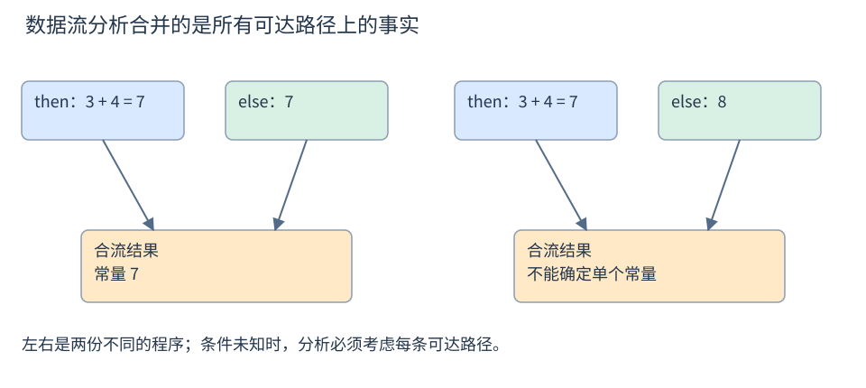

# 数据流事实的传播与收敛

编译器看到 `3+4`，容易确定结果为 7。但如果这个结果先进入分支，再通过 yield 返回，还能知道分支结果是什么吗？如果两条路径都返回 7，运行时条件虽然未知，结果仍然可以确定。反过来，只要一条可能执行的路径返回 8，就不能把结果统一替换为 7。

这类结论来自沿 IR 关系传播信息。本章先手工推导一个函数中的常量事实，再解释 MLIR 如何把同一过程交给数据流求解器。格、合流与不动点分别对应“怎样表示信息”“怎样合并路径”和“何时已经算够”，不会凭空引入另一套计算。

## 1. 从常量计算到分支结果

主例继续使用 SCF，研究如何沿分支推导值的可能取值：

<!-- analysis-example: constants -->
```text
module {
  func.func @propagate(%flag: i1, %x: i32) -> i32 {
    %c3 = arith.constant 3 : i32
    %c4 = arith.constant 4 : i32
    %sum = arith.addi %c3, %c4 : i32
    %r = scf.if %flag -> i32 {
      scf.yield %sum : i32
    } else {
      %c7 = arith.constant 7 : i32
      scf.yield %c7 : i32
    }
    %out = arith.addi %r, %x : i32
    return %out : i32
  }
}
```

函数的 `%flag` 与 `%x` 是运行时输入。分析不能任意指定它们，但可以顺着已经确定的信息计算：

| 位置 | 已知事实 | 产生的新结论 |
|---|---|---|
| 两个 constant | 值分别为 3、4 | `%c3=3`，`%c4=4` |
| addi | 两个输入已知 | `%sum=7` |
| true 出口 | yield sum | 这条路径给 if 结果 7 |
| false 出口 | yield c7 | 这条路径也给 if 结果 7 |
| if 结果 | 任意可达分支都给 7 | `%r=7` |
| 最后 addi | r=7，x 任意 | out 随 x 变化 |

固定版本的求解器实际返回：

<!-- analysis-output: constants -->
```text
sum: 7 : i32
if result: 7 : i32
out: unknown
```

unknown 表示分析尚未得到一个适用于全部允许执行的常量。这里函数仍按输入计算 `x+7`。



两图只改变 else 常量。合流考虑所有可达路径：都返回 7 时得到常量 7；分别返回 7 和 8 时得到非常量状态。运行时仍只执行实际选中的分支。

## 2. 常量事实的三类状态

为了逐步得出上表中的结论，需要区分“尚未处理到”与“已经无法用一个常量概括”。如果把这两者都写成 unknown，就难以正确合并还没计算完的路径。

常量分析可以用三类状态：

```text
                 unknown（任何可能值）
                  /      |      \
               const 3  const 7  const 8 ...
                  \      |      /
                  uninitialized
```

格的底部表示尚无事实，中间各点表示一个确定常量，顶部表示非常量。向上合并会放宽可能取值，直到能够包含所有可达来源。

当不同路径进入同一个结果，需要 join：

| 左边事实 | 右边事实 | join 结果 |
|---|---|---|
| uninitialized | 7 | 7 |
| 7 | 7 | 7 |
| 7 | 8 | unknown |
| 7 | unknown | unknown |

例如 true 出口已经求得 7、false 出口还没访问时，暂时得到 7。后来 false 也给 7，结论不变；若后来给 8，就上升到 unknown。求解器继续处理依赖此结果的操作，避免消费者永久停留在先前不完整的结论。

## 3. Transfer Function 与操作语义

路径合流使用 join，一条操作内部则需要根据输入事实推导输出事实。这通常称为 transfer function，传递函数。

对本例的 `addi`：两个输入分别为常量 3 和 4，按 `i32` 加法的语义得到常量 7。若一个输入为 unknown，输出通常也只能是 unknown。某些操作还有更强的特殊规则，例如与零的某些运算可以在另一输入未知时仍得到确定结果；是否采用这些规则，取决于操作的语义与实现。

MLIR 的 SparseConstantPropagation 会利用操作提供的 folding 能力来计算常量事实。分析因而不需要亲自实现每一个方言的完整解释器；操作把自己的局部折叠语义提供出来，求解框架负责传播与依赖。

这里仍在计算分析状态。直接运行 solver 并查询结果，不会自动把主例的 `scf.if` 从 IR 删除。要把事实落实为常量替换和无用代码清理，还需要消费者 Pass。

## 4. 控制流、可达性与区域边界

把 else 的常量从 7 改为 8，且 `%flag` 仍未知，两条路径都可能执行，if 结果变成 unknown。

再把条件改成恒 true。语义上 false 分支不会执行，它的 8 就不应参与结果合流；if 结果又可以是 7。这说明传播的不仅是数值事实，还包括哪些边和区域可达。

`DeadCodeAnalysis` 提供可执行路径，`SparseConstantPropagation` 据此传播常量。求解得到事实后，后续改写和清理再删除无用 IR。

`cf.br` 通过分支接口提供后继参数与 operands 的对应，`scf.if` 通过区域分支接口提供入口、出口与父结果的对应。自定义区域操作也需要提供相应协议，才能参与通用传播。

这把[区域接口](../ir_definition/regions_assembly)与分析联系起来：接口不仅用于 verifier，它还告诉外部消费者“值从哪里进入，沿哪些执行边流向哪里”。

## 5. 工作列表与不动点

线性地扫描一次文本，对前面这个小函数可能够用。但循环中的事实会沿回边返回；一个值的新结论也可能影响早先已经访问过的操作。求解器需要重复处理受影响的部分。

可以把工作列表理解为“还有哪些依赖旧事实的判断需要重算”：

```text
某个输入状态变化
    ↓
把依赖它的操作或程序位置加入工作列表
    ↓
重新执行局部传递/合流
    ↓
输出状态若变化，继续通知依赖者
    ↓
没有状态再变化，达到不动点
```

对常量域，每个状态只能沿 `uninitialized → 某常量 → unknown` 这个方向变化。即使整数常量有很多种，单个状态也不会在 7、8、9 之间无穷往返；7 与 8 的冲突直接合并为 unknown。有限 IR 与这种有限高度的单调变化共同支撑收敛。

若循环初值为 0、每轮加 1，循环头合并初值与回边值后会得到非常量状态。常量域通过放宽结论完成求解。

区间等更丰富的域可能具有较长上升链，需要配套的收敛策略或求解限制。定义分析时，应同时设计抽象域、传递规则和终止条件。

## 6. 稀疏、稠密与整数范围

主例把事实附着在 SSA Value 上，并沿 use-def 和控制流参数传递。这是稀疏数据流的直观形式：某个结果变化时，优先唤醒依赖这个值的地方。

稠密数据流通常在程序点保存状态，例如进入某操作前已初始化的内存位置；稀疏数据流则沿 Value 等实体传播。事实存放位置、传播关系和分析方向由任务决定，精度取决于所选域及传递规则。

常量域只保留单点值。对有界循环 `%i=0..3`，虽然无法把 `%i` 当成一个常量，却可以保留范围：

```text
scf.for %i = %c0 to %c4 step %c1 {
  %next = arith.addi %i, %c1 : index
  ...
}
```

对完整实验中的这一循环，加载 `IntegerRangeAnalysis` 后，实际得到有符号范围：

<!-- analysis-output: ranges -->
```text
i: 0..3
next: 1..4
```

整数范围可以用于化简比较和边界检查。LLVM 20.1.8 通过 `InferIntRangeInterface`、循环信息和可达性传播这些事实，推导时同时遵守位宽、有无符号解释和溢出语义。

## 7. 从求解结果到 IR 改写

对主例，完整的分析配置与查询核心如下。这里的 `module` 和 `value` 已经从解析后的 IR 取得：

```cpp
DataFlowSolver solver;
solver.load<dataflow::DeadCodeAnalysis>();
solver.load<dataflow::SparseConstantPropagation>();
if (failed(solver.initializeAndRun(module)))
  return failure();

auto *state = solver.lookupState<
    dataflow::Lattice<dataflow::ConstantValue>>(value);
if (state && !state->getValue().isUninitialized()) {
  Attribute constant = state->getValue().getConstantValue();
  // constant 非空才表示已知常量；空 Attribute 表示 unknown。
}
```

现在运行实际变换 `sccp`，再以 `canonicalize` 清理主例，可以得到：

<!-- analysis-output: constants-optimized -->
```text
module {
  func.func @propagate(%arg0: i1, %arg1: i32) -> i32 {
    %c7_i32 = arith.constant 7 : i32
    %0 = arith.addi %arg1, %c7_i32 : i32
    return %0 : i32
  }
}
```

最终保留 `x+7`：求解确定分支结果，常量改写替换相关计算，后续清理删除无用分支和操作。

到这里形成了完整过程：表示事实 → 沿操作与控制边传播 → 收敛 → 由变换消费事实 → 清理 IR。后续写自定义分析时，首先应确定需要支持哪种判断、怎样保守表示不知道，再选择求解框架和接口。

## 阅读自查

1. else 返回 8、flag 未知时，为什么 `%r` 不能保持 7？若 flag 恒 true 呢？
2. uninitialized 与 unknown 为什么必须区分？
3. solver 能查到 `%r=7`，为什么原来的 if 还可能留在 IR 中？
4. 一个循环变量不是常量，是否意味着分析对它完全没有可用信息？

## 实现依据与实践

配套[分析实验](https://github.com/jnfkdsn/aicompiler/tree/main/llvm-mlir/12-analysis)包含常量合流、改变分支、可达性与范围观察。API 按 LLVM/MLIR 20.1.8 的 [ConstantPropagationAnalysis.h](https://github.com/llvm/llvm-project/blob/llvmorg-20.1.8/mlir/include/mlir/Analysis/DataFlow/ConstantPropagationAnalysis.h)、[SparseAnalysis.h](https://github.com/llvm/llvm-project/blob/llvmorg-20.1.8/mlir/include/mlir/Analysis/DataFlow/SparseAnalysis.h)与 [IntegerRangeAnalysis.h](https://github.com/llvm/llvm-project/blob/llvmorg-20.1.8/mlir/include/mlir/Analysis/DataFlow/IntegerRangeAnalysis.h)核验。阅读其他版本的旧教程时，应按实际源码确认求解类与状态类型，不直接混用历史 API。
