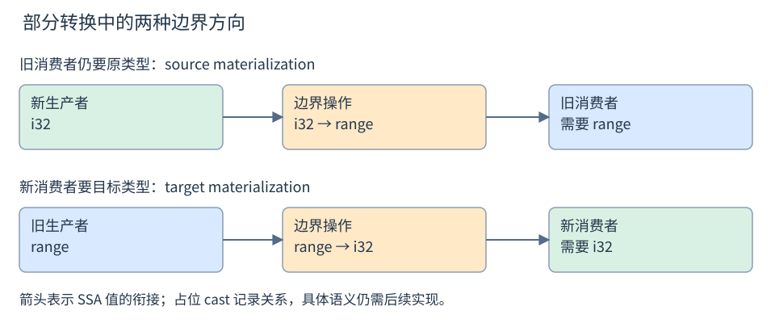

# 混合表示与边界衔接

上一章同时转换 limit、return 和函数签名，整条结果使用链都进入了 i32 表示。现在改变一个条件：当前阶段只展开 limit，函数仍向外返回 `!my.range<-4,7>`。这种情况可以出现在渐进降低中：一个组件先处理内部计算，另一个组件稍后处理接口。

计算已经得到 i32，旧 return 却还需要 range。**两端都知道各自要什么类型，缺的是把同一个逻辑值接过边界的方式。** 本章沿这个断点解释 materialization，并区分“先记录转换关系”与“已经有可执行的转换”。

## 1. 新生产者与旧使用者

输入仍是 `@clip`：limit 产生 range，return 接收 range。我们保持 func 和 return 在本阶段合法，仅要求消除 limit。局部展开后，逻辑关系变成：

```text
max/min 计算 → i32 值 ── ? ──→ return 需要 range
                                      ↑
                            函数仍声明返回 range
```

这里选择保留旧 return 和函数接口，所以需要让新产生的 i32 结果能接到旧的 range 使用者，同时维持 arith 操作自身的 i32 类型。

框架需要一个具体的 Value 来满足旧使用者。把这种衔接实际表现为 IR 的过程称为 **materialization**。

## 2. 类型映射与值的衔接

TypeConverter 中的 `range → i32` 回调只回答“用哪一种类型表示”。materialization 回调接收具体输入值、需要的类型和构造工具，用它们产生边界所需的值。

两者可以用本例分开：

| 问题 | 输入 | 输出 |
|---|---|---|
| 类型转换 | 类型 `!my.range<-4,7>` | 类型 i32 |
| 旧使用者的衔接 | 具体 i32 值 `%new`，期望 range | 一个能交给旧 return 的 range 值 |

实际转换可能包含打包、解包、扩展、截断或 ABI 适配。表示设计需要说明这些动作怎样保持语义，并评估其成本。

本例中的 range 与 i32 保存同一个有符号整数。我们不会在这里发明新的运行时表示，而是先用 MLIR 提供的占位操作记录尚待消解的边界：

```text
%old_view = builtin.unrealized_conversion_cast %new
    : i32 to !my.range<-4, 7>
```

这条 cast 记录“新值暂时供旧类型使用”的编译期关系。区间语义由前面的 limit 转换保证：max/min 已将数值限制在范围内。若输入是任意 i32，则还需要能保证范围的实际计算或前提。

## 3. Source 与 Target Materialization

### 3.1 方向由使用需求决定

`source` 和 `target` 相对于本次类型转换的两端命名：

```text
原表示 range ── 类型转换 ──→ 新表示 i32

新值 i32 ── source materialization ──→ 旧使用者需要的 range
旧值 range ── target materialization ──→ 新规则需要的 i32
```

本章当前场景需要 source materialization，因为保留下来的 return 仍使用源类型。若后面一条新规则需要 i32，而它能接到的值仍是 range，则可能需要 target materialization。

框架根据值映射、converter 和使用者所需类型，决定请求哪一种衔接。

### 3.2 一个有明确边界的回调

本例只接受一个 range 与一个 i32 之间的对应，其他请求返回空值：

<!-- range-source: materialize -->
```cpp
Value materializeRangeBoundary(OpBuilder &builder, Type type,
                               ValueRange inputs, Location loc) {
  if (inputs.size() != 1)
    return {};
  Type inputType = inputs.front().getType();
  bool toRange = isa<my::RangeType>(type) && inputType.isInteger(32);
  bool toInteger = type.isInteger(32) && isa<my::RangeType>(inputType);
  if (!toRange && !toInteger)
    return {};
  return builder.create<UnrealizedConversionCastOp>(loc, type, inputs).getResult(0);
}
```

数量和类型检查说明了这个回调的适用范围。它不会给任意类型对无条件造一个 cast，避免把缺少实现的其他转换也悄悄变成占位关系。

然后将它注册在两种需求下：

<!-- range-source: register-materializations -->
```cpp
converter.addSourceMaterialization(materializeRangeBoundary);
converter.addTargetMaterialization(materializeRangeBoundary);
```

这两次注册使辅助函数可处理两个方向，转换框架再按边界需要调用它。上一章的边界全部转换，本章保留的旧 return 则需要桥接。



图中用同一种 `range → i32` 类型映射对照两种值衔接。source/target 是相对于转换前后的类型体系命名；判断方向时，要先看消费者实际需要哪种类型。

这里的边界框没有暗示一次真实的机器数值转换。若它只是 `unrealized_conversion_cast`，后续还必须消解或实现这项关系。

## 4. 一次部分转换的实际结果

本例对 func 和 return 使用静态合法声明，对 limit 使用非法声明，然后应用 partial conversion。实际输出为：

<!-- range-output: partial -->
```text
module {
  func.func @clip(%arg0: i32) -> !my.range<-4, 7> {
    %c-4_i32 = arith.constant -4 : i32
    %c7_i32 = arith.constant 7 : i32
    %0 = arith.maxsi %arg0, %c-4_i32 : i32
    %1 = arith.minsi %0, %c7_i32 : i32
    %2 = builtin.unrealized_conversion_cast %1 : i32 to !my.range<-4, 7>
    return %2 : !my.range<-4, 7>
  }
}
```

沿 return 向前看：它拿到的仍是 range；再向前，cast 的输入是 minsi 的 i32 结果；继续向前，是原来 limit 的上下界计算。源计算被展开了，旧函数接口仍然存在，二者通过显式边界相连。

这份 IR 可以通过 verifier，也可以满足本阶段的 partial conversion 目标。但它尚不具备最终机器执行所需的全部实现。特别是占位 cast 仍需要后续转换消除，或由某种真实目标表示转换落实。

“部分转换成功”与“整条编译链结束”因此是两个不同结论。

## 5. 缺少 Materialization 的失败

保持输入、规则和目标不变，只不注册衔接回调。在当前固定版本默认启用 materialization 构造的配置下，框架报告：

```text
failed to legalize unresolved materialization from ('i32')
to ('!my.range<-4, 7>') that remained live after conversion
```

`remained live` 表明旧 return 仍然使用这条边界；当前配置缺少为它构造旧表示的实现，因此转换失败。

这与“limit 规则没有匹配”不同。规则已经能够创建新计算，失败发生在结果要交给旧世界时。排查这种诊断，应该沿使用者寻找谁仍要求旧类型，再决定：一起转换它，还是提供有语义依据的桥接。

该诊断对应 LLVM 20.1.8、`buildMaterializations=true` 的配置。

## 6. 消解占位关系与完成转换

### 6.1 将剩余边界也转入 i32

现在对第 4 节输出继续执行上一章的完整函数转换。return 和函数结果都改为 i32 后，原来的 source bridge 不再承担最终接口职责。

可以用下面的类型路径理解为什么有机会消去桥接：

```text
i32 → 暂时供 range 使用 → 后续又需要同一个 i32 表示
```

实际驱动可能直接利用已有映射或折叠消去这段往返，不一定把两条 cast 都保留在最终打印中。本例第二次完整转换的输出已经回到上一章的纯 i32 函数：

<!-- range-output: finished -->
```text
module {
  func.func @clip(%arg0: i32) -> i32 {
    %c-4_i32 = arith.constant -4 : i32
    %c7_i32 = arith.constant 7 : i32
    %0 = arith.maxsi %arg0, %c-4_i32 : i32
    %1 = arith.minsi %0, %c7_i32 : i32
    return %1 : i32
  }
}
```

### 6.2 Reconcile 的能力边界

对于确实留在 IR 中的占位链，可以尝试 `reconcile-unrealized-casts`。下面这个独立的小例子展示可消解的往返：

<!-- range-example: cast-roundtrip -->
```text
module {
  func.func @roundtrip(%x: i32) -> i32 {
    %r = builtin.unrealized_conversion_cast %x : i32 to !my.range<-4, 7>
    %v = builtin.unrealized_conversion_cast %r : !my.range<-4, 7> to i32
    return %v : i32
  }
}
```

它用于观察占位关系的消解，不用于声称 `%x` 已通过范围检查。去掉往返后，函数直接返回原来的 `%x`。

若只对第 4 节的 partial 输出运行 reconcile，旧 return 仍需要 range，单向 cast 仍被使用，因此会保留。完成这条路径需要继续转换函数接口，或提供具有实际执行语义的桥接。

到最终执行阶段，需要确认目标合法、IR 通过 verifier，并为剩余操作提供可执行实现。中间阶段可以允许占位 cast；后续阶段则负责消除或实现它。

## 理解检查与衔接

如果把旧 return 也一起转换，为什么可能不再需要 source materialization？如果一个 cast 仍被无法改动的外部函数接口使用，为什么不能直接删除它并宣布转换完成？

下一章将使用链延伸到[调用与区域边界](./boundaries)：在那里，旧类型不仅出现在 return，还出现在被调用函数、Block 参数和区域出口中。

## 实现与查阅

[配套工程](https://github.com/jnfkdsn/aicompiler/tree/main/llvm-mlir/08-type-conversion)提供 partial、禁用桥接、继续完成转换以及单独 reconcile 的观察。这里只执行编译器侧的构造与转换，不将占位 cast 当成可执行类型转换。

固定版本说明见 [Dialect Conversion](https://github.com/llvm/llvm-project/blob/llvmorg-20.1.8/mlir/docs/DialectConversion.md) 的 Type Conversion 和 materialization 部分；API 与 `reconcileUnrealizedCasts` 的契约见 [DialectConversion.h](https://github.com/llvm/llvm-project/blob/llvmorg-20.1.8/mlir/include/mlir/Transforms/DialectConversion.h)。
