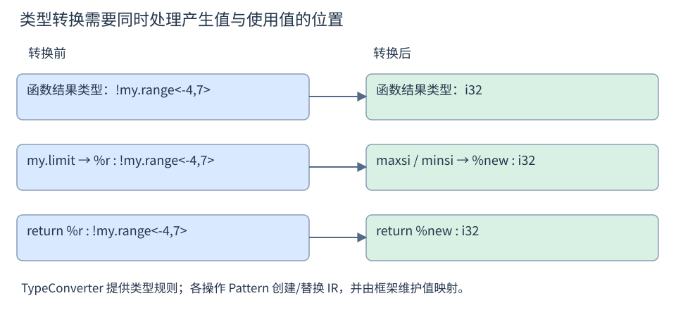

# 类型转换与函数签名

上一章把 `my.clamp` 展开成 max/min，输入、结果和函数返回值一直是 i32。现在继续表达同一个区间限制，但源 IR 把“结果一定在区间内”写进了类型：`!my.range<-4,7>`。

接下来使用的算术操作只需要普通 i32。我们希望保留区间限制的计算，同时让结果进入这种更简单的表示。问题由此扩大了：**结果类型改变后，接收它的 return 和函数签名也必须一起改变。** 本章先走完一个函数，不同时引入跨函数调用与嵌套区域。

## 1. 带范围保证的输入

源程序如下：

<!-- range-example: limit -->
```text
module {
  func.func @clip(%x: i32) -> !my.range<-4, 7> {
    %r = my.limit %x bounds(#my.bounds<-4, 7>) : !my.range<-4, 7>
    return %r : !my.range<-4, 7>
  }
}
```

`my.limit` 的输入仍是 i32，bounds 属性规定怎样限制输入，结果类型向使用者承诺同一个区间。它的 verifier 要求属性与类型中的上下界一致。

输入提供运行时数据，属性指定计算参数，类型声明结果契约。按源语义，输入 12 应返回 7，输入 -9 应返回 -4；这些结果在函数执行时产生。

目标希望用 i32 保存同一个数值。完整输出应是：

<!-- range-output: limit -->
```text
module {
  func.func @clip(%arg0: i32) -> i32 {
    %c-4_i32 = arith.constant -4 : i32
    %c7_i32 = arith.constant 7 : i32
    %0 = arith.maxsi %arg0, %c-4_i32 : i32
    %1 = arith.minsi %0, %c7_i32 : i32
    return %1 : i32
  }
}
```

变化有两个层次：limit 被展开；原来返回 range 的函数现在返回 i32。最后一次 minsi 仍限制结果上界，类型变简单没有让区间计算消失。

## 2. 沿结果使用链传播类型变化

### 2.1 一个结果牵动的三个位置

先只画与结果相关的部分：

```text
源表示：
my.limit → %r : !my.range<-4,7> → func.return
                                      ↑
                        函数声明返回 !my.range<-4,7>

目标表示：
arith.minsi → %v : i32 → func.return
                              ↑
                        函数声明返回 i32
```

如果只创建 i32 的 minsi，却保持旧 return 不动，它仍需要一个 range 值。如果只把 return 的 operand 改成 i32，却不更新函数签名，函数的返回约定又不一致。

因此，一个完整转换必须同时处理“值怎样产生”和“值怎样被接口接收”。源操作的局部规则只覆盖前者；函数与 terminator 的转换规则负责后者。

### 2.2 移除类型信息的语义条件

range→i32 改变结果的表示。区间约束继续由源程序的输入契约和转换后保留的 clamp 计算保证。

本例的 max/min 产生区间内的值，因此降低类型后仍得到相同结果。若 range 出现在源函数参数中，则调用方需要继续满足原区间前提。

这也是类型转换的语义职责：决定用什么表示保存原来的值，并说明原有保证由哪里维持。TypeConverter 可以记录这种设计，但不会替作者证明它正确。



对照图同时展开三个必须一致的位置。横向箭头表示对应位置的改写，纵向位置表示同一条结果使用链；它没有规定三个 Pattern 必须按从上到下的顺序执行。

`TypeConverter` 回答目标类型，操作 Pattern 创建计算，函数与 return 的 Pattern 则改变接口和使用位置。少处理其中一端，就可能留下类型不一致的边界。

## 3. TypeConverter 与类型映射

在这条转换中，我们选择：

| 源类型 | 目标类型 |
|---|---|
| `!my.range<lower, upper>` | `i32` |
| 当前例子中的其他类型 | 保持原样 |

可以把映射写成：

<!-- range-source: converter -->
```cpp
struct RangeTypeConverter : TypeConverter {
  RangeTypeConverter() {
    addConversion([](Type type) { return type; });
    addConversion([](my::RangeType type) -> Type {
      return IntegerType::get(type.getContext(), 32);
    });
  }
};
```

这段回调输入一个 `Type`，返回对应的目标 `Type`：range 映射为 i32。操作、参数及使用关系的实际改写由使用此映射的转换规则完成。

第一条回调是通用的恒等映射，第二条是 range 的特殊处理。固定版本按后注册的转换规则优先尝试，所以特殊处理放在后面。若先用通用规则截获了所有类型，range 就可能被错误地认定为无需转换。

对于这个 converter，`isLegal(i32)` 为真，因为 i32 映射到自己；`isLegal(range)` 为假，因为 range 要改成 i32。这里“类型合法”是相对于这套映射而言，不能与源类型自身是否可构造混为一谈。

通用 identity 回调原样返回其他类型。若 tensor 或 tuple 内部也包含 range，需要为这些容器补充相应的转换规则。

## 4. 操作规则怎样使用新表示

有了类型映射，仍需提供产生目标值的实际规则：

<!-- range-source: limit-pattern -->
```cpp
struct ConvertLimit : OpConversionPattern<my::LimitOp> {
  using OpConversionPattern::OpConversionPattern;
  LogicalResult matchAndRewrite(my::LimitOp op, OpAdaptor adaptor,
                               ConversionPatternRewriter &rewriter) const override {
    auto bounds = op.getBounds();
    auto lower = rewriter.create<arith::ConstantIntOp>(op.getLoc(), bounds.getLower(), 32);
    auto upper = rewriter.create<arith::ConstantIntOp>(op.getLoc(), bounds.getUpper(), 32);
    auto bounded = rewriter.create<arith::MaxSIOp>(op.getLoc(), adaptor.getInput(), lower);
    rewriter.replaceOpWithNewOp<arith::MinSIOp>(op, bounded, upper);
    return success();
  }
};
```

规则从 bounds 读取参数，创建 i32 常量和有符号 max/min。与第一章相比，算法没有改变；区别是原结果为 range，新结果为 i32。

规则使用带 converter 的构造方式加入集合：

```cpp
patterns.add<ConvertLimit>(converter, context);
```

这样转换框架知道它期待的输入类型。本例的 input 原本就是 i32，因此 `adaptor.getInput()` 的类型保持 i32。对于更一般的消费者，原 operand 可能引用旧类型值，adaptor 则提供按这条规则所用 converter 准备的输入。

框架记录旧 range 结果与新 i32 的对应，再把新值提供给消费者的转换规则。本例让相关使用者一起转到新表示；需要暂时保留旧消费者时，则用下一章的类型衔接机制。

## 5. 函数签名与 return 的转换

### 5.1 目标必须看见函数边界

如果仍像第一章那样把 `func.func` 和 `func.return` 无条件标成合法，框架就没有依据要求它们换掉 range。因此目标也要使用当前类型映射：

<!-- range-source: function-target -->
```cpp
target.addDynamicallyLegalOp<func::FuncOp>([&](func::FuncOp op) {
  return converter.isSignatureLegal(op.getFunctionType()) &&
         converter.isLegal(&op.getBody());
});
target.addDynamicallyLegalOp<func::ReturnOp>([&](func::ReturnOp op) {
  return converter.isLegal(op);
});
```

两个检查分别覆盖不同位置：

- 函数类型保存参数与返回类型，`isSignatureLegal` 检查这份签名。
- 函数 Region 中各 Block 的参数也各自带类型，`isLegal(&op.getBody())` 检查这些参数。
- return 的操作数是实际返回的 Value，另一条回调检查这些值的类型。

函数签名保存在 FunctionType 中，需要专门检查；函数体内的 limit、return 等操作再按各自规则处理。两层检查共同保证转换后的类型一致。

### 5.2 复用已有边界规则

MLIR 已提供函数签名与返回值的类型转换模式，本例加入：

<!-- range-source: function-patterns -->
```cpp
populateFunctionOpInterfaceTypeConversionPattern<func::FuncOp>(patterns, converter);
populateReturnOpTypeConversionPattern(patterns, converter);
```

第一项将同一套类型映射应用到函数接口及 body 参数；第二项让 return 使用转换后对应的值。普通函数声明没有 body，但同样需要转换签名。

于是，主例的几个变化可以对应起来：

| 原位置 | 修改后的状态 | 负责的规则 |
|---|---|---|
| limit 结果 | 新 minsi 的 i32 结果 | ConvertLimit |
| return 输入 | 接到上述 i32 值 | 返回值转换模式 |
| 函数结果类型 | 从 range 改成 i32 | 函数签名转换模式 |
| 函数输入 | 仍为 i32 | 恒等类型映射 |

这些规则可以由一个模块 Pass 内的 conversion driver 协调。类型映射说明表示选择，规则实际修改对象，目标决定边界是否已经到位；三者需要一致。

## 6. 完成条件与错误定位

本例结束时，函数不再含 range 类型或 limit 操作，也没有保留新旧类型之间的桥接。配套程序对这种整体转换即使不注册 materialization 回调也能成功，因为没有需要继续接收旧表示的使用者。

保留旧接口、旧消费者或尚未转换的区域时，使用链会跨越新旧两种表示。下一章通过保留旧函数接口来展示这类衔接。

检查结果时可以依次问：

1. 源 IR 合法吗？例如属性是 `[-4,7]`，类型却是 `[-4,8]`，应在转换前由源 verifier 拒绝。
2. 新值的类型是否正确？有没有实际实现 clamp，而不只是丢掉 limit？
3. return 与函数签名是否一致？目标是否错误地把旧接口视为已经完成？
4. 最终是否仍有 range 或未落实的转换桥接？这些残留是否在当前阶段的约定之内？

只检查 `my.limit` 字符串消失，无法回答后面几项问题。

## 理解检查与衔接

将上下界同时改为 `[7,7]`，目标仍应返回 i32，但函数应该得到什么数值？再设想只更新函数签名、保留原 return：为什么“类型映射已经注册”不能自动完成 return 的修改？

继续阅读[混合表示与边界衔接](./materialization)，仍使用本章输入，只让一部分表示先完成转换。

## 实现与查阅

[类型转换工程](https://github.com/jnfkdsn/aicompiler/tree/main/llvm-mlir/08-type-conversion)复用已有 My dialect，提供完整 Pass、源 IR、输出和检查。本章实际输出来自固定的 LLVM 20.1.8 工具；语义推演与目标程序执行分别对待。

接口与实现见 LLVM 20.1.8 的 [DialectConversion.h](https://github.com/llvm/llvm-project/blob/llvmorg-20.1.8/mlir/include/mlir/Transforms/DialectConversion.h) 和 [FuncConversions.cpp](https://github.com/llvm/llvm-project/blob/llvmorg-20.1.8/mlir/lib/Dialect/Func/Transforms/FuncConversions.cpp)，可分别查阅 TypeConverter、函数签名转换和 return 转换。
