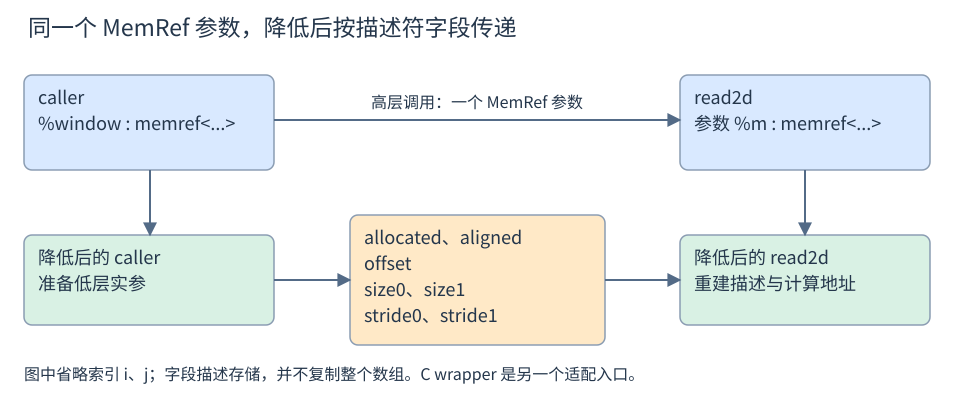

# 类型降低、ABI 与函数边界

上一章用指针、offset、sizes 和 strides 描述 MemRef。跨函数传递时，双方都要采用相同表示：**调用者准备这些字段，接收者据此计算地址和读取元素。**

本章先追踪两个 MLIR 函数之间的一次调用，观察 MemRef 参数怎样展开为低层参数。随后用 C wrapper 展示外部程序怎样按相应接口接入。

```text
调用者传入一个 MemRef → 被调用函数接收 MemRef → 读取元素
                         ↓ 类型与接口一起降低
调用者传入描述符字段  → 被调用函数接收这些字段 → 计算地址并读取
```

## 1. MemRef 参数的表示变化

下面两个函数都在 MLIR 模块内。`caller` 接收一个二维视图，把它和两个索引传给 `read2d`；后者读取一个元素并返回。

```mlir
module {
  func.func @read2d(
      %m: memref<?x?xi32, strided<[?, ?], offset: ?>>,
      %i: index, %j: index) -> i32 {
    %v = memref.load %m[%i, %j]
        : memref<?x?xi32, strided<[?, ?], offset: ?>>
    return %v : i32
  }

  func.func @caller(
      %window: memref<?x?xi32, strided<[?, ?], offset: ?>>,
      %row: index, %col: index) -> i32 {
    %value = func.call @read2d(%window, %row, %col)
        : (memref<?x?xi32, strided<[?, ?], offset: ?>>,
           index, index) -> i32
    return %value : i32
  }
}
```

这里没有 C 程序，也没有复制矩阵。调用只把访问视图所需的信息交给另一个函数。假设底层数组保存 `0…15`，视图的 offset 为 5、sizes 为 `[2,2]`、strides 为 `[4,1]`，传入坐标 `[1,1]`，应读取元素偏移 `5 + 1×4 + 1 = 10`，返回整数 10。

源 IR 把这组信息统一表示成一个 MemRef 参数。默认降低到 LLVM 时，二维描述符包含：

```text
allocated, aligned, offset, size0, size1, stride0, stride1
```

作为默认内部函数参数时，这些字段会展开成七个独立参数。本章使用 index 降为 i64 的配置，加上行列索引，`read2d` 的低层签名为以下形式；这里保留语义名称以便对照，函数体暂略：

```mlir
llvm.func @read2d(
    %allocated: !llvm.ptr, %aligned: !llvm.ptr,
    %offset: i64, %size0: i64, %size1: i64,
    %stride0: i64, %stride1: i64,
    %i: i64, %j: i64) -> i32
```

三个高层参数变成九个低层参数：MemRef 提供七个描述字段，两个 index 各变成 i64。字段引用原来的矩阵存储，并传递定位元素所需的元数据。

## 2. 调用点与函数定义的协同转换

只把 `read2d` 改成九个参数还不够。原来的 `func.call` 仍然传一个 MemRef 和两个 index，无法与新签名对应。调用点也要取得该 MemRef 的描述符字段，按相同顺序传递。

下面用字段名表示调用方已经取得的低层值，展示转换后的调用形态：

```mlir
%value = llvm.call @read2d(
    %allocated, %aligned, %offset,
    %size0, %size1, %stride0, %stride1, %row, %col)
    : (!llvm.ptr, !llvm.ptr, i64,
       i64, i64, i64, i64, i64, i64) -> i32
```

接收方使用这些字段，仍然计算相同的元素地址：

```text
aligned + (offset + i×stride0 + j×stride1) 个 i32
```

调用方式变了，读取哪个元素没有改变。对上一节的窗口，仍然返回 10。

这就是前面[调用与区域边界转换](../conversion/boundaries)的一个具体应用。此前把 `range` 参数换成 `i32` 参数；这里把一个 MemRef 参数展开成多个指针和整数。两者都要求函数定义、入口参数、调用点和返回值保持一致。

这种“参数怎样表示与排列、结果怎样返回”的低层接口约定，属于 **ABI（Application Binary Interface，应用二进制接口）**。本章关注 MLIR 到 LLVM 时的参数和结果表示；最终具体使用哪些机器寄存器或栈位置，继续由目标调用约定与后端处理。即使调用双方都来自 MLIR，也需要共同遵守这套约定。



图中展开二维 MemRef 的两个指针和五个整数，索引参数另外传递。调用点与函数声明一起降低后，接收者按这些字段还原同一个视图。

## 3. 函数转换与调用转换的配合

上述变化由 Func-to-LLVM 的转换规则完成。可以沿同一条调用链理解它的工作：

| 处理位置 | 转换规则完成的工作 |
|---|---|
| `func.func @read2d` | 用 LLVMTypeConverter 计算低层签名，创建 LLVM 函数，并转换入口 Block 参数 |
| `func.call @read2d` | 取得转换后的操作数，展开 MemRef 描述符字段，生成匹配新签名的 LLVM 调用 |
| 函数体中的 `memref.load` | 由 MemRef 的转换规则生成描述符访问、地址计算和 LLVM load |
| `func.return` | 使用转换后的值生成 LLVM return；本例结果仍是 i32 |

展开的入口参数可以在函数体中重新组装成描述符，供处理 MemRef 的通用规则使用；之后的优化有机会清理冗余的组装和提取。这样，函数边界遵守展开传参的约定，内部的 load 转换仍可以通过统一的描述符接口工作。

这里出现的 **Adaptor 与描述符是不同的对象**：Adaptor 是编译器中的辅助访问接口，让 Pattern 取得转换框架准备好的操作数；在本例中，其中一个操作数表示 MemRef 描述符。描述符是被生成程序中的数据表示。Adaptor 本身不会成为目标程序里的结构体。

编译规则生成拆分、组装、调用和读取字段的 IR；目标程序运行时，这些操作才取得当前输入的窗口信息和 stride。

函数与调用转换见 LLVM 20.1.8 的 [FuncToLLVM.cpp](https://github.com/llvm/llvm-project/blob/llvmorg-20.1.8/mlir/lib/Conversion/FuncToLLVM/FuncToLLVM.cpp)，签名映射与 operand 展开见 [LLVMTypeConverter](https://github.com/llvm/llvm-project/blob/llvmorg-20.1.8/mlir/lib/Conversion/LLVMCommon/TypeConverter.cpp)。

## 4. 外部调用与 C 包装函数

现在才改变一个条件：`read2d` 的调用方不再是同一模块中的 MLIR 函数，而是一个 C 程序，例如测试驱动或运行时。

前面的调用转换规则能够重写 MLIR 中的 `func.call`，却不会替我们改写另一份手写的 C 函数声明。若 C 侧猜测原型为 `int read2d(int *p, int i, int j)`，只传三个参数，生成的函数却按九个参数接收，调用就不匹配。即使函数体的元素地址公式正确，也无法弥补入口处的错误。

一种接入方式是直接匹配内部展开签名。为了让 C 侧按描述符结构体调用，MLIR 也提供 C wrapper：在源函数上添加 `llvm.emit_c_interface`，Func-to-LLVM 会额外生成 `_mlir_ciface_read2d`，接收描述符指针和两个索引。

下面使用与本章配置一致的 C 结构体和声明：

```c
typedef struct {
  int32_t *allocated;
  int32_t *aligned;
  int64_t offset;
  int64_t sizes[2];
  int64_t strides[2];
} I32View2;

extern int32_t _mlir_ciface_read2d(I32View2 *, int64_t, int64_t);
```

生成的 wrapper 完成的工作，可以用下列 C 伪代码理解；内部 `read2d` 的原型按前文九参数约定，此处省略：

```c
int32_t wrapper(I32View2 *d, int64_t i, int64_t j) {
  return read2d(d->allocated, d->aligned, d->offset,
                d->sizes[0], d->sizes[1],
                d->strides[0], d->strides[1], i, j);
}
```

```text
C 调用者准备描述符，传它的地址
                  ↓
wrapper 读取描述符并展开字段
                  ↓
内部 read2d 接收九个参数
                  ↓
计算元素地址，读取并返回 i32
```

wrapper 由编译器生成，不需要手工实现这段伪代码。它读取的是小结构体的字段，不会因此复制整个矩阵，也不会因此取得参数的释放责任。

C 调用方的核心片段如下，外围函数与标准头文件省略：

```c
int32_t data[16];
for (int k = 0; k < 16; ++k) data[k] = k;
I32View2 window = {data, data, 5, {2, 2}, {4, 1}};
int32_t result = _mlir_ciface_read2d(&window, 1, 1);  // 10
```

这和两个 MLIR 函数之间的主例访问同一个窗口。两根指针都来自调用方的局部数组，`read2d` 只借用；调用期间数组保持有效即可。offset 已经记录窗口偏移，aligned pointer 就仍指向当前约定的访问基址，不能再重复向后移动 5 个元素。

## 5. 返回 MemRef 的结果表示

前面的读取函数返回一个 i32，调用双方直接传递这个标量。若函数改为返回一个新矩阵，返回接口就需要携带描述符。

下面的 `make_copy` 明确分配并复制一个矩阵；这个新例子用来观察结果怎样跨过函数边界：

<!-- cpu-example: make-copy -->
```text
module {
  func.func @make_copy(%src: memref<2x3xf32>) -> memref<2x3xf32>
      attributes {llvm.emit_c_interface} {
    %out = memref.alloc() : memref<2x3xf32>
    memref.copy %src, %out : memref<2x3xf32> to memref<2x3xf32>
    return %out : memref<2x3xf32>
  }
}
```


内部低层函数返回一个描述符结构体，调用方接收它后取得数据指针和布局信息。生成的 C wrapper 则让调用方提供结果描述符的存放位置，作为第一个指针参数传入；wrapper 把内部函数返回的描述符写进去。

```c
typedef struct {
  float *allocated, *aligned;
  int64_t offset, sizes[2], strides[2];
} F32View2;

extern void _mlir_ciface_make_copy(F32View2 *result, F32View2 *source);

// 以下为调用函数内的片段。
float values[6] = {1, 2, 3, 4, 5, 6};
F32View2 input = {values, values, 0, {2, 3}, {3, 1}};
F32View2 output;
_mlir_ciface_make_copy(&output, &input);
// 使用 output 所描述的新矩阵。
free(output.allocated);
```

这次交接涉及两个不同对象：

| 对象 | 谁提供 | 保存什么 |
|---|---|---|
| `output` 结构体 | C 调用方 | 返回矩阵的指针、offset、sizes、strides |
| 新矩阵的数据 buffer | `make_copy` 内的 alloc | 复制得到的六个浮点数 |

函数通过 `memref.copy` 复制矩阵，再把新存储的描述符写入 `output`。输入按借用处理，返回分配由调用方负责释放，释放地址为 `output.allocated`。本例分配方式与 C `free` 匹配；其他 allocator 应使用对应的释放方法。

## 6. 接口一致性与生命周期

现在可以把整条过程分清：类型降低决定 MemRef 采用什么低层表示，函数和调用转换把这种表示送过边界，必要时 wrapper 连接外部调用者。指针和元数据传递正确之后，程序仍要遵守视图和所有权契约。

`make_copy` 的静态连续 `memref<2x3xf32>` 参数要求相应形状和步长。要接收任意窗口，应设计支持动态布局的接口。返回独立分配和返回输入 subview 也需分别约定别名与释放责任。

遇到调用结果异常，可以沿这条数据流核对：实际调用的是内部函数还是 wrapper；参数顺序与位宽是否匹配；描述符是否指向正确窗口；访问期间存储是否仍有效。类型正确和链接成功都不能代替这些契约。

本章完成的是函数边界的表示协调。接下来按阅读路线进入 [LLVM Dialect 与 LLVM IR](../../dialects/llvm/translation)，再学习代码生成、链接与执行；LLVM Dialect 中已经匹配的函数和调用，还要翻译到 LLVM 的对象模型。

## 阅读自查

1. 调用者与被调用者都来自 MLIR，为什么仍要转换函数接口？若只把 `read2d` 改成九个参数，原调用点会有什么问题？
2. 参数类型从 MemRef 降为描述符，与调用约定把字段展开成七个参数，是怎样相连的两件事？
3. C wrapper 在这条主线中解决什么接入问题？调用双方都由同一套规则转换时，是否必须经过它？
4. `make_copy` 返回时，描述符的写回、矩阵数据的复制以及底层存储的释放，分别由哪一部分完成？

## 资料与实践

本章采用 LLVM 20.1.8、64 位 index 和默认描述符调用约定。函数参数展开、wrapper 与返回结构体行为依据[LLVM Target 调用约定](https://github.com/llvm/llvm-project/blob/llvmorg-20.1.8/mlir/docs/TargetLLVMIR.md)和前文固定源码；C 结构体定义还需与实际目标布局匹配。

新增的 caller/read2d 模块验证解析、完整 LLVM lowering、LLVM IR translation，以及输入窗口的本机返回值；C wrapper 和新矩阵返回由现有本机 C 驱动验证。正文中的低层签名与调用片段使用解释性变量名，wrapper 的 C 实现是语义示意，不作为工具逐字输出。

可选实践：[11-cpu-lowering 实际 C 驱动与观察入口](https://github.com/jnfkdsn/aicompiler/tree/main/llvm-mlir/11-cpu-lowering)。
