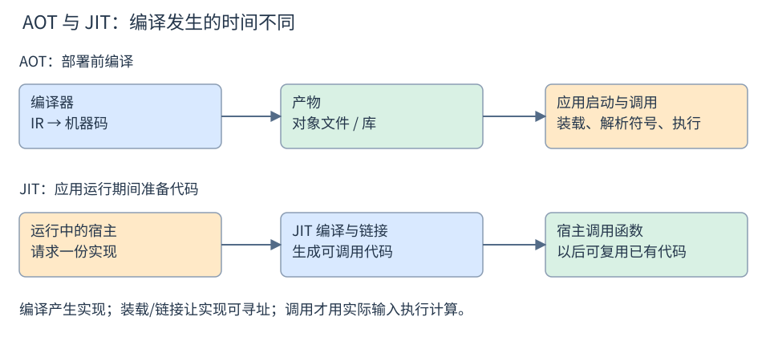

# Translation、JIT 与 AOT

LLVM Dialect 函数和 C 调用约定已经准备好，下一项任务是让 CPU 执行它。这里有两条常见路径：提前生成目标文件并链接进程序，或在进程运行时生成机器码再调用。

两条路径都需要解决相同的基本问题：目标指令怎样生成，外部函数地址怎样找到，输入结果怎样按 ABI 传递。差异主要在于这些工作何时完成、产物如何装载与复用。

## 1. 从 MLIR 到目标文件

对已经降成可翻译形式的输入，一条 AOT 路径是：

```text
LLVM Dialect
    ↓ mlir-translate：构造 LLVM IR
LLVM IR
    ↓ llc：目标代码生成
目标文件 .o
    ↓ 链接器：合并对象并解析符号
可执行程序 / 动态库
```

AOT 即 ahead-of-time，强调机器码在调用前提前生成。目标文件包含机器码和必要的符号、重定位信息，仍可能引用尚未确定地址的函数，例如 malloc 或某个数学库函数。

链接器把这些引用与定义连接起来。生成动态库时，一部分符号解析也可能延后到装载或运行阶段；具体规则取决于平台和链接选项。



AOT 在交付前编译，JIT 在宿主运行期间调用编译设施。两者都会装载可调用代码，再传入本次数据执行；图中省略缓存和对象文件细节。

## 2. 直接观察一条 AOT 命令链

下面假设 `lowered.mlir` 已经完成必要的 LLVM lowering，`driver.c` 使用与生成函数匹配的 C 声明：

```bash
mlir-translate --mlir-to-llvmir lowered.mlir -o program.ll
llc -filetype=obj -relocation-model=pic -O0 program.ll -o program.o
clang driver.c program.o -o run
./run
```

这里每个工具只负责明确的一段：translate 不替你把任意 Tensor 操作展开；llc 不知道 Python 中张量的形状约定；clang 在这条命令中编译 C 驱动并完成链接，不负责重新读取 MLIR。

使用系统中较老的 clang 链接新 LLVM 生成的目标文件，与让它直接解析新 LLVM IR，是不同的兼容性问题。本文实验采用同版本 LLVM 的 translate 和 llc，系统 clang 只处理 C 与目标文件，并在本机验证这条组合。

本例用 `-O0` 便于观察编译步骤。性能比较则需要固定目标、输入、优化配置和计时范围，后面的验证指南会继续说明。

## 3. 运行时函数与未解析符号

低层程序可能仍包含外部调用：

```text
llvm.func @malloc(i64) -> !llvm.ptr
```

这份声明给出 malloc 的调用方式，具体实现由链接或运行时符号解析提供。Translation 与代码生成可以先保留这个外部引用。

链接时需要为外部引用提供定义。某些 MemRef 复制路径还依赖 `mlir_c_runner_utils` 等支持库，可以通过生成代码和未定义符号列表确定所需链接项。

链接建立符号连接，执行时还需要有效描述符与地址，并按预期完成计算。错误定位可据此区分链接问题、调用问题和数值问题。

## 4. JIT 的执行过程

JIT 即 just-in-time。它将后端编译和代码装载放到正在运行的进程中，常见过程为：

```text
准备可翻译的 MLIR 模块
    ↓
Translation 与 LLVM 编译
    ↓
在进程中为机器码分配并装载内存
    ↓
解析外部符号，查找入口地址
    ↓
按约定调用，获得结果
```

MLIR 的 ExecutionEngine 提供相关基础设施，`mlir-runner` 是可以直接观察这条路径的工具。它不会因为采用 JIT 就自动理解任意自定义高层操作；输入仍要满足工具所支持的转换与翻译条件。

用一个最小标量例子，将工具接入与矩阵 ABI 暂时分开：

<!-- cpu-example: jit -->
```text
module {
  func.func @main() -> i32 {
    %a = arith.constant 20 : i32
    %b = arith.constant 22 : i32
    %r = arith.addi %a, %b : i32
    return %r : i32
  }
}
```

将其降低到 LLVM Dialect 后，执行：

```bash
mlir-runner jit-llvm.mlir -e main -entry-point-result=i32
```

工具打印 `42`，对应所调用函数返回的 i32 值。这里 runner 显示函数结果；C 可执行程序的 `main` 返回值则用于进程退出状态。

本例的加法已折叠为常量返回，适合观察 JIT 查找、调用和取回结果。矩阵示例再展示运行时数据访问与计算。

## 5. 调用包装与符号解析

ExecutionEngine 的通用包装把参数地址打包交给统一入口；前一章 `_mlir_ciface_` 则由 Func-to-LLVM 生成，用于 C 兼容的描述符接口。它们分别适配引擎调用方式和函数 ABI。

如果 JIT 程序需要外部库，必须让引擎能发现其符号，例如通过加载支持库或注册运行时地址。错误的函数签名不会因为符号查找成功而被自动修正；解析出地址以后，仍要按一致的参数与返回约定调用。

JIT 引擎与生成代码本身也有生命周期。保存下来的函数地址通常依赖引擎所管理的代码内存继续存在；销毁引擎之后再调用旧地址，不能作为合法的复用方式。

## 6. 按阶段定位失败

| 失败位置 | 应首先查看的对象 | 本系列的具体例子 |
|---|---|---|
| Parser / verifier | 当前操作结构、类型和引用 | load 类型或 Block 参数不一致 |
| Lowering | 尚未完成的转换、目标合法性 | 仍存在不支持的高层操作 |
| Translation | 剩余操作及翻译接口 | LLVM 函数中仍有 arith 操作 |
| 链接 / JIT 符号解析 | 未定义符号与实际库 | 声明了外部函数却未提供实现 |
| 执行结果 | ABI、地址、初始化、算法语义 | offset/stride 错误或归约初值错误 |

表中按失败阶段给出排查入口：链接错误检查符号，调用错误检查参数和存储，数值错误继续追踪计算与各阶段 IR。

接下来在[Linalg 到 CPU 的最小执行链](../../tutorials/pipelines/cpu)里，把矩阵计算、描述符、AOT 链接和结果核对放在同一个完整案例中。

## 阅读自查

1. Translation 成功后，为什么仍可能在链接时找不到函数？
2. AOT 和 JIT 是否都需要遵守同样明确的调用约定？
3. `mlir-runner` 打印 42 证明了什么？为什么不能由此评价加法性能？
4. JIT 入口地址为什么不能脱离管理其代码内存的引擎生命周期使用？

## 资料与实践

LLVM 20.1.8 下 AOT 与最小 JIT 路径均已实际执行。源码入口见[ExecutionEngine.cpp](https://github.com/llvm/llvm-project/blob/llvmorg-20.1.8/mlir/lib/ExecutionEngine/ExecutionEngine.cpp)、[JitRunner.cpp](https://github.com/llvm/llvm-project/blob/llvmorg-20.1.8/mlir/lib/ExecutionEngine/JitRunner.cpp)与[mlir-runner 工具](https://github.com/llvm/llvm-project/tree/llvmorg-20.1.8/mlir/tools/mlir-runner)。

可选实践：[直接命令、AOT 数值与 JIT 观察](https://github.com/jnfkdsn/aicompiler/tree/main/llvm-mlir/11-cpu-lowering)。
