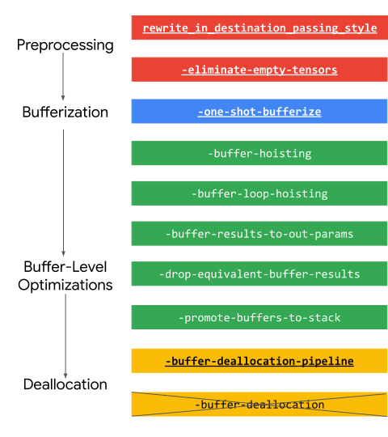

# Bufferization 与内存生命周期

把 `[10,20,30,40]` 的第一项更新为 99，看起来只是一条 Tensor 操作；执行时却需要选择存储、保留仍被读取的旧内容，并最终释放临时分配。本模块沿这次更新，把三项工作连成一条过程。

```text
维护张量新旧值 → 分析复用与复制 → 改写成 Buffer 操作
                                      ↓
                         追踪释放责任与生命周期
```

## 阅读前置

[Tensor](../../dialects/tensor/)、[Linalg DPS](../../dialects/linalg/destination_style)、[MemRef 视图与别名](../../dialects/memref/)。无需先实现新的自定义操作接口。

## 主线阅读

| 顺序 | 章节 | 贯穿案例与需要解释的过程 |
|---|---|---|
| 1 | [Tensor 到 Buffer 的表示变化](./bufferization) | 对照同一次更新的复用与复制实现；旧值 10 和新值 99 分别从哪里读取。 |
| 2 | [One-Shot Bufferization 的决策](./one_shot) | 从冲突到 operand 决策，区分可写性、是否需要初始内容及 alias/equivalence。 |
| 3 | [函数边界、所有权与释放](./ownership) | 从临时分配进入参数借用、返回责任与分支上的条件释放。 |

三篇主线均有完整输入、关键输出和推演。[自定义操作接入 Bufferization](./custom_operations)继续用 my.add_one 展示外部模型、复用/分配决定、完整覆盖与未知边界，包含实际 CPU 数值。

## 完成边界与衔接

能解释标准操作路径上的复用、复制与释放，理解这三个决定各自依赖什么。下一站是[CPU Lowering](../lowering/)的循环、descriptor、ABI 与执行链详细机制。

完整课程范围见[章节目录](../../chapter_plan)与[覆盖表](../../coverage)。默认函数所有权协议是本模块使用的具体编译约定；不同运行时、异步设备或自定义内存空间需要结合目标项目继续处理。

## Bufferization 与后续存储处理

下面的 LLVM 原图把表示转换、buffer 优化和释放安排放在同一条纵向流程里。它帮助区分“张量已经变成了 buffer”与“所有存储管理工作都已完成”。

<div class="source-figure">



</div>

图源：[LLVM 20.1.8 Bufferization 文档](https://github.com/llvm/llvm-project/blob/llvmorg-20.1.8/mlir/docs/Bufferization.md)。

图中红色区域把计算整理成便于选择目标存储的形式，蓝色 One-Shot Bufferize 决定并改写 tensor 使用的 buffer，绿色区域优化 buffer 位置和函数边界，黄色区域安排释放。`rewrite-in-destination-passing-style` 概括前处理目标，具体 Pass 组合由项目选择。

第一、二章解释表示转换和复用决策，第三章处理分配之后的所有权与释放。图中划去的旧 `buffer-deallocation` 对应已弃用流程，正文采用 ownership-based 流程；绿色区域的优化可以在需要改善存储安排时继续学习。

## 图片来源与许可

- **Bufferization 流程图**：来自 [LLVM Project 20.1.8](https://github.com/llvm/llvm-project/blob/llvmorg-20.1.8/mlir/docs/includes/img/bufferization_passes.svg)，采用 [Apache-2.0 WITH LLVM-exception](/licenses/llvm-20.1.8.txt)。原图未修改。
