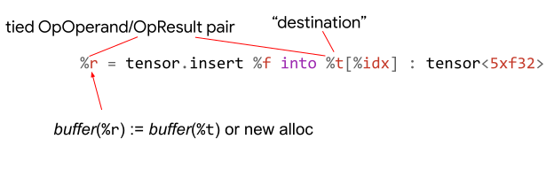

# One-Shot Bufferization 的决策

上一章已经看到：同一个 `tensor.insert`，只读取新值时可以直接覆盖输入，随后读取旧值时则需要另一片存储。现在要解释的是，编译器怎样从 IR 得到这个结论。

One-Shot Bufferization 先分析张量 use-def 关系，为操作的 tensor operands 决定能否就地使用存储，再按决定改写 IR。这里“先分析再改写”的价值是：**在仍然能区分旧张量值和新张量值时，作出存储选择。** 如果已经把它们都随意映射成同一块内存，原有的值版本信息就很难恢复了。

## 1. Destination 给出复用候选

以这条更新为例：

```text
%u = tensor.insert %v into %t[%i] : tensor<4xi32>
```

`%t` 是 destination，`%u` 是围绕它构造的新结果。因此分析有一个自然的候选：让 `%u` 复用 `%t` 的 buffer。

这正是 [DPS](../../dialects/linalg/destination_style) 为分析提供的信息：先指定一个可考虑复用的输入，再检查复用是否安全。对于 `tensor.insert`，通过检查就沿用 destination 的 buffer；存在冲突时，则为结果另行分配存储。

所以，同样的数学计算，IR 是否提供合适的 destination，会影响这一步容易得到什么实现。后续 tiling/fusion 的结果是否形成清晰的数据流链，也会影响复用机会。

<div style="background: white; padding: 0.6rem; border-radius: 6px;">

<div class="source-figure">



</div>

</div>

图源：[LLVM 20.1.8：Bufferization 的 Destination-Passing Style](https://mlir.llvm.org/docs/Bufferization/#destination-passing-style)。

官方图用 `%r` 标结果，本文用 `%u`。先找 `into` 后面的 `%t`，再看结果能否沿用它的 buffer。如果写入会破坏后续需要的旧值，结果就要另找空间。

## 2. 读写冲突的具体推导

对 preserve 例子，先假设复用成立，再推演后果：

| IR 中的行为 | Tensor 语义需要什么 | 假设复用后的访存 |
|---|---|---|
| `%t` 来自输入边界 | 原内容第一项为 10 | A 中存着 10 |
| insert 得到 `%u` | 新内容第一项为 99 | 向 A[0] 写 99 |
| extract `%t[0]` | 读取旧值 10 | 从 A[0] 读出 99，冲突 |
| extract `%u[0]` | 读取新值 99 | 从 A[0] 读出 99，正确 |

冲突发生在第三行：写入 99 后，原本应该读到 10 的操作也读到了 99。这是分析要避免的 read-after-write 冲突。

判断冲突需要知道每个 use 做什么、何时执行、访问哪片存储。查询形状可以与元素更新共存；写入之前已经读出的标量也可以继续使用。旧值还可能经过 slice 才被读取，因此分析需要沿别名关系追踪到这些间接使用者。

例如，在直线代码中先提取旧值、再执行 insert，就能保留所需的旧标量并复用 buffer。遇到复杂循环或索引关系时，分析器需要更多事实才能作出同样的判断；信息不足时会选择独立存储。

## 3. 分析输出中的 Operand 决策

可以让工具只分析、不改写，并打印冲突：

```bash
mlir-opt preserve.mlir \
  '--one-shot-bufferize=test-analysis-only print-conflicts'
```

完整分析输出中的关键两处如下，SSA 名字保留工具打印形式，省略无关属性：

```text
%inserted = tensor.insert %c99_i32 into %0[%c0]
  {__inplace_operands_attr__ = ["none", "false", "none"]} : tensor<4xi32>

// 对照 reuse 例子，同一位置是：
{__inplace_operands_attr__ = ["none", "true", "none"]}
```

三个条目依次对应插入的标量、destination 和索引。中间的 tensor operand 参与存储决策：`true` 表示可以原地使用，`false` 表示需要独立存储。两侧的标量与索引用 `none` 标记，表示它们无需这项决策。

工具还会关联冲突中的定义、写入和读取，帮助定位阻止复用的那条旧值读取。带双下划线的属性由分析器生成，用于展示判断结果；调整复用行为，需要修改产生冲突的读写关系或相应接口信息。

## 4. 可写性与值依赖是两种条件

即使删去旧值读取，也可能无法复用。把输入边界的 `writable` 去掉：

<!-- memory-example: readonly -->
```text
module {
  func.func @readonly(%m: memref<4xi32>) -> i32 {
    %c0 = arith.constant 0 : index
    %v = arith.constant 99 : i32
    %t = bufferization.to_tensor %m restrict : memref<4xi32> to tensor<4xi32>
    %u = tensor.insert %v into %t[%c0] : tensor<4xi32>
    %new = tensor.extract %u[%c0] : tensor<4xi32>
    return %new : i32
  }
}
```

这个函数仍然返回 99，但 One-Shot 不允许对输入存储生成写入。结果采用新分配，复制旧内容后再更新；分析输出会标记来源不可写。

是否允许写入，由这里的函数边界信息决定。即使运行时传入普通可写内存，缺少 `writable` 时，One-Shot 仍按只读来源处理。加上 `writable` 后，分析还要检查旧值读取：preserve 例子具有写入许可，却仍需保留旧内容。

因此，在排查额外复制时，至少先区分：**候选存储不允许写入，还是写入会破坏所需的值？** 两种原因需要调整的条件不同。

## 5. 新分配与复制的区别

再把单元素更新改成完整填充，同时保留旧值读取：

<!-- memory-example: fill-preserve -->
```text
module {
  func.func @fill_preserve(%m: memref<4xi32>) -> (i32, i32) {
    %c0 = arith.constant 0 : index
    %v = arith.constant 99 : i32
    %t = bufferization.to_tensor %m restrict writable : memref<4xi32> to tensor<4xi32>
    %u = linalg.fill ins(%v : i32) outs(%t : tensor<4xi32>) -> tensor<4xi32>
    %old = tensor.extract %t[%c0] : tensor<4xi32>
    %new = tensor.extract %u[%c0] : tensor<4xi32>
    return %old, %new : i32, i32
  }
}
```

旧值仍要保护，所以新结果不能覆盖原存储。但是 fill 为每个结果位置都写入 99，不需要读取 destination 的旧元素。实际输出为：

<!-- memory-output: fill-preserve-buffer -->
```text
module {
  func.func @fill_preserve(%arg0: memref<4xi32>) -> (i32, i32) {
    %c0 = arith.constant 0 : index
    %c99_i32 = arith.constant 99 : i32
    %alloc = memref.alloc() {alignment = 64 : i64} : memref<4xi32>
    linalg.fill ins(%c99_i32 : i32) outs(%alloc : memref<4xi32>)
    %0 = memref.load %arg0[%c0] : memref<4xi32>
    %1 = memref.load %alloc[%c0] : memref<4xi32>
    return %0, %1 : i32, i32
  }
}
```

这里有 alloc，没有 copy。可以分两步理解：

```text
旧值还要读取 → 需要独立的结果存储
结果完整覆盖 → 新存储不需要继承旧内容
```

`tensor.insert` 的未更新位置需要继承旧内容，因此还要复制。两种操作的输入输出类型可以相同，读写行为却决定了不同的初始化方式。

## 6. Alias 与 Equivalent 的作用

分析中需要追踪“哪些张量未来可能共享存储”。其中共享一部分存储与对应同一个完整 buffer，是不同强度的事实。

对于 slice，结果可指向源 buffer 的一个子视图：两者 alias，访问范围由各自的形状和 offset 决定。对成功原地处理的 insert，destination 与结果可对应同一个完整 buffer，具有 **Equivalent** 关系。这里描述的是存储关系；更新前后的张量仍分别表示旧值和新值。

这种区别可以在局部填充中直接看到：

<!-- memory-example: tile-update -->
```text
module {
  func.func @tile_update(%m: memref<4x4xi32>) -> (i32, i32) {
    %c0 = arith.constant 0 : index
    %c1 = arith.constant 1 : index
    %c2 = arith.constant 2 : index
    %v = arith.constant 99 : i32
    %t = bufferization.to_tensor %m restrict writable : memref<4x4xi32> to tensor<4x4xi32>
    %tile = tensor.extract_slice %t[1, 1][2, 2][1, 1]
      : tensor<4x4xi32> to tensor<2x2xi32>
    %filled = linalg.fill ins(%v : i32) outs(%tile : tensor<2x2xi32>) -> tensor<2x2xi32>
    %u = tensor.insert_slice %filled into %t[1, 1][2, 2][1, 1]
      : tensor<2x2xi32> into tensor<4x4xi32>
    %inside = tensor.extract %u[%c1, %c2] : tensor<4x4xi32>
    %outside = tensor.extract %u[%c0, %c0] : tensor<4x4xi32>
    return %inside, %outside : i32, i32
  }
}
```

数据流是“取窗口 → 填窗口 → 将结果放回同一位置”。没有额外旧值冲突，destination 又允许写入时，窗口可以由 subview 实现。执行 One-Shot 后，再用 CSE 合并相同视图并 canonicalize 清理自复制，得到：

<!-- memory-output: tile-update-buffer -->
```text
module {
  func.func @tile_update(%arg0: memref<4x4xi32>) -> (i32, i32) {
    %c0 = arith.constant 0 : index
    %c1 = arith.constant 1 : index
    %c2 = arith.constant 2 : index
    %c99_i32 = arith.constant 99 : i32
    %subview = memref.subview %arg0[1, 1] [2, 2] [1, 1] : memref<4x4xi32> to memref<2x2xi32, strided<[4, 1], offset: 5>>
    linalg.fill ins(%c99_i32 : i32) outs(%subview : memref<2x2xi32, strided<[4, 1], offset: 5>>)
    %0 = memref.load %arg0[%c1, %c2] : memref<4x4xi32>
    %1 = memref.load %arg0[%c0, %c0] : memref<4x4xi32>
    return %0, %1 : i32, i32
  }
}
```

最后只剩一个 subview、在窗口上的 fill，以及两次读取。原数组 `[1,2]` 变成 99，窗口外的 `[0,0]` 保持原内容。这里没有把整个 `4×4` 数组复制一遍。

这个结果分两步形成：One-Shot 选择共享存储并改写操作；CSE/canonicalize 再合并等价 subview、清理自复制。逐阶段打印 IR，可以看到这些清理分别发生在哪里。

## 7. 操作接口与改写阶段

读写和存储关系由操作的 `BufferizableOpInterface` 实现提供。分析器查询接口，得知操作是否读取 destination、是否写入，以及结果可能与哪些输入共享存储；改写阶段再调用接口提供的 bufferization 方法。自定义操作也通过这套接口接入分析。

对于当前例子，消费关系可以理解成：

```text
操作接口：说明读写、结果与输入的存储关系
       ↓
One-Shot 分析：沿 use-def 与控制流检查冲突，决定原地与否
       ↓
按决定准备 operand 的 buffer，必要时分配和复制
       ↓
操作的 bufferize 实现：产生 store、load、subview 或 buffer 形式计算
```

因此，`tensor.insert` 的最终改写函数可以很短：取得已经准备好的 destination buffer，创建 store，再把原结果替换为这个 buffer。保护旧值的工作已经在前面的分析和 buffer 准备阶段完成；直接向原输入生成 store 会跳过这些检查，在 preserve 例子中破坏旧值读取。

许多标准操作的接口实现采用外部模型，位于方言的 Transforms 库中。构建工具时，方言注册提供解析等基本能力，外部模型注册则提供 One-Shot 所需的分析和改写方法。遇到缺少支持的 tensor 操作，默认转换会失败；启用 `allow-unknown-ops` 后，可以暂时保留这些操作与 tensor/buffer 边界，交给后续转换继续处理。

自定义操作的接入过程见[自定义操作的 Bufferization](./custom_operations)，其中会把这些查询与改写方法放进一个完整实现。

## 8. 分析顺序与额外复制

One-Shot 按启发式顺序分析，逐步建立 alias/equivalence 关系，并作出局部的原地决定。前面选定的共享关系会影响后面的冲突判断，因此分析顺序可能影响最终分配和复制的数量。接口信息的精度、分支结构、布局与函数边界约束，也会影响可用的复用机会。

排查额外分配或复制时，可以依次检查来源是否可写、哪个 operand 被判为非原地、哪条读取构成冲突。找到原因后，再调整数据流或 destination，并检查修改后的读写是否仍保留所需的张量值。

即便所有复用决定都正确，临时分配仍要释放。下一章[函数边界、所有权与释放](./ownership)继续处理这一部分。

## 阅读自查

1. fill 和 insert 都不能复用旧 buffer 时，为什么只有后者需要复制初始内容？
2. 一个 tensor 有两个 use 是否足以证明存在冲突？给出形状查询或提前取值的例子。
3. 如果在 tile 更新之后还读取原张量窗口中的旧元素，刚才的 subview 原地实现为什么需要重新评估？
4. `Equivalent` 为什么可以用于数值不同的旧张量与新张量？

## 资料与实践

输入、分析标记与实际输出按 LLVM 20.1.8 验证。实现依据见[One-Shot 分析](https://github.com/llvm/llvm-project/blob/llvmorg-20.1.8/mlir/lib/Dialect/Bufferization/Transforms/OneShotAnalysis.cpp)、[Tensor 的外部接口模型](https://github.com/llvm/llvm-project/blob/llvmorg-20.1.8/mlir/lib/Dialect/Tensor/Transforms/BufferizableOpInterfaceImpl.cpp)以及[接口契约](https://github.com/llvm/llvm-project/blob/llvmorg-20.1.8/mlir/include/mlir/Dialect/Bufferization/IR/BufferizableOpInterface.td)。

配套实验：[冲突、不可写来源、完整覆盖与窗口更新](https://github.com/jnfkdsn/aicompiler/tree/main/llvm-mlir/10-memory-bufferization)。

## 图片来源与许可

- **tensor.insert 与目标缓冲区图**：来自 [LLVM Project 20.1.8](https://github.com/llvm/llvm-project/blob/llvmorg-20.1.8/mlir/docs/includes/img/bufferization_tensor_insert_dst.svg)，采用 [Apache-2.0 WITH LLVM-exception](/licenses/llvm-20.1.8.txt)。原图未修改。
