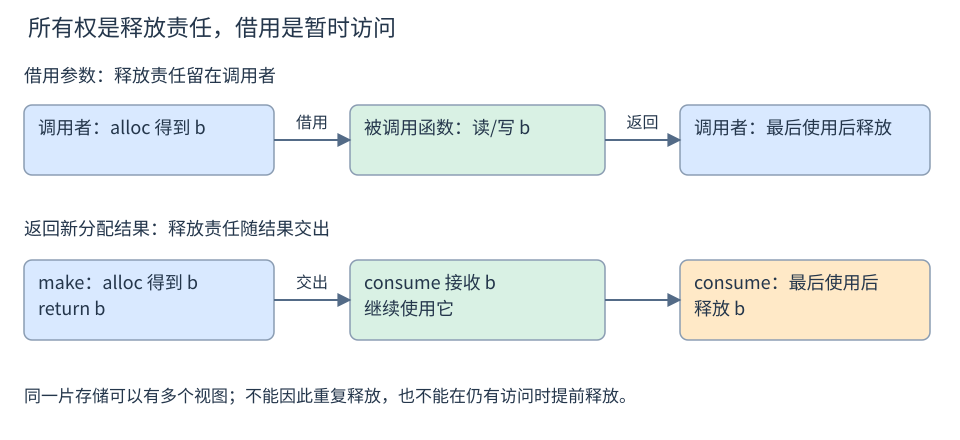

# 函数边界、所有权与释放

Bufferization 已经让旧值和新值各自读到正确内容，但 preserve 例子多出了一次 `memref.alloc`。如果函数反复执行，而这片临时存储一直不释放，即使每次计算结果都正确，程序仍会持续消耗内存。

本章继续追踪这片存储由谁释放、责任如何跨函数和分支传递，以及释放应放在哪里。多个视图可以共享同一分配，而 ownership 协议需要协调出一次正确的释放。

## 1. 局部临时 Buffer 的最后使用

preserve 函数将新张量的内容放到独立 buffer，最后只返回三个标量。既然标量已经读出，临时 buffer 就没有继续存活的必要。

将两阶段连接起来：

```bash
mlir-opt preserve.mlir --one-shot-bufferize \
  --buffer-deallocation-pipeline --verify-each
```

实际输出为：

<!-- memory-output: preserve-dealloc -->
```text
module {
  func.func @preserve(%arg0: memref<4xi32>) -> (i32, i32, i32) {
    %c0 = arith.constant 0 : index
    %c1 = arith.constant 1 : index
    %c99_i32 = arith.constant 99 : i32
    %alloc = memref.alloc() {alignment = 64 : i64} : memref<4xi32>
    memref.copy %arg0, %alloc : memref<4xi32> to memref<4xi32>
    memref.store %c99_i32, %alloc[%c0] : memref<4xi32>
    %0 = memref.load %arg0[%c0] : memref<4xi32>
    %1 = memref.load %alloc[%c0] : memref<4xi32>
    %2 = memref.load %alloc[%c1] : memref<4xi32>
    memref.dealloc %alloc : memref<4xi32>
    return %0, %1, %2 : i32, i32, i32
  }
}
```

新增的 dealloc 位于最后一次 load 之后、return 之前。返回值不再引用临时 buffer，所以释放不会破坏它们。输入 `%arg0` 没有被释放：它来自调用方，当前函数只是借用。

直线代码容易确定最后使用。跨分支、返回值和视图会延长存储的使用范围，因此需要先追踪这些路径，再选择释放位置。

## 2. 函数参数与返回值的责任约定

逐个函数处理时，释放 pass 需要一套共同的函数边界约定，否则它不知道被调用函数是否接管了参数，也不知道返回 buffer 应由谁清理。

本章使用的 ownership-based deallocation 默认约定是：

| 边界行为 | 释放责任 |
|---|---|
| 将 memref 作为参数传入 | 被调用者借用，调用方继续负责 |
| 返回 memref | 责任交给接收返回值的调用方 |
| 返回与某个参数共享底层分配的 memref | 需要消除这种别名返回，必要时产生独立副本 |

本章采用这套释放流程的 ABI 约定。项目采用其他所有权协议时，需要让编译器、外部函数和运行时共同遵守；普通 memref 类型本身只描述存储视图，调用时的所有权转移由协议规定。

先看最直接的责任转移：

<!-- memory-example: call -->
```text
module {
  func.func @make() -> memref<4xi32> {
    %c0 = arith.constant 0 : index
    %v = arith.constant 42 : i32
    %m = memref.alloc() : memref<4xi32>
    memref.store %v, %m[%c0] : memref<4xi32>
    return %m : memref<4xi32>
  }
  func.func @consume() -> i32 {
    %c0 = arith.constant 0 : index
    %m = func.call @make() : () -> memref<4xi32>
    %v = memref.load %m[%c0] : memref<4xi32>
    return %v : i32
  }
}
```

`@make` 分配并初始化第一项，随后返回整个 buffer。`@consume` 接收它，读取第一项，最后仅返回标量。

运行释放 pipeline 后：

<!-- memory-output: call-dealloc -->
```text
module {
  func.func @make() -> memref<4xi32> {
    %c0 = arith.constant 0 : index
    %c42_i32 = arith.constant 42 : i32
    %alloc = memref.alloc() : memref<4xi32>
    memref.store %c42_i32, %alloc[%c0] : memref<4xi32>
    return %alloc : memref<4xi32>
  }
  func.func @consume() -> i32 {
    %c0 = arith.constant 0 : index
    %0 = call @make() : () -> memref<4xi32>
    %1 = memref.load %0[%c0] : memref<4xi32>
    %base_buffer, %offset, %sizes, %strides = memref.extract_strided_metadata %0 : memref<4xi32> -> memref<i32>, index, index, index
    memref.dealloc %base_buffer : memref<i32>
    return %1 : i32
  }
}
```

`@make` 里面没有释放，因为返回之后还要使用；`@consume` 的 load 之后出现释放。这里的 `extract_strided_metadata` 取得用于清理的底层分配信息，与前面学习的访问元数据是同一套 MemRef 表示。

外部 C 或运行时函数返回 memref 时，也需要遵守这套返回值所有权约定。若外部接口实际返回借用视图，应先通过包装或其他明确协议衔接。



图中两条调用链分别展示借用和所有权转移：上面允许被调用者临时访问已有存储，下面将新分配结果及释放责任交给接收者。

## 3. 返回参数为什么可能引入副本

考虑一个看似无需任何工作的函数：

<!-- memory-example: return-alias -->
```text
module {
  func.func @return_alias(%m: memref<4xi32>) -> memref<4xi32> {
    return %m : memref<4xi32>
  }
}
```

作为普通 MemRef IR，它就是返回传入的视图。但放进上述默认所有权协议时，会产生歧义：调用方既保留原参数的释放责任，又按约定取得返回值的释放责任，两者其实指向同一次分配。

释放 pipeline 将它改成：

<!-- memory-output: return-alias-dealloc -->
```text
module {
  func.func @return_alias(%arg0: memref<4xi32>) -> memref<4xi32> {
    %0 = bufferization.clone %arg0 : memref<4xi32> to memref<4xi32>
    return %0 : memref<4xi32>
  }
}
```

释放流程在这里插入 `bufferization.clone`。本系列的 `convert-bufferization-to-memref` 将其转成分配和复制，使返回值取得独立的 allocated base；来自参数的子视图也按同一约定处理。

`bufferization.clone` 的通用契约允许共享存储，并规定 clone 后修改源或结果属于未定义行为。本章观察的是它在所选 lowering 中生成独立分配的行为。手写需要独立修改的副本时，可以明确使用 `memref.alloc` 和 `memref.copy`。

复制既可能用于保护 Tensor 旧值，也可能用于满足函数所有权协议。若接口允许调用方提供输出 buffer，可以采用显式输出参数；若结果与参数等价且调用方式允许，也可以先消除冗余返回。选择方案时需要同步调用双方的 ABI。

## 4. Tensor 函数边界的衔接

前两章刻意使用 memref 参数和标量结果，让读者先集中理解函数内部的存储选择。真实 Tensor 程序也需要转换函数签名。例如：

<!-- memory-example: signature -->
```text
module {
  func.func @updated(%t: tensor<4xi32>) -> tensor<4xi32> {
    %c0 = arith.constant 0 : index
    %v = arith.constant 99 : i32
    %u = tensor.insert %v into %t[%c0] : tensor<4xi32>
    return %u : tensor<4xi32>
  }
}
```

使用以下配置，把函数边界也纳入 bufferization，并在本例中选择 identity layout：

```bash
mlir-opt signature.mlir \
  '--one-shot-bufferize=bufferize-function-boundaries function-boundary-type-conversion=identity-layout-map'
```

得到：

<!-- memory-output: signature-buffer -->
```text
module {
  func.func @updated(%arg0: memref<4xi32>) -> memref<4xi32> {
    %c0 = arith.constant 0 : index
    %c99_i32 = arith.constant 99 : i32
    memref.store %c99_i32, %arg0[%c0] : memref<4xi32>
    return %arg0 : memref<4xi32>
  }
}
```

这时函数参数和返回值已变为 memref，内部更新可以原地执行。接下来若使用默认释放协议，返回值与参数的别名关系又需要按上一节处理。**计算可以原地实现，与返回值可以按某种 ABI 无成本地转交，是两个相邻但不同的问题。**

本例用固定形状和连续布局展示释放责任。一般接口还可能需要动态 offset/strides；选择布局时，应同时考虑调用方需要传入的视图和转换成本。

函数调用和定义需要协同转换；递归、外部声明与复杂调用图还受具体版本的函数 bufferization 支持范围约束。后续 CPU lowering 再展开 descriptor 与实际机器 ABI，本章先把 tensor-to-buffer 边界和 ownership 边界区分清楚。

## 5. 分支中的动态所有权

当程序根据条件选择“新分配”或“借用参数”，只跟踪一个 memref 不足以决定要不要释放：

<!-- memory-example: branch -->
```text
module {
  func.func @choose(%m: memref<4xi32>, %useFresh: i1) -> i32 {
    %c0 = arith.constant 0 : index
    %v = arith.constant 77 : i32
    %selected = scf.if %useFresh -> memref<4xi32> {
      %fresh = memref.alloc() : memref<4xi32>
      memref.store %v, %fresh[%c0] : memref<4xi32>
      scf.yield %fresh : memref<4xi32>
    } else {
      scf.yield %m : memref<4xi32>
    }
    %r = memref.load %selected[%c0] : memref<4xi32>
    return %r : i32
  }
}
```

两条路径分别是：

| 条件 | `%selected` 的来源 | 读出的值 | 当前函数是否负责释放 |
|---|---|---|---|
| true | 本函数新分配 | 77 | 是 |
| false | 借用 `%m` | 输入第一项 | 否 |

Ownership pass 在需要时让 memref 与一个 `i1` 责任标志一起经过区域边界。可以把中间关系理解为下列示意，具体自动生成 IR 还包含别名与保留集合处理：

```text
true 分支  → (新 buffer, true)
false 分支 → (借用 buffer, false)
                   ↓
            (selected, owned)
                   ↓
             读取 selected
                   ↓
          owned 为真时释放其分配
```

完整 pipeline 简化后，本例的实际输出是：

<!-- memory-output: branch-dealloc -->
```text
module {
  func.func @choose(%arg0: memref<4xi32>, %arg1: i1) -> i32 {
    %c0 = arith.constant 0 : index
    %c77_i32 = arith.constant 77 : i32
    %0 = scf.if %arg1 -> (memref<4xi32>) {
      %alloc = memref.alloc() : memref<4xi32>
      memref.store %c77_i32, %alloc[%c0] : memref<4xi32>
      scf.yield %alloc : memref<4xi32>
    } else {
      scf.yield %arg0 : memref<4xi32>
    }
    %1 = memref.load %0[%c0] : memref<4xi32>
    %base_buffer, %offset, %sizes, %strides = memref.extract_strided_metadata %0 : memref<4xi32> -> memref<i32>, index, index, index
    scf.if %arg1 {
      memref.dealloc %base_buffer : memref<i32>
    }
    return %1 : i32
  }
}
```

释放条件直接化简为原来的分支条件 `%arg1`。选择借用参数时不会释放输入；选择新分配时，先读出 77，再释放它。

这条条件记录当前路径是否承担释放责任。复杂合流中，条件可能一直保留到运行时，再据其值决定是否释放。

## 6. 从所有权到具体释放操作

内部的 `bufferization.dealloc` 同时描述待处理的 buffers、相应责任条件，以及必须保留的 buffers。其语义需要避免对同一分配重复释放，也需要避免释放仍由后续值使用的存储。

`@make` 的分配通过返回值传给调用者，因此释放位置要延后到接收方使用完毕。分支中的责任条件随路径变化，别名关系可在静态已知时化简，必要时也可在运行时比较。

这也是使用完整 `buffer-deallocation-pipeline` 的原因：它不仅插入抽象的释放请求，还安排相关规范化、释放简化与 lowering，尽可能消除冗余条件和检查。直接把未经简化的抽象 dealloc 降低，可能得到不必要的运行时开销。

自动释放流程在相关 bufferization 完成后运行，接管这批分配的生命周期。输入应遵守其要求，避免混入已手工安排的 dealloc；后续新建分配的 Pass 则需另外安排释放。

## 7. 生命周期闭环与后续 Lowering

到这里，同一个张量更新已经有一条完整的存储解释：

```text
旧值与新值的语义
    ↓
复用许可、读写冲突与布局
    ↓
分配 / 复制 / 访存
    ↓
参数借用、返回责任与分支传递
    ↓
在安全位置释放
```

分配提升、栈提升、内存池和更早释放可以继续改善生命周期安排；异步设备还需要把完成事件纳入分析。接下来进入 [CPU Lowering](../lowering/)，把当前计算继续转成循环、描述符和可执行代码。

## 阅读自查

1. `@make` 的 alloc 为什么不能在 `@make` 返回前释放？责任最后在哪个函数结束？
2. 参数借用与返回所有权采用上述约定时，直接返回参数为什么需要特别处理？
3. `scf.if` 的两个分支产生相同 memref 类型，为什么仍要追踪额外的责任条件？
4. One-Shot 没有产生 copy，是否足以证明后续完整 pipeline 也不会产生 copy？

## 资料与实践

本文使用 LLVM 20.1.8 的默认所有权协议，未启用 private-function dynamic ownership 扩展。契约和 pipeline 见[固定版本 Ownership-based Buffer Deallocation](https://github.com/llvm/llvm-project/blob/llvmorg-20.1.8/mlir/docs/OwnershipBasedBufferDeallocation.md)，相关接口模型见[BufferDeallocation 源码目录](https://github.com/llvm/llvm-project/tree/llvmorg-20.1.8/mlir/lib/Dialect/Bufferization/Transforms)。

可选实践：[函数返回、借用与分支释放](https://github.com/jnfkdsn/aicompiler/tree/main/llvm-mlir/10-memory-bufferization)。实验验证具体 IR 结构和本机数值，不据此声称完成任意程序的内存安全证明或性能测量。
