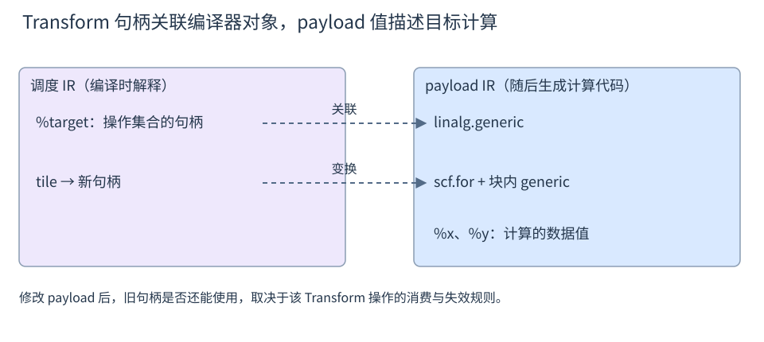

# Transform Dialect 与显式调度

同一个 Linalg 计算可以选择不同的 tile size、遍历次序和向量宽度。前面用 C++ Pass 表达“怎样修改 IR”；现在希望把“对哪部分计算，按什么顺序应用哪些变换”单独写出来，让它可以阅读、修改与复现。

Transform Dialect 用 MLIR 表达这份调度。它处理的对象仍然是原来的计算 IR，但它自己的值代表待变换的对象集合。把这两层分清，后面的匹配、句柄与失效就有了共同依据。

## 1. 算法与调度的两层 IR

沿用上一章的计算：

```text
算法 IR：linalg.generic 表达 y[i] = 2 × (x[i] + 1)
调度 IR：匹配 generic → 分块 4 → 对块向量化 4
```

算法 IR 常称 payload IR。它将来参与生成目标程序：里面的 `%x` 是程序的数组，`%a` 是计算中的数值。

Transform interpreter 在编译时执行调度 IR：`%target` 关联编译器中的 Operation，变换修改这些对象。完成后，新的算法 IR 继续进入目标编译。

同一算法可以采用不同调度。每项变换都需要满足自己的依赖、迭代类型及尺寸条件。



图左的 handle 在编译时关联右侧的 Operation，虚线表示匹配或变换；右侧 `%x` 等值描述目标程序的数据流。下面继续解释 handle 的有效期。

## 2. 句柄与对象集合

上一章的匹配是：

```text
%target = transform.structured.match ops{["linalg.generic"]} in %root
  : (!transform.any_op) -> !transform.any_op
```

`%root` 关联本次解释器处理的根操作；在本例里是模块。匹配在这个范围内寻找指定名字的操作，把找到的对象关联给 `%target`。

Handle 可以关联零个、一个或多个对象。本例只有一个 generic，因此匹配集合包含一个对象；多个 generic 时，后续变换按自身契约处理这组目标。

需要更精确地定位时，可以按操作名、属性、父子关系等进一步匹配或筛选。接口和扩展提供更多定位方式；最终目的始终是让“想优化的那段计算”与“拿到的对象集合”一致。

## 3. 变换结果与句柄失效

分块操作接受旧对象，返回修改后对象及新循环：

```text
%tiled, %loop = transform.structured.tile_using_for %target tile_sizes [4]
  : (!transform.any_op) -> (!transform.any_op, !transform.any_op)
transform.structured.vectorize %tiled vector_sizes [4] : !transform.any_op
```

可以把执行时的关联画成：

```text
修改前：%target ──→ 原 generic

分块后：%target ──× 不能继续使用
        %loop  ──→ 新 scf.for
        %tiled ──→ 循环内部的小块 generic
```

分块消费旧 handle，并返回指向新结构的 handle。旧操作可能被替换或改变嵌套位置，因此继续调度时要使用更新后的映射。

如果把向量化的 `%tiled` 错改成 `%target`，实际解释器报错：

```text
error: op uses a handle invalidated by a previously executed transform op
note: invalidated by this transform op that consumes its operand #0 ...
```

诊断定位到此前的分块操作，说明使用了已失效的调度句柄。

## 4. 别名句柄与嵌套对象

若两个 handle 指向同一个 payload，消费其中一个也影响另一个；消费容器时，指向其内部对象的旧映射也可能失效。

继续操作时，可以使用变换返回的 handle，或从仍有效的上层范围重新匹配。Transform 效果描述分别记录查询、生成映射、修改 payload 和释放映射。

`transform.readonly` 约束 named sequence 参数 handle 的使用与消费。本例保留 `%root` 的映射，再匹配和消费其子对象 handle 来完成分块。

Expensive checks 帮助发现失效句柄。调度程序始终需要按 handle 的有效期使用映射。

## 5. 失败传播与抑制

变换可能不适用于某个对象。例如 `structured.vectorize` 接受 Linalg 操作，把 `scf.for` 交给它就不满足条件。这种“不适用”可能以 silenceable failure 返回；协议损坏或无法继续的错误则是 definite failure。

Silenceable failure 可以由支持处理它的外层操作显式抑制；若一直传播到最外层，解释执行仍会失败。

实验专门按下面顺序执行：

```text
在 transform.sequence failures(suppress) 中：
  1. 匹配 generic
  2. 分块 4                  ← 已修改 payload
  3. 尝试向量化 %loop        ← scf.for 不是 Linalg，silenceable failure
  4. transform.print %scope  ← 仍会执行
```

实际打印结果仍包含新 `scf.for` 和内部 generic，没有恢复成分块之前的程序。固定版本的 sequence 在 suppress 模式下抑制本次可抑制失败，然后继续执行后面的操作。

Suppress 会保留此前成功的修改。第 3 步消费 handle 后，相关旧映射也按协议失效；后续需使用有效 handle。Definite failure 则继续向外传播。

若要失败后恢复并尝试另一种调度，应选择具有恢复语义的机制，或在独立副本上尝试，确认成功后再采用结果。

## 6. 与 Pass、Pattern 和搜索的关系

现在可以把已经学习的几层重新连接起来：

| 层次 | 在本例里承担的工作 |
|---|---|
| Pattern / 变换实现 | 真正创建循环、切片或向量操作，并维护 IR |
| Pass / pipeline | 在工具里组织阶段、分析、验证及后续 lowering |
| Transform 程序 | 定位目标，显式组合分块、向量化等动作与参数 |
| 搜索或调优程序 | 如果需要，生成多份参数选择，调用编译与测量比较 |

Transform interpreter 本身通常由 Pass 调用。已有变换通过 Transform 操作暴露出来；需要新动作时也可以写扩展，但仅使用已有动作不必先开发一套新框架。

Tile size=4 是调度程序记录的一项选择。比较不同值需要结合目标成本或测量，下一篇将对照几种合法实现的实际运行时间。

## 7. 阅读检查与衔接

1. `%target` 关联两个 generic 时，它与一个包含两个元素的 `vector` 有什么本质区别？
2. 分块后使用另一个曾经指向原 generic 的 handle，能否绕过消费规则？
3. sequence 抑制了第 3 步的失败，第 2 步已经生成的循环还在吗？第 4 步是否执行？

继续读[调度选择与性能解释](./performance)。版本依据：[Transform 设计文档](https://github.com/llvm/llvm-project/blob/llvmorg-20.1.8/mlir/docs/Dialects/Transform.md)与 [sequence 实现](https://github.com/llvm/llvm-project/blob/llvmorg-20.1.8/mlir/lib/Dialect/Transform/IR/TransformOps.cpp)。[配套工程](https://github.com/jnfkdsn/aicompiler/tree/main/llvm-mlir/15-vector-transform)可以观察成功调度、句柄失效及失败后的 IR。
