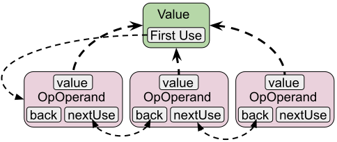

# C++ IR API：从读取对象到安全地修改 IR

上一章已经把 Pass 的运行过程追到了 `runOnOperation()`。现在继续走进去：假设手里拿到了一个 `func::FuncOp`，怎样找到加法，把它的结果替换成另一个值，再删掉原来的操作？这几步在纸上很容易，写成 C++ 后却涉及对象生命周期、use-list、插入位置和作用域。

本章继续使用 `twice`，先把加零变成直接使用参数，再将剩下的 `x+x` 改写成 `x*2`，最后用同一段函数解释构造和克隆。选择第二条变换是为了同时观察“创建新 IR”和“删除旧 IR”，不据此判断某个目标上乘法一定更快。

本章用一个独立 C++ 程序操作 IR，依次观察创建、引用替换和删除。程序使用轻量句柄、引用、模板调用与 RAII；后面的贯通教程再把这些修改接入 Pass 和 pipeline。

本章的学习目标是能预测操作对象和引用关系的变化，并判断一次修改是否安全。方法名和重载参数可以边写边查；能说明“需要重接两个 operand，旧结果无 use 后才能考虑删除”，比脱离场景记住 RAUW 的拼写更重要。C++ 是表达这些修改的工具，语法不熟的部分可以单独查阅，不必因此停下整条学习主线。

## 1. 从文本里的三条加法开始

输入仍然是下面这个函数：

<!-- mlir-example: ir-api-input -->
```text
module {
  func.func @twice(%x: i32) -> i32 {
    %zero = arith.constant 0 : i32
    %a = arith.addi %x, %zero : i32
    %b = arith.addi %x, %zero : i32
    %r = arith.addi %a, %b : i32
    return %r : i32
  }
}
```

这里有三条 `arith.addi`，但 C++ 程序不能靠搜索 `%a` 来找到第一条加法。`%a` 是文本表示中的名字；parser 建立对象之后，我们主要通过包含关系和 def-use 关系查找它。

从函数出发，包含关系是一条路径：

```text
func::FuncOp
  → getBody()：Region
  → front()：入口 Block
  → Block 中的 Operation
```

从第三条加法出发，数据关系是另一条路径：

```text
arith::AddIOp（对应 %r 的定义）
  → getLhs()：对应 %a 的 Value
  → getDefiningOp()：第一条加法的 Operation
```

两条路径的区别很实用：找“函数里有哪些加法”沿结构走；找“这条加法的输入由谁产生”沿数据关系走。`walk` 不会因为看到一次 `func.call` 就跳进被调用函数，它遍历的是静态包含结构。

## 2. 哪个对象拥有 IR，哪个只是访问它

先看独立程序如何取得顶层对象。以下代码位于 `main` 内，`argv[2]` 是输入文件路径：

<!-- cpp-example: parse -->
```cpp
DialectRegistry registry;
registry.insert<arith::ArithDialect, func::FuncDialect>();
MLIRContext context(registry);
context.loadDialect<arith::ArithDialect, func::FuncDialect>();
OwningOpRef<ModuleOp> module = parseSourceFile<ModuleOp>(argv[2], &context);
if (!module || failed(verify(module->getOperation())))
  return 1;
```

`DialectRegistry` 保存可供 Context 使用的方言注册信息；方言被加载到 `MLIRContext` 后，Context 才具有相应的操作定义、类型等设施。parser 可以按需加载已注册方言；本例也会主动构造操作，所以显式加载 `arith` 和 `func`，让构造所依赖的定义在使用前就位。

Context 还管理 uniqued 的 Type、Attribute 等存储。在同一个 Context 中反复请求相同的 `i32`，可以共享其类型存储；创建两个相同的加法操作，则仍然得到两个不同的 Operation。Context 不会因此自动合并相同表达式。

`parseSourceFile<ModuleOp>` 返回 `OwningOpRef<ModuleOp>`。它是拥有顶层操作的 RAII 对象，离开作用域时销毁 module 及其子结构。这里先声明 Context，再声明 module，C++ 按相反顺序析构，IR 因而在 Context 之前释放。

用 `module->lookupSymbol<func::FuncOp>("twice")` 可以按符号名查找函数。配套程序确认函数存在且包含一个 Block，签名为 `(i32) -> i32` 后，再执行下面的操作。

需要区分以下几种 C++ 表达：

| 表达 | 它表示什么 | 复制或离开作用域会发生什么 |
|---|---|---|
| `Operation *` | 指向实际操作对象的非拥有指针 | 复制指针不复制 IR；指针变量销毁不删除操作 |
| `arith::AddIOp` / `func::FuncOp` | 对同一个 Operation 的带类型访问句柄 | 复制句柄仍然指向原操作；不会延长其生命周期 |
| `Value` | 指向一个 OpResult 或 BlockArgument 的轻量句柄 | 复制句柄不会复制计算，也不保活定义对象 |
| `Block &` / `Region &` | 对包含结构的引用 | 所属结构被删除后不能继续访问 |
| `Type` / `Attribute` | 对 Context 管理的存储的句柄 | 依赖所属 Context 的生命周期 |
| `OwningOpRef<ModuleOp>` | 对顶层操作的拥有关系 | 析构时释放所持有的 IR |

auto `another` = add 复制句柄，两者指向同一操作。`add.erase()` 删除该对象后，两个句柄都失效，后续应从存活 IR 重新取得需要的对象。

## 3. 带类型的 Op 如何连接通用 Operation

通用遍历得到 `Operation *raw` 后，`dyn_cast<arith::AddIOp>(raw)` 会检查类型并返回对应句柄，失败时返回空句柄。已确认类型时可用 `cast`，只需要布尔判断时可用 `isa`。

这些转换使用 LLVM/MLIR 的类型识别机制。取得 `arith::AddIOp` 句柄后，可以通过 `getLhs()`、`getRhs()`、`getResult()` 访问底层同一个 Operation 的字段。

对这个单结果二元操作，`getLhs()` 对应 operand 0，`getResult()` 对应 result 0。多结果操作需要指定结果编号。`func.func` 通常没有自身的 SSA 结果；其 FunctionType 描述函数返回类型，函数体中的 `func.return` 提供运行时返回的值。

下面的片段一次走通结构和数据两条路径。`fn` 是已经检查过的函数句柄：

<!-- cpp-example: inspect -->
```cpp
Region &body = fn.getBody();
Block &entry = body.front();
Value x = entry.getArgument(0);
llvm::errs() << "argument_has_defining_op="
             << (x.getDefiningOp() != nullptr) << "\n";
fn.walk([](arith::AddIOp add) {
  Operation *raw = add.getOperation();
  Value lhs = add.getLhs();
  Value result = add.getResult();
  llvm::errs() << raw->getName() << " lhs_type=" << lhs.getType()
               << " result_uses=" << std::distance(result.use_begin(),
                                                   result.use_end()) << "\n";
});
unsigned uses = 0;
llvm::SmallPtrSet<Operation *, 4> uniqueUsers;
for (OpOperand &use : x.getUses()) {
  ++uses;
  uniqueUsers.insert(use.getOwner());
  llvm::errs() << "x operand_slot=" << use.getOperandNumber() << "\n";
}
llvm::errs() << "x_uses=" << uses << " x_unique_users="
             << uniqueUsers.size() << "\n";
```

`fn.walk([](arith::AddIOp add) { ... })` 递归访问函数及嵌套 Region 内的加法；`entry.getOps<arith::AddIOp>()` 则枚举入口 Block 直接包含的加法。按所需范围选择遍历方式。

`%x` 定义在入口 Block 的参数位置，因此属于 BlockArgument，`getDefiningOp()` 返回空。加法结果属于 OpResult，该方法返回对应加法。通用代码可以据此继续区分这两类定义来源。

`std::distance` 在这里用于统计 use 链表，适合观察小例子；若只关心是否无使用者或只有一个 use，应使用 `use_empty()`、`hasOneUse()`，不必每次遍历计数。

## 4. 一个 use 是一个 operand 槽位

对输入程序，`%x` 有两个 use：第一、第二条加法各使用一次。简化成 `arith.addi %x, %x` 后，仍然有两个 use，但只有一个不同的 user Operation。

```text
Value x
  ← 最后一条加法的 operand 0
  ← 最后一条加法的 operand 1
```

一个 `OpOperand` 就是某个 Operation 的一个输入槽位。它知道自己属于哪个操作、位于第几个槽位，以及当前引用哪个 Value。Value 的 use-list 将引用它的这些槽位连接起来。

`getUses()` 遍历使用边，`getUsers()` 沿每条边返回使用者，因此同一个操作可能出现多次。下面用集合统计不同的 user，简化后得到：

```text
argument_has_defining_op=0
x_uses=2 x_unique_users=1
```

当调用 `someUse.set(newValue)` 时，改变的是这一个槽位的引用，并更新旧、新 Value 的 use-list。它没有改变旧 Value 的含义，也没有修改产生旧 Value 的运算。

这层机制使编译器不用重新扫描整个函数来寻找所有 `%a` 的出现位置：定义对象已经知道有哪些输入槽位引用它。

## 5. 第一次修改：把加零的使用改为使用 x

现在把“`x+0` 可以替换为 `x`”落实为 C++。我们先收集加法句柄，再逐个匹配并修改：

<!-- cpp-example: remove-zero -->
```cpp
llvm::SmallVector<arith::AddIOp> candidates;
fn.walk([&](arith::AddIOp add) { candidates.push_back(add); });
for (arith::AddIOp add : candidates) {
  if (!add.getType().isSignlessInteger(32) ||
      add.getOverflowFlags() != arith::IntegerOverflowFlags::none)
    continue;
  auto constant = add.getRhs().getDefiningOp<arith::ConstantOp>();
  if (!constant)
    continue;
  auto integer = dyn_cast<IntegerAttr>(constant.getValue());
  if (!integer || !integer.getValue().isZero())
    continue;
  Value oldValue = add.getResult();
  Value replacement = add.getLhs();
  oldValue.replaceAllUsesWith(replacement);
  add.erase();
}
```

匹配部分限定了这条规则的适用范围：标量 signless i32、无 overflow flags，并且 RHS 直接由整数零常量定义。遇到其他类型或更复杂的常量表达式时，代码保留原操作。

真正改变数据图的是 `replaceAllUsesWith`，通常缩写为 RAUW。处理第一条加法时，变化可以分成两个时刻：

| 时刻 | 第一条加法 `%a = x+0` | 最后一条加法 |
|---|---|---|
| 修改前 | 结果有一个 use | `%r = addi %a, %b` |
| RAUW 后 | 对象仍在，结果已经没有 use | `%r = addi %x, %b` |
| erase 后 | 对象被销毁 | `%r = addi %x, %b` |

随后处理第二条加法，`%r` 的两个输入就都成了 `%x`。此时常量零已经没有 use，但还没有删除。程序 `zero` 模式打印的实际状态是：

<!-- mlir-example: ir-api-zero-output -->
```text
module {
  func.func @twice(%arg0: i32) -> i32 {
    %c0_i32 = arith.constant 0 : i32
    %0 = arith.addi %arg0, %arg0 : i32
    return %0 : i32
  }
}
```

这份 IR 通过 verifier。此时无用常量仍保留在 Block 中，后续可以通过清理过程删除。

在本例中，替换前的加法已经合法，`%x` 在函数入口定义，支配这些使用，替换前后类型也相同；`x+0=x` 则提供语义依据。这些才是允许替换的理由。RAUW 本身不会帮调用者证明这些条件。

<div style="background: white; padding: 0.6rem; border-radius: 6px;">

<div class="source-figure">



</div>

</div>

图源：[LLVM 20.1.8：Understanding the IR Structure](https://mlir.llvm.org/docs/Tutorials/UnderstandingTheIRStructure/#traversing-the-def-use-chains)。

沿官方图中的 `First Use` 和 `nextUse` 走一遍。下排的每个格子都是一个操作数位置。即使两个位置属于同一条加法，也必须分别改接，才能替换这个值的全部使用。图中的 `back` 供维护链表使用。

## 6. 从 use-list 源码看 RAUW 的能力边界

沿 `Value::replaceAllUsesWith` 进入底层 use-list，核心逻辑是：

```cpp
while (!use_empty())
  use_begin()->set(newValue);
```

这是 `IR/UseDefLists.h` 中实现的核心摘录。每次把链表中的一个 use 转接出去，直到旧值没有 use。这里没有搜索等价表达式，没有插入类型转换，也没有计算 DominanceInfo。

RAUW 后，`%r` 仍有两个 operand 槽位，只是都从引用 `%a` 改为引用 `%x`。因此 `%a` 的 use-list 变空，`%x` 的 use-list 增加两项，使用者 `%r` 本身继续存在。

由这段逻辑还能推导一个常见错误。假设原来有 `%old`，先创建 `%new = addi %old, %one`，再无条件把 `%old` 的所有 uses 换成 `%new`。新增加法使用 `%old` 的槽位也会被替换，结果成为：

```text
%new = arith.addi %new, %one : i32
```

在函数的 SSACFG Region 中，这产生了非法的自引用。RAUW 没有“忽略刚创建的 user”这个默认行为。若算法需要保留某些使用，应明确选择要改的 `OpOperand`，或者使用条件替换 API，并另外证明选中使用的合法性。

因此，调用者应先判断自己在做哪一种变换：

- **替换原计算**：像下一节从 `x+x` 构造 `x*2`，新操作使用旧操作的输入，不使用旧结果。新结果能够替代旧结果后，执行 RAUW，再删除旧操作。
- **在旧结果上增加计算**：新操作确实需要 `%old`，就必须保留这条依赖，只重接选定的下游使用。固定版本提供 `oldValue.replaceAllUsesExcept(newValue, newOp)`，也可以用 `replaceUsesWithIf` 选择 use。此时旧结果仍被新操作使用，不能再删除旧定义。

第二种做法控制了哪些使用位置被替换。新增计算的语义、类型和支配关系仍由调用者检查，确保替换后的每个使用都能取得正确的值。

类似地，`Value::setType(i64)` 只改类型记录，不会插入扩展/截断，不会同步改写全部用户和函数签名。需要改变表示类型时，应构造满足新类型关系的 IR；系统性的类型变化随后交给 Dialect Conversion 和 TypeConverter 讨论。

## 7. 第二次修改：先创建替代对象，再转接使用

现在需要把剩下的 `x+x` 变成 `x*2`。与加零不同，替代 Value 尚不存在，必须先创建常量和乘法。

`OpBuilder` 把“创建什么”和“放在哪里”连接起来。它保存 Context 和插入点；一个插入点包含 Block 与该 Block 中的位置。`setInsertionPoint(add)` 表示在这条加法之前插入，`setInsertionPointAfter(add)` 表示在它之后插入。

下面是完整处理函数的核心。正常执行时 `badDominance=false`，取真用于下一节的故意错误示例：

<!-- cpp-example: multiply -->
```cpp
OpBuilder builder(fn.getContext());
llvm::SmallVector<arith::AddIOp> candidates;
fn.walk([&](arith::AddIOp add) { candidates.push_back(add); });
for (arith::AddIOp add : candidates) {
  if (!add.getType().isSignlessInteger(32) ||
      add.getOverflowFlags() != arith::IntegerOverflowFlags::none ||
      add.getLhs() != add.getRhs())
    continue;
  OpBuilder::InsertionGuard guard(builder);
  builder.setInsertionPoint(add);
  if (badDominance)
    builder.setInsertionPointAfter(add); // Deliberate verifier counterexample.
  Location loc = add.getLoc();
  auto two = builder.create<arith::ConstantIntOp>(loc, 2, 32);
  builder.setInsertionPoint(add);
  auto mul = builder.create<arith::MulIOp>(loc, add.getLhs(), two.getResult());
  add.getResult().replaceAllUsesWith(mul.getResult());
  add.erase();
}
```

正常路径的变化顺序是：

```text
起点：                 创建之后：                   替换并删除之后：
%r = addi %x, %x        %two = constant 2             %two = constant 2
return %r              %m = muli %x, %two            %m = muli %x, %two
                       %r = addi %x, %x              return %m
                       return %r
```

创建 `%m` 时不会自动删除 `%r`。只有把 `%r` 的 use 转向 `%m` 后，才能删除原加法。乘法使用 `%x` 和 `%two`，没有使用旧结果 `%r`，因此也没有上一节的自引用问题。

`builder.create<arith::MulIOp>(...)` 调用该 Op 的 builder 填充状态，再创建并插入 Operation。本例的结果类型由输入推导；其他 Op 按自己的 builder 要求提供类型。构造完成后可显式调用 verifier；需要构造时尝试折叠，则使用 `createOrFold`。

常量的整数值 `2` 是 Attribute 层面的静态信息，常量操作的结果 `%two` 才是供乘法使用的 SSA Value。这是前面 Type/Attribute 概念在构造代码中的具体区别。

`Location` 传给新操作，用于把后续诊断关联到原始程序位置。这里沿用被改写加法的 location；更复杂的合并可能需要 FusedLoc 等表示，location 本身不决定支配或算术语义。

`InsertionGuard` 在进入作用域时保存插入点，在退出时恢复它，适合保护辅助函数对 builder 状态的临时修改。创建、RAUW 和删除已经改变的 IR 会保留下来，插入锚点的生命周期也需由调用者维护。本例局部 builder 初始没有插入点，退出时恢复该状态。

## 8. 插入成功为什么仍会验证失败

如果把常量 `2` 放到旧加法之后，却仍把乘法放在旧加法之前，删除旧加法后得到的顺序就是：

```text
%m = arith.muli %x, %two : i32
%two = arith.constant 2 : i32
return %m : i32
```

类型完全匹配，常量和乘法也确实已经创建，RAUW 可以执行完。但乘法在同一 Block 中使用了后面才定义的 `%two`。`bad-dominance` 模式的实际 verifier 诊断包含：

```text
operand #1 does not dominate this use
```

这表明 builder 的插入点只表达位置选择，不承担合法性证明。对于当前直线程序，把新定义放在旧加法之前，并保证新定义的输入已经可用，足以满足这里的支配要求。

同一 Block 内，可以沿“输入定义 → 新操作 → 结果使用”检查顺序。跨 Block 时，需要确认输入定义支配新操作、新操作支配被替换的使用，并满足 Region 作用域和隔离约束。

到了有分支或 Region 的程序，需要同时考虑替代值能否到达所有使用、是否越过隔离边界、操作移动后是否改变执行次数和效果。`moveBefore` / `moveAfter` 移动的是已有对象，不会像 `clone` 那样生成新定义；但这些移动 API 同样不会替你证明支配、效果或循环不变量。

程序在修改之后显式检查：

<!-- cpp-example: verify -->
```cpp
if (failed(verify(module->getOperation()))) {
  llvm::errs() << "IR after failed verification:\n";
  module->print(llvm::errs());
  llvm::errs() << "\n";
  return 2;
}
module->print(llvm::outs());
llvm::outs() << "\n";
return 0;
```

失败时打印的是已修改的 IR；函数返回后，这些修改仍然保留。Verifier 检查结构、类型和支配等约束。若把 `x+x` 写成类型正确的 `x*3`，这些检查可能通过，因此还需要通过推导和行为测试检查计算是否保持原意。

## 9. 删除操作也会改变你正在遍历的容器

前面的代码先把加法收集到 `SmallVector`，再逐个删除。它在本例中安全，是因为每次只删除当前候选本身，不顺手删除其他候选或包含其他候选的父操作。这个向量保存的是非拥有句柄；如果算法会连带删除其他候选，剩余元素仍可能悬空。

对于当前 Block 中无用常量的清理，可以提前取得下一个迭代位置：

<!-- cpp-example: cleanup -->
```cpp
Block &entry = fn.getBody().front();
for (Operation &op : llvm::make_early_inc_range(entry)) {
  if (isa<arith::ConstantOp>(op) && isOpTriviallyDead(&op))
    op.erase();
}
```

`make_early_inc_range` 在处理当前对象前推进迭代器，允许回调删除当前对象；接下来要访问的对象仍须保持有效。本例用它扫描入口 Block 并删除无用常量。

`isOpTriviallyDead` 结合操作可删除性与结果使用情况提供判断，不能用“没有结果”替代它。`Operation::erase()` 则负责脱离父 Block 并销毁对象，包括其子结构；`remove()` 只脱离父 Block，不销毁。若只想移动位置，优先用移动 API，避免留下无人管理的 detached operation。

默认后序 `walk` 允许回调删除当前操作；前序遍历删除当前操作后，要返回 `WalkResult::skip()`，让遍历跳过已经删除的子结构。选择删除范围时，还需保留遍历继续进行所依赖的其他节点。

清理之后，`rewrite` 模式的实际输出为：

<!-- mlir-example: ir-api-rewrite-output -->
```text
module {
  func.func @twice(%arg0: i32) -> i32 {
    %c2_i32 = arith.constant 2 : i32
    %0 = arith.muli %arg0, %c2_i32 : i32
    return %0 : i32
  }
}
```

至此发生过三类不同修改：创建常量和乘法、更新使用边、销毁加法和无用常量。它们各自有独立的 API 和前提。

## 10. 从零构造函数：签名、入口参数和返回操作

修改已有函数之后，再看怎样在同一个 module 中构造一个新的 `@twice_built`。这能补齐 FunctionType、BlockArgument 和 terminator 的对应关系：

<!-- cpp-example: build -->
```cpp
OpBuilder builder(module.getContext());
OpBuilder::InsertionGuard guard(builder);
builder.setInsertionPointToEnd(module.getBody());
Type i32 = builder.getI32Type();
auto type = builder.getFunctionType({i32}, {i32});
Location loc = builder.getUnknownLoc();
auto fn = builder.create<func::FuncOp>(loc, "twice_built", type);
Block *entry = fn.addEntryBlock();
builder.setInsertionPointToStart(entry);
Value x = entry->getArgument(0);
auto sum = builder.create<arith::AddIOp>(loc, x, x);
builder.create<func::ReturnOp>(loc, sum.getResult());
```

创建 `func::FuncOp` 时传入的 FunctionType 描述一个 i32 输入和一个 i32 返回类型。刚创建的函数没有函数体，随后 `addEntryBlock()` 根据输入类型创建入口参数；返回类型不会因此变成 Block 的另一个参数，而是由 `func.return` 的 operand 来满足。

`builder.getI32Type()` 构造的是类型句柄，`entry->getArgument(0)` 取得的是运行时参数对应的 Value。二者即使都与 i32 有关，角色也完全不同。

这里在 module 的 body 末尾插入函数是合法的：`builtin.module` 不需要额外的终结操作。对于已经有 `func.return` 的函数 Block，“末尾插入”则意味着放在 return 之后，通常会破坏 terminator 必须位于末尾的约束；应选择在 terminator 之前插入。代码里在新建的空 Block 起点插入，再依次建立加法和 return，最后才验证完整 module。

Builder 支持逐步构造：可以先建立 Block 和操作，再补 terminator。完整结构就绪后，再调用 verifier 检查最终 IR。

## 11. 克隆函数体：复制对象时要重建哪些引用

最后将原函数的 body 复制到新函数 `@twice_copy`。假设两者签名相同，分别具有入口参数 `%x_old` 和 `%x_new`。

若复制加法时仍引用 `%x_old`，新函数就会使用旧函数的局部参数，违反作用域。即使 printer 把两者都打印成 `%arg0`，它们仍是不同 Block 中的对象，需要通过映射连接到新参数。

`IRMapping` 明确记录旧对象到新对象的对应。这里完整复制一个单 Block body，包括 return；正常执行时 `omitArgumentMapping=false`：

<!-- cpp-example: clone -->
```cpp
OpBuilder builder(module.getContext());
OpBuilder::InsertionGuard guard(builder);
builder.setInsertionPointToEnd(module.getBody());
auto copy = builder.create<func::FuncOp>(source.getLoc(), "twice_copy",
                                        source.getFunctionType());
Block *target = copy.addEntryBlock();
IRMapping mapping;
if (!omitArgumentMapping)
  mapping.map(source.getArguments(), target->getArguments());
builder.setInsertionPointToStart(target);
for (Operation &op : source.getBody().front())
  builder.clone(op, mapping);
```

起点先建立参数映射。随后按定义顺序克隆 body 操作，clone 会记录新创建结果的映射，供后续操作使用：

| 克隆进度 | mapping 中新增的对应 | 后续用途 |
|---|---|---|
| 创建新入口 Block | 旧 `%x` → 新入口参数 | 新加法不再捕获旧函数参数 |
| 克隆零常量 | 旧 `%zero` → 新常量结果 | 新加法使用新常量 |
| 克隆前两条加法 | 旧 `%a/%b` → 新加法结果 | 第三条加法使用新的定义 |
| 克隆第三条加法 | 旧 `%r` → 新结果 | 新 return 引用新结果 |

沿 `Operation::clone(IRMapping &)` 源码可以看到关键规则：外部 operand 使用 `mapper.lookupOrDefault(opValue)` 查找映射；缺少映射时保留原 Value，创建后再把新旧结果加入 mapping。

保留未映射外部 Value 是有用途的：在相同作用域内克隆一个操作时，往往希望继续使用原来的外部输入。因此 clone 不会无条件拒绝缺少映射，调用者必须根据目标作用域决定哪些外部引用需要重定向。

`bad-clone` 模式故意跳过参数映射，其验证诊断包含：

```text
using value defined outside the region
```

这是新函数违反隔离约束的表现。正常克隆则通过验证，两个函数分别引用各自的入口参数。

本例克隆函数签名与单 Block body。扩展到多 Block CFG 时，还要映射 Block 和 successor；复制完整函数时，要保留相关属性。Op/Region 的克隆设施处理内部结构映射，调用方负责外部引用。若涉及符号定义，则由 SymbolTable 等机制维护名称唯一性和符号用途。

## 12. 这些 API 怎样进入下一章的改写框架

目前程序直接拥有 module，没有运行 pattern driver，也没有维护可复用的分析缓存，所以可以自行组织创建、RAUW、删除和验证。

当同样的变换进入 PatternRewriter，driver 可能维护待处理操作、监听修改并更新工作表。若绕过 rewriter 直接 `erase()` 或修改 operand，它可能不知道对象已经变化。下一章因此需要在本章的对象机制之上建立统一的修改协议：怎样表达匹配失败，怎样通知替换与删除，以及 driver 怎样继续处理受影响的操作。

进入 Pass 后，修改还需要符合该 Pass 的操作范围，并按实际影响声明哪些分析可以保留。这样，后续 Pass 才能查询有效的分析结果。

本章给出的独立程序只访问指定的 `@twice`，示范两条受约束规则。单次扫描是否足够取决于规则间的关系；扩展更多规则后，新的操作可能需要再次匹配，遍历顺序也可能影响暴露的机会。这正是后面引入改写 driver 的具体动机。

## 读完后应能独立推演

1. 在 `%r = addi %a, %a` 中，`%a` 有几个 use、几个不同 user？RAUW 改的是哪些对象？
2. 为什么 RAUW 之后旧加法还在，`erase` 之后保存的 Op / Value 句柄却不能继续访问？
3. 为什么类型匹配的替换仍会违反支配？新操作应该插在哪里，取决于哪些输入和使用？
4. 为什么克隆时未映射的外部 Value 会保留，跨函数复制却必须重新映射参数？

能沿主例说明这些变化，就可以继续学习 PatternRewriter。正式的小 Pass 实验将在理解其改写协议后统一安排，不需要把配套程序中的每个 API 都先背下来。

## 依据与复现

[IR API 观察实验](https://github.com/jnfkdsn/aicompiler/tree/main/llvm-mlir/03-ir-api)提供分步操作。可从 workspace 根目录运行：

```bash
python3 aicompiler-labs/llvm-mlir/03-ir-api/observe.py
```

默认观察一次加零消除，依次打印 RAUW 前、RAUW 后以及 erase 后的 IR 和使用关系。`--step rewrite` 展示完整改写，`--step dominance` 和 `--step clone` 对照合法与非法修改。可以改变输入，比较 use-list 和输出结构怎样变化。

本文以工作区 `llvmorg-20.1.8` 为准。正文 C++ 片段与 `aicompiler-labs/llvm-mlir/docs/ir_api/ir_api_demo.cpp` 中对应区域逐字核对；省略的部分是头文件、模式分发、输入形状检查和主函数组织。

主要源码路径：

- [Value.h](https://github.com/llvm/llvm-project/blob/llvmorg-20.1.8/mlir/include/mlir/IR/Value.h) / [UseDefLists.h](https://github.com/llvm/llvm-project/blob/llvmorg-20.1.8/mlir/include/mlir/IR/UseDefLists.h)：Value、use-list、RAUW 与类型修改的边界。
- [Operation.h](https://github.com/llvm/llvm-project/blob/llvmorg-20.1.8/mlir/include/mlir/IR/Operation.h) / [Operation.cpp](https://github.com/llvm/llvm-project/blob/llvmorg-20.1.8/mlir/lib/IR/Operation.cpp)：walk 删除协议、erase/remove/move、clone 的外部引用映射。
- [Builders.h](https://github.com/llvm/llvm-project/blob/llvmorg-20.1.8/mlir/include/mlir/IR/Builders.h) / [Builders.cpp](https://github.com/llvm/llvm-project/blob/llvmorg-20.1.8/mlir/lib/IR/Builders.cpp)：插入点、InsertionGuard、create 与 clone。
- [OwningOpRef.h](https://github.com/llvm/llvm-project/blob/llvmorg-20.1.8/mlir/include/mlir/IR/OwningOpRef.h) / [IRMapping.h](https://github.com/llvm/llvm-project/blob/llvmorg-20.1.8/mlir/include/mlir/IR/IRMapping.h)：拥有关系与映射默认行为。
- [ArithOps.td](https://github.com/llvm/llvm-project/blob/llvmorg-20.1.8/mlir/include/mlir/Dialect/Arith/IR/ArithOps.td)：运算类型、访问器与 overflow flags 的定义来源。

官方 [Understanding the IR Structure](https://mlir.llvm.org/docs/Tutorials/UnderstandingTheIRStructure/) 可以对照结构遍历与 def-use API；[Pattern Rewriting](https://mlir.llvm.org/docs/PatternRewriter/) 用于衔接下一章的修改协议。在线教程与固定版本存在差异时，优先核对本地头文件与实际运行结果。

## 图片来源与许可

- **Use-list 图**：来自 [LLVM Project 20.1.8](https://github.com/llvm/llvm-project/blob/llvmorg-20.1.8/mlir/docs/includes/img/Use-list.svg)，采用 [Apache-2.0 WITH LLVM-exception](/licenses/llvm-20.1.8.txt)。原图未修改。
