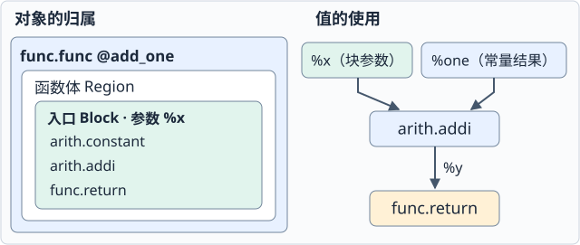

# IR 对象模型与表示

读一段 MLIR 可以沿两个方向走。找一条加法属于哪个函数，沿着 **Operation、Region、Block 的包含关系** 走。找加法的两个输入由谁提供，沿着 **Value 的定义和使用关系** 走。编译器把这两种关系保存在同一份 IR 里。先看清它们，再看文本如何读入、Pass 修改的又是什么。

## 1. 函数里的对象和值

<!-- mlir-example: ir-model-1 -->
```text
module {
  func.func @add_one(%x: i32) -> i32 {
    %one = arith.constant 1 : i32
    %y = arith.addi %x, %one : i32
    return %y : i32
  }
}
```

左图中的框表示归属，右图的箭头表示把值用作输入。请在两边各找一次同一条 `arith.addi`。



**沿包含关系读。** 模块 `builtin.module` 是一个 Operation，它的 Region 中有一个 Block，块中放着函数定义 `func.func @add_one`。图中放大了这个函数。函数也是 Operation，拥有一个表示函数体的 Region。入口 Block 按顺序保存常量、加法和返回这三条 Operation。即使函数完全没有分支，仍然需要这个块来容纳参数和操作。

**沿值的使用关系读。** 加法的第一个输入（operand）是入口 Block 的参数 `%x`，第二个输入是常量操作产生的结果（result）`%one`。加法自己的结果是 `%y`，它被 `func.return` 使用。于是“加法在哪个块中”和“加法用了哪个常量”有不同答案。在变换中，把使用 `%one` 的位置改为另一个可用的 i32 值，会改变加法读取的值，而加法仍属于原来的 Block。

## 2. Operation 如何容纳一段程序

Operation 是有名字和语义的节点。加法这样的节点只要操作数和结果就能表达计算；函数定义和循环还需要记下内部程序，它们用 Region 保存这部分结构。每个 Region 归一个 Operation 所有，内含一组有序的 Block。每个 Block 又可以保存其他 Operation。这样，通用遍历沿同一套结构能找到循环体深处的加法，循环要执行几轮则由 `scf.for` 的语义决定。

```text
func.func
└── 函数体 Region
    └── 函数入口 Block
        ├── 准备边界等值的 Operation
        ├── scf.for
        │   └── 循环体 Region
        │       └── 循环体 Block
        │           ├── arith.addi
        │           └── scf.yield
        └── func.return
```

现在从树中的加法往外读。直接拥有它的是循环体 Block，再向外经过循环体 Region 才到 `scf.for`。在上一层，`scf.for` 和 `func.return` 属于同一个函数入口 Block。只数文本里的花括号容易漏掉入口块，因为简洁写法可以省略块标签。

若需要判断执行方向，再看父操作和块末尾的操作。函数中的 `scf.if` 把分支程序放在自己的 Region 中；换成 `cf.cond_br`，分支操作会选择同一 Region 中的后继 Block。这里多出的是**控制流**关系，箭头的终点是接下来进入的块。

## 3. 函数定义与调用点

<!-- mlir-example: ir-model-3 -->
```text
module {
  func.func @callee(%x: i32) -> i32 {
    %one = arith.constant 1 : i32
    %y = arith.addi %x, %one : i32
    return %y : i32
  }

  func.func @caller(%input: i32) -> i32 {
    %output = func.call @callee(%input) : (i32) -> i32
    return %output : i32
  }
}
```

模块的 Block 里并列放着 `@caller` 和 `@callee` 两项定义。沿包含关系走进 `@caller`，能找到一条 `func.call`。它的操作数 `%input` 和结果 `%output` 参与调用者内部的数据流；另一个字段通过符号名 `@callee` 指向被调用的定义。沿这个名字才找得到另一个函数体。在多个位置调用同一个函数时，每个调用点各有自己的参数和结果，它们可以引用同一项定义。

到这里可以区分四种常见关系。**包含**回答“这个节点放在哪里”，**值的使用**回答“读哪个定义的值”，**控制流**回答“接下来进入哪个块”，**符号引用**回答“这个名字指向哪项定义”。从文字或图中看到一根箭头时，先辨认它连接的是哪两种对象。

## 4. 文本、内存对象与打印

读入 `@add_one` 时，parser 创建函数、入口块和块中的操作。处理加法的 `%one` 时，它会查找前面建立的值，把加法的第二个操作数连到常量的结果。此后 Pass 可以直接遍历对象、修改引用。printer 再沿对象结构输出文本，并为值分配可读名字。即使打印出的 `%one` 变成 `%0`，仍然能沿加法的第二个操作数找到同一个定义。前端也可以通过 C++ API 在内存中直接构造这套对象。

同一个函数还可以写成通用文本格式。请找出上一种写法隐含的入口 Block。

<!-- mlir-example: ir-model-2 -->
```text
"builtin.module"() ({
  "func.func"() <{sym_name = "add_one", function_type = (i32) -> i32}> ({
  ^bb0(%x: i32):
    %one = "arith.constant"() <{value = 1 : i32}> : () -> i32
    %y = "arith.addi"(%x, %one) : (i32, i32) -> i32
    "func.return"(%y) : (i32) -> ()
  }) : () -> ()
}) : () -> ()
```

`^bb0(%x: i32)` 显式列出块和参数；函数的简洁写法把参数放在函数名后。通用格式中 `func.func` 操作自身的签名是 `() -> ()`，被定义函数接收和返回 i32 的约定则保存在 `function_type` 中。前者描述定义节点在模块里使用和产生的 SSA 值，后者描述调用这个函数时的类型。

需要保存或传输 IR 时，还可以使用 bytecode 来序列化这份结构。在 C++ 中，`Operation *` 提供通用访问，`func::FuncOp` 等类型化包装提供特定字段的访问器。方言注册、共享类型与属性等基础设施位于 `MLIRContext`，具体程序的包含树则从模块节点向下展开。

## 5. Region 的执行规则与作用域

函数体通常按控制流图执行。进入函数时参数传给入口 Block，分支可以把值传给后继 Block 的参数。这样的 Region 称为 **SSACFG Region**。入口块不能同时作为该 Region 内分支的目标；需要循环回边时可以另设一个 header 块。块末尾的 terminator 给出跳转或退出的方式。

模块体属于 **Graph Region**。在本章的 LLVM 20.1.8 中，这类 Region 限于一个 Block，块内操作的排列不施加 SSACFG 的先定义后使用要求。模块里两个函数的书写次序也不决定谁调用谁。操作自身仍可施加约束。比如模块体允许省去终结操作，而 `scf.for` 的简洁写法可以隐去按规则补出的 `scf.yield`。

| 阅读一个带 Region 的操作时 | 可在定义中确认的约束 |
|---|---|
| 内部程序有几块 | 普通函数定义可以有多个块，外部函数声明的 Region 为空，`scf.for` 循环体有一个块。 |
| 块参数从哪来 | 父操作规定入口协议。函数入口从调用取得参数，循环体取得归纳变量和循环携带值。 |
| 哪些外层值可用 | 函数体具有隔离约束，循环体则可以使用满足作用域和支配条件的外层值。 |
| 内部结果怎样给外部用 | Region 自身没有 SSA 结果列表。带迭代结果的 `scf.for` 解释 `scf.yield` 提供的值，循环结束后外部使用的是 `scf.for` 的结果。 |

这些约束会直接影响 IR 能否通过验证。例如，若在 `@add_one` 中插入一个循环，把常量定义移进循环体，却让循环外的加法继续使用它，循环外就引用了一个在那里不可见的定义。即使操作数和结果仍然都是 i32，这个程序也有错。需要核对某个具体操作的约束时，可以从方言定义查起。[函数定义](https://github.com/llvm/llvm-project/blob/llvmorg-20.1.8/mlir/include/mlir/Dialect/Func/IR/FuncOps.td) · [循环定义](https://github.com/llvm/llvm-project/blob/llvmorg-20.1.8/mlir/include/mlir/Dialect/SCF/IR/SCFOps.td) · [模块定义](https://github.com/llvm/llvm-project/blob/llvmorg-20.1.8/mlir/include/mlir/IR/BuiltinOps.td)

## 源码对照与自查

读 LLVM 20.1.8 的 IR API 时，可以先选一个方向查。向外找所属块用 `Operation::getBlock`，向内找区域用 `getRegions`，查看块参数和操作序列则分别用 `Block::getArguments`、`getOperations`。[Operation.h](https://github.com/llvm/llvm-project/blob/llvmorg-20.1.8/mlir/include/mlir/IR/Operation.h) · [Block.h](https://github.com/llvm/llvm-project/blob/llvmorg-20.1.8/mlir/include/mlir/IR/Block.h) · [MLIR LangRef](https://github.com/llvm/llvm-project/blob/llvmorg-20.1.8/mlir/docs/LangRef.md)

1. 在 `@add_one` 里，把 `return %y` 改成返回 `%x`。哪一条值的使用关系变了？三条操作的包含关系有何变化？
2. 在 `@caller` 中再调用一次 `@callee`。模块里会多出什么对象？两次调用从哪里找到同一项函数定义？
3. printer 改变了常量结果的名字。再看打印后的加法，怎样判断它的第二个操作数是否仍使用原来的常量？

接着读[Value、SSA 与支配关系](./values_ssa)，讨论一个值能在哪些位置被合法使用。
