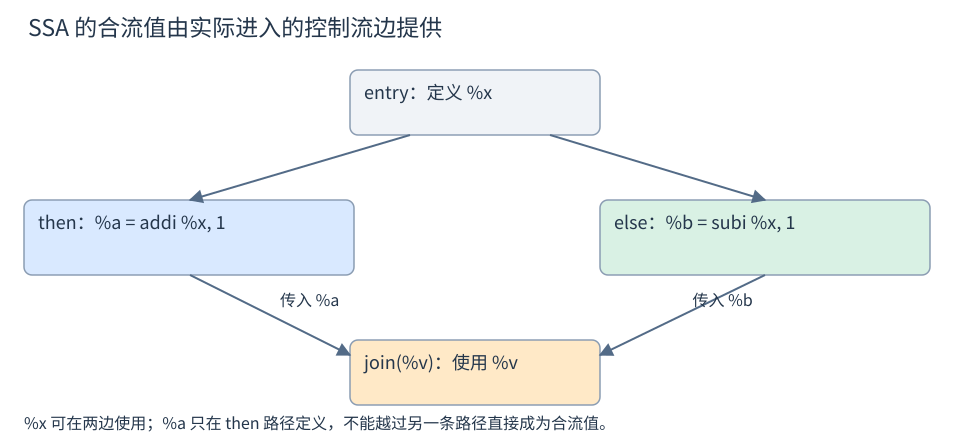

# Value、SSA 与支配关系

前置：[IR 对象模型](./ir_model)。本文从定义与使用出发，解释 Block 参数、合流、循环和层次支配。默认讨论 SSACFG Region；Graph Region 的例外单独说明。CF 和 SCF 的完整操作契约在方言章节展开。

## 1. Value 是数据流中的值

MLIR 的一个 SSA Value 有且只有一个定义来源：某个 Operation 的一个结果，或某个 Block 的一个参数。它携带类型，可以被零个或多个操作使用。

| 对象 | 定义者 | 例子 |
|---|---|---|
| OpResult | 某个 Operation | `%y = arith.addi ...` 的 `%y` |
| BlockArgument | 某个 Block | 函数入口的 `%x`、循环体的 `%iv` |
| OpOperand | 使用者 Operation 的某个输入位置 | addi 的第一个或第二个输入槽 |

operand 是操作中引用已有 Value 的位置。`arith.addi %x, %x` 的两个 operand 都指向 `%x`，因此产生两个 use，使用者 Operation 则只有一个。

完整模块：

<!-- mlir-example: ssa-two-uses -->
```text
module {
  func.func @double(%x: i32) -> i32 {
    %y = arith.addi %x, %x : i32
    return %y : i32
  }
}
```

`%x` 是入口 BlockArgument，add 操作对它有两个 OpOperand；`%y` 是 add 的 OpResult，return 对它有一个 use。`func.func` 自身没有因为签名里的 `-> i32` 而产生 `%y`：函数签名描述调用，`%y` 在函数体内定义。

`%x` 是文本名，Value 的身份由 IR 对象确定。重新打印成 `%arg0` 后，定义和引用关系仍保持原样。多结果操作可写为 `%r:2 = ...`，再以 `%r#0`、`%r#1` 分别引用其两个结果。

## 2. SSA 限制的是静态定义

普通程序的 `x = x + 1` 混合了“读取旧值”和“更新变量”。SSA 把数据依赖显式化：某个定义提供旧值，另一个定义产生新值，后续使用指向新值。

Static Single Assignment 描述静态 IR 中的定义关系。循环体可以只有一个加法节点，运行时每次进入 Block 都重新绑定参数并执行这条加法，得到当次迭代的结果。

编译器编辑 IR 时，可以让一个 use 改为引用另一个 Value。修改后的结构需要继续满足类型、支配和作用域约束，从而保持合法的 SSA 关系。



图中 `%x` 定义在两条分支之前，两个分支各产生自己的值，再通过进入 join 的边传给 `%v`。箭头是控制流与沿边传值；它与 Operation 包含 Region 的容器树是不同关系。

## 3. 支配保证每次使用前都有定义

在可达的函数 CFG 中，如果从入口到 Block B 的每条路径都经过 Block A，则 A 支配 B。操作级支配还考虑同一 Block 内的先后顺序：通常一个 OpResult 只能在其定义之后使用，不能在定义操作自身的 operand 中使用。

这解释了为什么“文本上写在前面”不够。下面故意构造一个失败模块：

<!-- mlir-invalid: ssa-bad-dominance | does not dominate -->
```text
module {
  func.func @bad(%cond: i1, %x: i32) -> i32 {
    cf.cond_br %cond, ^left, ^right
  ^left:
    %one = arith.constant 1 : i32
    %only_left = arith.addi %x, %one : i32
    cf.br ^join
  ^right:
    cf.br ^join
  ^join:
    return %only_left : i32
  }
}
```

当执行 `entry → right → join` 时，没有执行 `%only_left` 的定义。它虽然写在 `return` 前面，却不支配该使用。Block 标签的排版顺序不会修复这条缺失的定义路径。

## 4. Block 参数把合流写成显式传值

正确表示需要每条进入合流块的路径都提供一个值：

<!-- mlir-example: ssa-merge -->
```text
module {
  func.func @choose_increment(%cond: i1, %x: i32) -> i32 {
    cf.cond_br %cond, ^left, ^right
  ^left:
    %one = arith.constant 1 : i32
    %inc = arith.addi %x, %one : i32
    cf.br ^join(%inc : i32)
  ^right:
    cf.br ^join(%x : i32)
  ^join(%selected: i32):
    return %selected : i32
  }
}
```

`^join(%selected: i32)` 定义一个新 BlockArgument。沿 left 的边进入时绑定 `%inc`，沿 right 的边进入时绑定 `%x`。`%selected` 的定义始终存在于 join 入口，具体取得哪个运行时值由实际前驱决定。

这承担了传统 SSA 中 `phi` 合流的角色：Block 参数声明目标需要的值，branch operands 提供当前这条边传入的值。

一条分支必须给目标参数按位置提供类型相容且满足该操作约束的实参。这里 `cf.br` 要求对应类型相同；MLIR 不会自动插入整数转换。

## 5. 循环回边也是参数传递

循环的 SSA 状态可用同一个规则描述：

```text
entry ── initial ──→ header(%state)
                       │ 条件真
                       ↓
                     body：%next = update(%state)
                       │
                       └── %next ──→ header

header 条件假 ──→ exit：使用最后一轮的 %state
```

`%state` 是 header 的 BlockArgument。第一次进入时接收 entry 传来的值，之后每次沿回边进入时接收本轮更新的值。

函数的入口 Block 不能成为该 Region 内 branch 的 successor，因此一般另建 header 承接回边。[CF 章节](../dialects/cf)给出完整循环；[SCF for](../dialects/scf/for)把这个协议编码在一个结构化 Operation 中。

## 6. 支配还必须穿过嵌套层级

检查外层值能否用于嵌套 Region，可以先判断父 Operation 能否在该位置使用此值，再检查 Region 的隔离和额外约束。

下面 `%one` 可以被 if 的两个区域使用，两个分支的局部结果则经 `scf.yield` 交给 if：

<!-- mlir-example: ssa-region-result -->
```text
module {
  func.func @region_result(%cond: i1, %x: i32) -> i32 {
    %one = arith.constant 1 : i32
    %chosen = scf.if %cond -> (i32) {
      %a = arith.addi %x, %one : i32
      scf.yield %a : i32
    } else {
      %b = arith.subi %x, %one : i32
      scf.yield %b : i32
    }
    return %chosen : i32
  }
}
```

四条不同约束需要分别记住：

1. 外层 `%one` 在 if 之前定义，支配 if；if 允许捕获这样的值。
2. `%a`、`%b` 各自在自己的 Region 内定义，不能直接在 if 外使用，也不能横跨到另一个分支使用。
3. `%chosen` 是 if 的结果，由实际执行分支的 yield 提供，供 if 之后的操作使用。
4. 不能在 if 自身内部引用尚未产生的 `%chosen`，期望得到某种隐式递归状态；循环状态需要相应 Block 参数协议。

`IsolatedFromAbove` 会进一步禁止从拥有该 trait 的 Op 外部捕获 SSA 值，即使普通层次支配看起来允许。`func.func` 是常见例子；[符号与作用域](./symbols_scopes)解释隔离后如何引用其他函数。

## 7. Graph Region 的适用边界

Graph Region 使用另一套作用域规则。在 LLVM 20.1.8 中，同层 OpResult 可以表达无顺序甚至循环依赖的图，同时仍需要唯一的 Value 定义、正确类型，并满足层次作用域及具体操作约束。

因此应先确认 RegionKind，再判断引用是否合法。`func.func` 的函数体使用 SSACFG 规则，verifier 会继续检查其中的支配关系。

## 8. use-def 对编译器变换的意义

把 `%y = addi %x, 0` 化简为 `%x`，需要将 `%y` 的所有使用改为引用 `%x`，随后删除失去用途的加法。

概念步骤是：证明操作语义允许替换 → 确认替代 Value 的类型和支配有效 → 将相关 uses 指向 `%x` → 在安全条件下删除旧操作。某些变换还要维护符号、效果和分析缓存。

`Value::getDefiningOp()` 对 OpResult 返回定义 Operation，对 BlockArgument 则返回空。`getUses()` 遍历使用位置，`getUsers()` 遍历对应使用者，同一个 Operation 可能出现多次。`replaceAllUsesWith` 用于转接引用；调用者负责确认替换的语义与类型，并在 Pattern 中通过 rewriter 通知 driver。

## 理解检查

- `%x` 被一个 addi 使用两次时，有几个定义、几个 use、几个不同 user？
- 把失败模块中的 left 排到 right 后面，能否修复支配？
- 为什么合流参数和循环参数都是一个静态定义，却可能接收不同值？
- 为什么 for 的 result 不能替代循环体参数作为本轮状态？

<details>
<summary>核对要点</summary>

一个定义、两个 use、一个不同 user；排版不改变 CFG 路径；BlockArgument 在每次进入时按实际边或父 Op 协议绑定；循环 result 是整个循环的输出，本轮状态由 body 参数提供。

</details>

依据：[LangRef](https://github.com/llvm/llvm-project/blob/llvmorg-20.1.8/mlir/docs/LangRef.md) 的 Value Scoping/Blocks/Regions；[Value.h](https://github.com/llvm/llvm-project/blob/llvmorg-20.1.8/mlir/include/mlir/IR/Value.h) 的 Value/OpOperand；[Dominance.h](https://github.com/llvm/llvm-project/blob/llvmorg-20.1.8/mlir/include/mlir/IR/Dominance.h)；[Verifier.cpp](https://github.com/llvm/llvm-project/blob/llvmorg-20.1.8/mlir/lib/IR/Verifier.cpp)。

下一章：[类型与静态信息](./types_attributes)。
