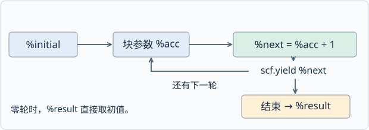

# SCF For：循环状态与结果

前置：[SSA](../../core/values_ssa)、[CF](../cf)、[SCF 概览](./)。本文完整展开顺序 for 的结构、范围、状态传递、多结果、边界与 CFG 对照；并行循环和循环优化算法另列。

版本：LLVM 20.1.8。示例使用小范围整数，确保索引计算可表示。阅读中的执行表是语义推演，解析与 lowering 的验证范围见文末。

## 1. SCF 保留了哪些信息

SCF 是 Structured Control Flow。`scf.for` 在 IR 中直接表达“这是一个循环”，其下界、上界、步长和循环体都是可访问的组成部分。

对比 `arith.addi`：加法规定把两个输入计算成一个输出；`scf.for` 则规定如何反复执行内部 Region，并在迭代之间传递值。它的语义涉及一个内部程序，因此语法比加法复杂。

学习这类操作，需要回答三类问题：

1. 它在 IR 中包含什么结构？
2. 每次进入循环体时，参数绑定到哪些值？
3. 循环体结束和整个循环结束时，分别把值交给谁？

## 2. 先看没有累加结果的循环

下面的完整模块把长度为 4 的 buffer 清零：

<!-- mlir-example: for-base-1 -->
```text
module {
  func.func @zero_four(%buffer: memref<4xi32>) {
    %lb = arith.constant 0 : index
    %ub = arith.constant 4 : index
    %step = arith.constant 1 : index
    %zero = arith.constant 0 : i32
    scf.for %i = %lb to %ub step %step {
      memref.store %zero, %buffer[%i] : memref<4xi32>
      scf.yield
    }
    return
  }
}
```

在通常的顺序执行理解下，它对应：

```c
for (int i = 0; i < 4; i += 1) {
  buffer[i] = 0;
}
```

先认识四个量：

| 文本 | 含义 |
|---|---|
| `%lb` | lower bound，下界 |
| `%ub` | upper bound，上界，不包含该值 |
| `%step` | 正步长 |
| `%i` | induction variable，当前迭代的索引，是循环体 Block 参数 |

这里 `%i` 依次接收 0、1、2、3。更新索引和检查上界是 `scf.for` 的语义，循环体里不用自己再写 `%i + 1` 或条件跳转。

循环体末尾的 `scf.yield` 没有 operand，因为这个循环没有需要在迭代间传递的 SSA 累加值。它表示循环体到达终结位置，后续执行由所属 `scf.for` 的规则决定。

无循环携带值时，简洁格式可以省略这个空 yield，由 parser 按操作定义补出。本文显式写出来，方便看清 Block 终结结构。

## 3. 累加值为什么需要单独传递

再看一个 C 风格的累加过程，暂时只考虑不会溢出的输入：

```c
int acc = initial;
for (int i = 0; i < 4; i += 1) {
  acc = acc + 1;
}
return acc;
```

普通变量 `acc` 被反复更新。SSA 要把这些更新之间的数据依赖明确表达出来：第一轮从哪里得到初始值，本轮计算的结果怎样交给下一轮，最后又怎样交给循环外部。

对应的完整 MLIR 模块为：

<!-- mlir-example: for-base-2 -->
```text
module {
  func.func @increment_four_times(%initial: i32) -> i32 {
    %lb = arith.constant 0 : index
    %ub = arith.constant 4 : index
    %step = arith.constant 1 : index
    %one = arith.constant 1 : i32
    %result = scf.for %i = %lb to %ub step %step
        iter_args(%acc = %initial) -> (i32) {
      %next = arith.addi %acc, %one : i32
      scf.yield %next : i32
    }
    return %result : i32
  }
}
```

## 4. 逐项拆开语法

单独看循环头和结束位置，下面是上例中的片段：

```text
%result = scf.for %i = %lb to %ub step %step
    iter_args(%acc = %initial) -> (i32) {
  %next = arith.addi %acc, %one : i32
  scf.yield %next : i32
}
```

| 位置 | 对应的 IR 对象或信息 | 作用 |
|---|---|---|
| `%result` | `scf.for` 的 OpResult | 循环结束后供外部使用的值 |
| `%lb`、`%ub`、`%step` | `scf.for` 的前三个 operand | 控制迭代范围 |
| `%initial` | 额外 operand | 提供循环携带值的初始状态 |
| `%i` | 循环体的第一个 Block Argument | 接收当前迭代索引 |
| `%acc` | 循环体的第二个 Block Argument | 接收当前迭代的累加状态 |
| `-> (i32)` | 循环结果类型 | 声明整个 for 产生 i32 结果 |
| `%next` | 循环体内 addi 的 OpResult | 本轮计算出的新状态 |
| `scf.yield %next` | 循环体 terminator 及其 operand | 把新状态交还循环结构 |

`iter_args(%acc = %initial)` 声明循环体参数 `%acc`，并将 `%initial` 绑定为它在第一轮的值。

这些名字的作用域也不同：`%initial` 定义在循环外，`%i`、`%acc`、`%next` 属于循环体，`%result` 是在循环结束之后使用的外层结果。

## 5. 一次完整执行怎样传值

设 `%initial` 在本次函数调用中是 10：

| 迭代 | `%i` | 进入循环体时 `%acc` | addi 产生 `%next` | yield 后的去向 |
|---|---:|---:|---:|---|
| 第 1 次 | 0 | 10，来自 `%initial` | 11 | 下一次迭代的 `%acc` |
| 第 2 次 | 1 | 11 | 12 | 下一次迭代的 `%acc` |
| 第 3 次 | 2 | 12 | 13 | 下一次迭代的 `%acc` |
| 第 4 次 | 3 | 13 | 14 | 循环结束，成为 `%result` |



沿回到块参数的箭头看，第 1 轮交出的 11 是第 2 轮接收的值。第 4 轮之后，循环将 14 交给外层的 `%result`。

索引更新由 for 自己规定，所以 `scf.yield` 只需要携带累加状态，不需要把下一轮 `%i` 一起传回。

用伪代码表示这个执行协议：

```text
i = lower_bound
state = initial_value
while i < upper_bound:
    本次循环体绑定：%i ← i，%acc ← state
    执行循环体，取得 yield 提供的 new_state
    state = new_state
    i = i + step
for 的外部结果 = state
```

## 6. yield 与父操作的传值约定

SCF 中的 `yield` 是区域终结操作。它如何把值交给后续执行，要由所属的父 Operation 解释。

| 所在结构 | yield 的含义 |
|---|---|
| 带 `iter_args` 的 `scf.for` | 提供下一轮的状态，最后一轮则提供循环结果 |
| 无循环携带值的 `scf.for` | 空 yield，结束本轮循环体 |
| 返回结果的 `scf.if` 分支 | 为这个 if 操作提供被选中分支的结果 |

在这里，yield 结束本轮 body 的执行，将更新后的循环状态交给 for。

`func.return %result` 则按照函数语义把结果交给函数调用方。它出现在循环之后；每次执行 `scf.yield` 不会立即让整个函数返回。

若 for 中嵌套 if，if 分支里的 yield 先为 if 提供结果；循环体自己的 yield 再为 for 提供状态。不同层级的终结操作要分别看其所属结构。

## 7. 隐藏在简洁语法中的 Block 参数

上例的循环对象实际拥有一个 Region，Region 里只有一个 Block：

```text
scf.for Operation
├── operands：%lb、%ub、%step、%initial
├── result：%result: i32
└── 循环体 Region
    └── Block
        ├── arguments：%i: index、%acc: i32
        ├── arith.addi → %next
        └── scf.yield，operand 为 %next
```

同一个 for 的通用打印形式如下，片段省略了输入的定义：

```text
%result = "scf.for"(%lb, %ub, %step, %initial) ({
^bb0(%i: index, %acc: i32):
  %next = "arith.addi"(%acc, %one) : (i32, i32) -> i32
  "scf.yield"(%next) : (i32) -> ()
}) : (index, index, index, i32) -> i32
```

末尾类型列表对应四个 operand；Region 接收两个参数。for 使用上下界和步长控制迭代，把当前索引与当前累加值传给 body。

这也解释了为什么循环在运行时不断产生不同的 `%acc` 内容，却仍符合 SSA：静态 IR 中只有一个 `%acc` Block Argument 定义，每次执行循环体时由循环协议进行绑定。

## 8. 必须理解的边界与约束

### 零次迭代

对于这里的正步长 index 循环，如果起始时下界已经不小于上界，循环体执行零次。没有 yield 实际执行，for 的结果直接取初始值。

在上例中把 `%ub` 的常量改为 0，结果应为 `%initial`；不能把它理解为“没有结果”或未初始化。

### 数量和类型要对应

对于携带状态的 for，下列部分要逐项对应：

```text
初始值的数量与类型
  ↔ iter_args 中循环体状态参数的数量与类型
  ↔ scf.yield 的 operand 数量与类型
  ↔ scf.for 的结果数量与类型
```

例如初始状态是 i32，不能 yield 一个 i64，然后希望编译器自动转换。如果有多个携带状态，各项按位置对应。

### 步长和范围

本例的下界、上界和步长都使用 index，上界为排他边界，步长要求为正。动态步长需要由调用约定或运行时检查保证有效。

该版本也允许 signless integer 的 IV/边界/步长，在简洁语法中以 `: i32` 等标明。范围比较采用有符号语义；不要从较新网页直接搬入当前版本未提供的语法。IV 类型必须与三个控制 operand 一致，携带状态则可使用其他合法类型。

在索引计算可表示且不溢出的前提下，lb < ub 时迭代次数为 `ceil((ub-lb)/step)`，否则为 0。将这个数学公式实现为固定位宽运算时，还需要处理减法、加法可能发生的溢出。

携带值的静态类型在迭代间不变；若类型含动态维，运行时具体尺寸未必因此固定。尺寸不变需要另外的操作契约或分析依据。

### 循环外用哪个值

循环外使用 `%result`。`%acc` 和 `%next` 属于循环体的作用域，不能直接拿到外面引用。

## 9. 多个携带值按位置共同传递

完整模块同时维护和与次数。它们的更新表达式读取本轮旧参数，再一次性由 yield 传给下一轮：

<!-- mlir-example: for-multiple -->
```text
module {
  func.func @sum_and_count(%n: index) -> (index, index) {
    %zero = arith.constant 0 : index
    %one = arith.constant 1 : index
    %r:2 = scf.for %i = %zero to %n step %one
        iter_args(%sum = %zero, %count = %zero) -> (index, index) {
      %sum_next = arith.addi %sum, %i : index
      %count_next = arith.addi %count, %one : index
      scf.yield %sum_next, %count_next : index, index
    }
    return %r#0, %r#1 : index, index
  }
}
```

对于 n=4，四轮累加 0、1、2、3，结果为 `(6, 4)`；对于 n=0，结果为 `(0, 0)`。适用前提是输入和中间索引/累加均可表示。交换两个 yield operand 会交换下一轮绑定的状态；即使类型仍相同、verifier 通过，算法也可能已经改变。

与普通可变赋值不同，不能把 `yield %count_next, %sum_next` 理解成只更改输出展示顺序：它同时改变回边数据流。

## 10. 显式检查零轮与类型错误

完整零轮模块：

<!-- mlir-example: for-zero -->
```text
module {
  func.func @zero_iterations(%initial: i32) -> i32 {
    %zero = arith.constant 0 : index
    %step = arith.constant 1 : index
    %one = arith.constant 1 : i32
    %r = scf.for %i = %zero to %zero step %step
        iter_args(%acc = %initial) -> (i32) {
      %next = arith.addi %acc, %one : i32
      scf.yield %next : i32
    }
    return %r : i32
  }
}
```

这个循环的 body 虽然包含 addi，但迭代次数为零。canonicalization 因此可以将它化简为直接返回 initial。

下面故意 yield 一个 index，而循环状态/结果要求 i32：

<!-- mlir-invalid: for-yield-type | different type -->
```text
module {
  func.func @bad_yield(%initial: i32) -> i32 {
    %zero = arith.constant 0 : index
    %one = arith.constant 1 : index
    %r = scf.for %i = %zero to %one step %one
        iter_args(%acc = %initial) -> (i32) {
      scf.yield %i : index
    }
    return %r : i32
  }
}
```

这里 yield 提供 index，而父 for 要求另一种类型。检查错误时，需要对照 init、body 参数、yield 和 result，修复整条传值链上的类型关系。

## 11. Lower 到 CF 后，熟悉的跳转在哪里

理解 for/yield 后，可以用同一个程序的显式 CFG 表示进行对照。下面是本地 LLVM 20.1.8 对前面的累加模块运行 `--convert-scf-to-cf` 得到的结果，保留工具产生的名字：

<!-- mlir-example: for-base-3 -->
```text
module {
  func.func @increment_four_times(%arg0: i32) -> i32 {
    %c0 = arith.constant 0 : index
    %c4 = arith.constant 4 : index
    %c1 = arith.constant 1 : index
    %c1_i32 = arith.constant 1 : i32
    cf.br ^bb1(%c0, %arg0 : index, i32)
  ^bb1(%0: index, %1: i32):
    %2 = arith.cmpi slt, %0, %c4 : index
    cf.cond_br %2, ^bb2, ^bb3
  ^bb2:
    %3 = arith.addi %1, %c1_i32 : i32
    %4 = arith.addi %0, %c1 : index
    cf.br ^bb1(%4, %3 : index, i32)
  ^bb3:
    return %1 : i32
  }
}
```

对应关系为：

| SCF 中的组成 | CF 中的表示 |
|---|---|
| 第一次进入循环 | 入口 `cf.br` 传入下界与初始状态 |
| `%i`、`%acc` | `^bb1` 的两个 Block 参数 `%0`、`%1` |
| 范围判断 | `arith.cmpi` 和 `cf.cond_br` |
| 循环体计算 | `^bb2` 内第一个 addi |
| 索引更新 | `^bb2` 内第二个 addi |
| `scf.yield` 的状态传递 | 回到 `^bb1` 的分支携带新状态 |
| for 结束后的结果使用 | 退出 Block 中直接使用合适的 SSA 值 |

这些 Block 处于同一个函数体 Region 中。SCF 将循环信息封装在一个 Operation 及其内部 Region 中，CF 则把判断与回边显式表达出来。

`scf.for` 定义重复进入 body 的执行规则，因此同一个静态 Block 可以在运行时执行多轮。

## 12. 阅读这类操作的固定方法

以后遇到一个不熟悉的结构化操作，按下面顺序阅读定义：

1. 操作的 operand 和 result 分别是什么？
2. 有几个 Region，每个 Region 允许几个 Block？
3. 入口 Block 参数在哪里声明，进入时如何赋值？
4. 由什么操作终结内部区域，传出什么？
5. 父 Operation 如何解释传出值：继续迭代、退出还是形成结果？
6. 零次执行、类型不匹配、空分支等边界怎样处理？

用“初始值 → 本轮参数 → yield → 下一轮参数或最终结果”可以追踪整个循环。下一篇继续看 [scf.while](./while) 如何分别表达循环条件与状态更新。

## 源码与验证依据

- [LLVM 20.1.8 SCFOps.td](https://github.com/llvm/llvm-project/blob/llvmorg-20.1.8/mlir/include/mlir/Dialect/SCF/IR/SCFOps.td)：ForOp、IfOp、YieldOp 的语义和结构约束。
- [SCF.cpp](https://github.com/llvm/llvm-project/blob/llvmorg-20.1.8/mlir/lib/Dialect/SCF/IR/SCF.cpp)：parser、printer、verifier 和 folding 的实现入口。
- [SCF 非法输入测试](https://github.com/llvm/llvm-project/blob/llvmorg-20.1.8/mlir/test/Dialect/SCF/invalid.mlir)：Region、参数、结果数量与类型错误。
- [SCFToControlFlow.cpp](https://github.com/llvm/llvm-project/blob/llvmorg-20.1.8/mlir/lib/Conversion/SCFToControlFlow/SCFToControlFlow.cpp)：需要解释 lowering 实现时再阅读。

完整合法模块参与解析、verifier、通用打印往返；包含 SCF 的完整模块还进行 SCF-to-CF 检查。零轮例子检查 canonicalization 的结构结果，错误 yield 检查预期诊断。运行表依据语义推演，未报告机器码执行或性能测试。

理解检查还应包括：多状态交换 yield 后为何可能类型合法却语义不同；为什么 step=0 不能当作普通无限 for；为什么无结果的 for 仍可能有内存效果。

下一章：[SCF While：两区域循环协议](./while)。
