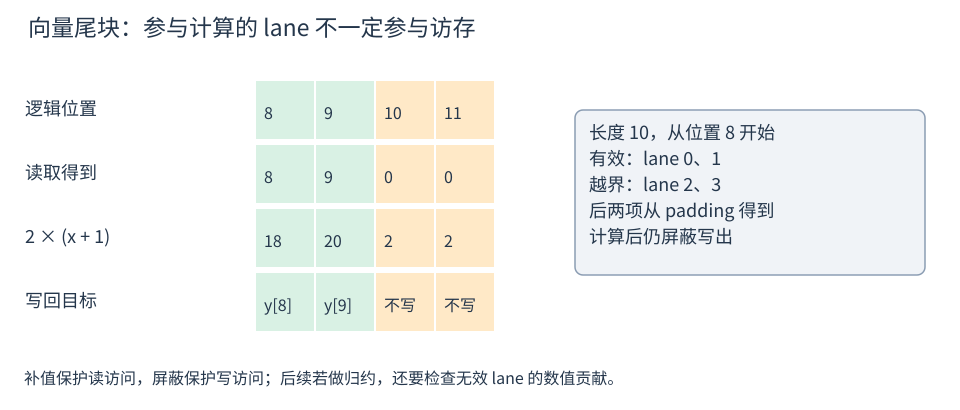

# Transfer、Mask 与边界

上一节读取的 `2×4` 小块刚好全部有效。实际计算通常没有这么整齐：如果输入长度为 10，每次处理四个元素，最后一组从位置 8 开始，只有两个元素可读写。

本章继续计算 `y[i] = 2 × (x[i] + 1)`。目标是让局部计算仍使用四元素向量，同时保证只读写程序允许的位置。读入时的补值和写出时的屏蔽共同完成这件事。

## 1. 有效区间与尾块

设 `x = [0,1,2,3,4,5,6,7,8,9]`，输入输出长度相同且不重叠。处理范围为：

| 起点 | 逻辑位置 | 有效元素数 |
|---|---|---|
| 0 | 0、1、2、3 | 4 |
| 4 | 4、5、6、7 | 4 |
| 8 | 8、9、10、11 | 2 |

位置 10、11 不属于这两个缓冲区。不能因为希望“一次算四个”，就认为访问它们也合法。解决方式可以是最后两个用标量处理，也可以保留向量宽度、只让其中两条 lane 参与内存访问。

## 2. Transfer 的补值与条件写入

下面使用第二种方式。片段外已有 `%c0=0`、`%c4=4`、标量 `%zero=0.0`，以及向量 `%ones=[1,1,1,1]`、`%twos=[2,2,2,2]`。

```text
%n = memref.dim %x, %c0 : memref<?xf32>
scf.for %i = %c0 to %n step %c4 {
  %v = vector.transfer_read %x[%i], %zero
    : memref<?xf32>, vector<4xf32>
  %a = arith.addf %v, %ones : vector<4xf32>
  %b = arith.mulf %a, %twos : vector<4xf32>
  vector.transfer_write %b, %y[%i]
    : vector<4xf32>, memref<?xf32>
}
```

省略 `in_bounds` 时，transfer 需要处理可能越界的向量部分，lowering 再选择检查或屏蔽方式。最后一次可推演为：

```text
读取： [8, 9, 0, 0]     末两项来自 padding，并未读取 x[10:12]
加一： [9,10, 1, 1]
乘二： [18,20,2, 2]
写入： y[8]=18，y[9]=20；末两项不写入
```

无效 lane 在局部计算后也可以得到 `2`。写回时屏蔽这些 lane，就能避免越界访问。

但若下一步要对四项求和，这两个 `2` 就会影响答案。padding 必须和后续算法一起考虑：加法归约常用零，最大值归约常用负无穷；如果 padding 又经历了变换，可能要在归约前重新屏蔽。不能把“内存安全”当成“数值一定正确”。



最后一组仍有四个向量元素，但只有前两项来自有效地址。padding 经计算可以变成非零数；只要对应写入仍被屏蔽，就不会访问输出的越界位置。若再做归约，则还需排除无效 lane 的贡献。

## 3. 显式 Mask

也可以把参与访问的位置写成布尔向量。在起点 `%i` 处，剩余数为 `n-i`：

```text
%left = arith.subi %n, %i : index
%mask = vector.create_mask %left : vector<4xi1>
```

`create_mask` 将前 `min(max(left,0),4)` 项设为 true：`left=10` 得到四个 true，`left=2` 得到两个 true 和两个 false，结果宽度始终为 4。

用它进行显式受控访问：

```text
%v = vector.maskedload %x[%i], %mask, %zeros
  : memref<?xf32>, vector<4xi1>, vector<4xf32> into vector<4xf32>
// 对 %v 做前面相同的两次逐元素计算，得到 %b。
vector.maskedstore %y[%i], %mask, %b
  : memref<?xf32>, vector<4xi1>, vector<4xf32>
```

这里 `%zeros` 是整条向量，给未读取的位置提供 pass-through 值。**maskedload/store 不会替你证明 mask 正确。** 所有置 true 的 lane 都必须对应合法地址；把最后一块的 mask 写成全 true，会重新引入越界访问。

`vector.mask` 用 Region 包住支持 MaskableOpInterface 的操作，将有效 lane 集合传给它，例如 transfer 或归约。自动向量化篇会展示这种形式的生成过程。

## 4. `in_bounds` 与维度映射

若已证明整个小块在界内，可以设置 `in_bounds = [true]`。lowering 随后利用这个条件，省去该维度的额外边界处理。

如果已用正确 mask 排除了所有无效 lane，生成的 transfer 也可能标记 `in_bounds=true`。此时保证针对实际参与访问的部分；不能删掉 mask 后继续沿用同一保证。

二维缓冲区还要分清哪些维度参与向量化。假设从矩阵某一行读取四个相邻列：

```text
%v = vector.transfer_read %a[%row, %col], %zero
  {permutation_map = affine_map<(i,j) -> (j)>}
  : memref<?x?xf32>, vector<4xf32>
```

映射让向量位置沿列 `j` 变化，并固定 `row`。padding 处理向量化列的尾部；固定行的有效性需要在访问前保证。

若映射改为 `(i,j)->(i)`，lane 就沿行变化，来源地址的步长也随之改变。这种访问关系会影响 lowering 选择连续 load、标量 gather 或目标专用操作。

## 5. 完整块与标量余块

另一条合法实现把 `end = n - n % 4` 作为分界：

```text
[0, end)     每次四项，vector.load → addf → mulf → vector.store
[end, n)     每次一项，memref.load → addf → mulf → memref.store
```

`n=10` 时 `end=8`，前八项使用完整向量访问，剩余两项使用标量访问。`n=0` 两个循环都不执行；`n=3` 只有第二段执行。

本教程在 `vector.load/store` 路径中保证所有访问在界内，避免依赖目标对越界向量访问的特殊支持。它适合比较完整块和尾块的成本。transfer 路径则更直接保留了高层边界语义，方便编译器继续选择实现。

这两种实现没有脱离同一个计算契约；区别在于边界检查放在哪里、如何落实到目标指令。哪一种更快，要看目标能否高效实现掩码，以及边界判断能否移到主循环之外。

## 6. 阅读检查与衔接

1. padding 为零，经过“加一、乘二”后无效 lane 为什么不再是零？这对写回与归约的影响有什么不同？
2. 二维 transfer 的列尾部允许补值，是否意味着 `%row` 也可以越界？
3. 把 `%left` 错写为常量 1，会发生越界，还是漏算？怎样用长度 4 的输入看出它？

下一篇讨论[归约、收缩与目标形态](./reduction_contract)。实际把 Linalg 变成 mask/transfer 的过程见[向量化](../../compiler/optimization/vectorization)。

契约见 LLVM 20.1.8 的 [VectorOps.td](https://github.com/llvm/llvm-project/blob/llvmorg-20.1.8/mlir/include/mlir/Dialect/Vector/IR/VectorOps.td)。[配套实验](https://github.com/jnfkdsn/aicompiler/tree/main/llvm-mlir/15-vector-transform)展示不同长度下的尾块计算与写回，可用 0、1、3、4、10 等长度观察边界行为。
