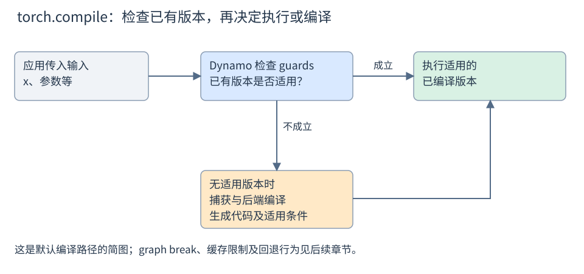

# 从 PyTorch 函数到编译执行

考虑图像网络里常见的一段计算：输入特征乘权重，加上偏置，再经过 ReLU。用 PyTorch 写出来只需要一行：

```python
def model(x, weight, bias):
    return torch.relu(x @ weight + bias)
```

这行代码已经可以执行。加入 `torch.compile` 的目的，是让编译器看到一段相互连接的计算，据此选择更合适的执行方式：哪些操作一起处理，哪些使用已有库，哪些生成新代码，以及中间数据怎样保存。

本章跟踪这个函数的一次编译和两次调用：第一次需要准备实现，后续输入满足条件时可以复用它。整个过程可以先看成：

```text
第一次调用：取得计算图 → 准备实现 → 检查/准备数据 → 调用实现 → 返回结果
后续调用：检查已有实现是否适用 → 适用时直接调用 → 返回新输入的结果
```

下面先算清模型的中间值，再对照实际生成物，观察哪些工作交给已有矩阵库、哪些由编译器生成代码，以及结果空间由谁准备。最后回到第二次调用，说明为什么已经完成的编译工作可以复用。后续章节分别展开这些步骤。

## 1. 模型语义与中间张量

令输入、权重和偏置为：

```text
x = [[ 1, -2,  3],     weight = [[1,  0],     bias = [0.5, -0.5]
     [ 0,  1, -1]]               [2, -1],
                                 [1,  2]]
```

`x` 的每行是一份三维特征，权重将三维映射到二维。矩阵乘法的每个输出元素为：

```text
m[i,j] = sum(k = 0..2, x[i,k] * weight[k,j])
```

随后 bias 沿每行广播，ReLU 把负数置为零。可以手工推导出三个阶段：

```text
matmul          add bias           relu
[[0,  8],       [[0.5,  7.5],      [[0.5, 7.5],
 [1, -3]]        [1.5, -3.5]]       [1.5, 0.0]]
```

这三份矩阵表示计算中间值。实际程序可以分别保存它们，也可以算出一个元素后直接继续做下一项运算。编译器需要保持结果正确，再决定分配几块内存、调用几个计算函数。

例如，加偏置不需要先复制成一个 2×2 矩阵。计算第 `i` 行第 `j` 列时读取 `bias[j]` 即可。广播语义允许实现共享同一份小向量。



图把一次输入请求放到已有编译版本之前。guards 判断当前输入和执行环境是否仍满足版本的假设；只有需要准备新版本时才进入捕获与后端编译。它概括的是本章的默认路径，图中没有把“数据值变了”等同于“一定重新编译”。

## 2. Eager 执行与跨操作优化

普通 eager 执行沿 Python 表达式推进：先调用矩阵乘法，再调用加法，最后调用 ReLU。Python 组织这些调用，各操作内部由已有的数值实现完成计算。

eager 中，矩阵乘法接口描述当前调用，bias 和 ReLU 的后续关系保存在外层 Python 执行逻辑中。图捕获则把这些调用关系一起交给编译器。

编译器希望提前得到下面这段关系：

```text
x ──────────┐
weight ─────┴→ matmul → add → relu → output
bias ──────────────────↑
```

箭头表示张量值的生产和使用。拿到整段关系以后，它才有机会把 `matmul + add` 换成一个带 bias 的矩阵乘法，或者让加法和激活在同一个循环中执行。

实现选择需要比较完整成本：已有矩阵库可能计算更快，专用融合内核则可能减少中间访存和启动。编译器根据接口支持与实际代价权衡两者。

编译前后的区别也可以用一个中间元素说明。矩阵乘法先得到第二行第二列 -3，加 bias 后为 -3.5，ReLU 后为0。模型要求这些计算关系成立，但如果调用者只要最终结果，程序未必需要长期保留 -3 和 -3.5 对应的两份完整矩阵。编译器取得跨操作关系后，才有条件判断哪些旧值可以不保存、哪些已有实现可以承担组合计算。

原来的 PyTorch 矩阵乘法已经在调用底层实现。这里新增的优化机会是检查相邻操作，决定能否一起执行，以及哪些中间结果需要写入内存。

## 3. 图捕获与编译入口

下面把这个函数交给 `torch.compile`，再用同一组输入检查生成程序。

最小使用方式如下。这里的函数和输入都是完整的 Python 例子；安装步骤留在实验说明中。

```python
import torch

def model(x, weight, bias):
    return torch.relu(x @ weight + bias)

x = torch.tensor([[1., -2., 3.], [0., 1., -1.]])
weight = torch.tensor([[1., 0.], [2., -1.], [1., 2.]])
bias = torch.tensor([.5, -.5])

compiled = torch.compile(model, fullgraph=True)
with torch.no_grad():
    y = compiled(x, weight, bias)
```

这段代码有三个不同时间点：

| 动作 | 当前产生什么 | 是否已经得到本次 y |
|---|---|---|
| `compiled = torch.compile(model, ...)` | 包装后的可调用对象 | 否 |
| 第一次 `compiled(x, weight, bias)` 的准备阶段 | 捕获图、编译实现、准备调用入口 | 尚未完成本次数值结果 |
| 调用准备好的数值程序 | 读取实际输入、写出输出 | 是 |

第一次调用准备好程序后，后续输入满足相关条件时，就可以直接调用它。每次仍然要读取新的输入并计算结果。

`torch.compile(model)` 返回一个可调用对象。常见的这条路径在第一次收到输入后才捕获和编译，因为输入的 dtype、设备、形状等会影响生成哪一种程序。

**Dynamo** 在 Python 执行边界分析函数，将可捕获的张量计算整理成 FX 图。图记录操作及其输入输出引用，并可生成对应的 Python `forward` 方法。后端随后利用这张图优化计算、生成目标代码。

对本例，忽略临时变量名后的图可以写成：

```text
输入：x[2,3]、weight[3,2]、bias[2]，均为 float32
m = matmul(x, weight)
a = add(m, bias)
y = relu(a)
返回：y
```

`fullgraph=True` 要求这次捕获不能通过 graph break 拆开函数；本例很小，能够满足。它**不要求整个模型最终只生成一个内核**。捕获完整性和内核融合是不同阶段的问题。

本例选择默认后端 Inductor。后端收到图以及相关输入信息，继续进行图处理、实现选择和代码生成。后续章节会逐步展开，但此时只需保留一条主线：

```text
Python 函数和输入条件
    → 捕获张量计算图
    → 为图选择并生成实现
    → 得到可以调用的执行程序
```

Dynamo 交出的图还可能包含原地修改和共享存储。默认后端会先整理这些行为，再交给 Inductor 生成计算代码；第四章会解释具体做法。后面的形状变化、输入修改和部分 Python 行为，也都会影响已有程序能否继续使用。

## 4. 图中的计算与实际执行程序

调用入口本身没有说明内部采用了什么实现。下面打开生成程序，把它与前面算过的矩阵乘法、偏置和 ReLU 一一对应。

在本系列固定的 PyTorch 2.7.1 CPU 实验中，捕获后的计算图含有 `mm`、`add`、`relu`，最终程序则使用 `addmm` 完成前两项计算，再调用生成的 C++ ReLU 内核。

下面摘出实际生成 wrapper 中与数据流有关的部分，仅把参数名改为正文中的名字，并省略导入和尺寸检查：

```python
buf0 = empty_strided_cpu((2, 2), (2, 1), torch.float32)
extern_kernels.addmm(bias, x, weight, alpha=1, beta=1, out=buf0)
buf1 = buf0  # reuse
cpp_fused_relu_0(buf1)
return (buf1,)
```

先分配 2×2 的输出存储，`addmm` 将 `x @ weight + bias` 写入其中。这一步执行完，里面是：

```text
[[0.5,  7.5],
 [1.5, -3.5]]
```

ReLU 内核接着在同一块存储上更新元素，最终得到：

```text
[[0.5, 7.5],
 [1.5, 0.0]]
```

可以按存储状态逐步核对 wrapper：

| 时刻 | buf0/buf1 指向的空间中有什么 |
|---|---|
| 分配后 | 内容尚未由本次计算定义 |
| addmm 后 | `[0.5,7.5;1.5,-3.5]` |
| `buf1 = buf0` 后 | 仍是同一块空间，没有发生数值复制 |
| ReLU 后 | `[0.5,7.5;1.5,0]` |

ReLU 从这块空间读取数据，再将结果写回。这里通过复用节省了一块输出空间；如果要进一步省去这次读写，还需要把激活计算接到矩阵计算的结果产生处。本例 wrapper 采用的是前一种方案。

为什么可以复用？这个例子里，`addmm` 的未激活结果没有其他消费者，模型也不要求把它作为输出保留。ReLU 将其覆盖后，不会破坏后续需要的值。如果模型同时返回激活前和激活后的结果，编译器必须重新判断存储关系。

实际生成的 C++ 使用 CPU 向量类型完成加载、截断负值和回写。用等价的标量伪代码表达其数值意图，是：

```cpp
for (int p = 0; p < 4; ++p) {
    out[p] = relu_with_pytorch_semantics(out[p]);
}
```

这段伪代码没有展开 NaN 传播和 SIMD 掩码等实现细节；这些不能凭普通 `std::max` 随意替代。这里要观察的是数据位置和读写顺序。

因此，编译结果包含调用、尺寸检查和内存分配代码，也包含生成的计算内核，还可能调用已有的算子实现。本例就用库调用完成矩阵乘法与偏置，再用生成的 C++ 代码执行 ReLU。

本机实际编译执行的结果正是 `[[0.5, 7.5], [1.5, 0.0]]`，与 eager 和前面的手工推导一致。

## 5. 首次调用、条件检查与复用

首次调用可能依次发生图捕获、规范化、代码生成、C++ 编译、动态库加载，最后才执行数值计算。第二次收到满足已有假设的输入时，可以复用已经准备好的程序。

例如，输入数值改变，但 shape、dtype、stride 等相关条件保持一致，这段矩阵计算通常不需要重新编译。它仍然从新的输入存储中读取数值。

若把 `x` 改成 5×3，原来针对 2×3 生成的检查和实现就不一定适用。系统先检查已有编译结果的条件，满足时复用，不满足时可能另选已有版本、重新捕获编译，或按配置回退。保护这些假设的条件称为 **guards**。

因此性能至少分成两笔账：

```text
总时间 = 编译与准备时间 + 所有调用的执行时间之和
```

本例很小，调用和检查的固定开销可能占很大比例。即使融合减少了计算步骤，也不能直接断言 `compile` 必然快于 eager。实验分别记录首次调用和预热后的调用；本章不使用这个小矩阵给出通用加速比。

## 6. 编译边界与后续学习位置

从这一次执行已经能看到三个不同问题：

- **捕获边界**：哪些 Python 行为能够进入图？不能进入的部分如何执行？
- **实现边界**：图中哪些计算交给库，哪些生成内核，什么信息决定选择？
- **运行边界**：如何检查复用条件、安排存储并调用这些实现？

接下来先在[图捕获](/notes/compile/pytorch-compiler/02_capture)中展开第一个问题，再学习 guards 与动态形状、图规范化、Inductor 表示和代码生成。部署篇解释怎样把编译工作提前完成，训练篇则解释反向图和保存中间值带来的变化。

GPU 路径常见 Triton 代码生成，但当前 CPU 例子的生成内核是 C++。PyTorch Compiler 的默认路径也不要求先经过 torch-mlir；那是另一个有独立输入和 lowering 路径的项目。

## 7. 推演与实践入口

读完后可以尝试解释：

1. 三个图节点为什么对应 addmm 与 ReLU 两个数值调用？若额外返回激活前结果，原地覆盖需要重新检查什么？
2. 相同结构但数值不同的第二次输入，哪些工作可以复用，哪些计算仍需重新执行？
3. 首次调用更慢，为什么不能直接说明稳态也更慢？生成C++、编译C++、执行数值函数分别发生什么？

可选实验见 [PyTorch Compiler labs](https://github.com/jnfkdsn/aicompiler/tree/main/pytorch-compiler)：`overview` 保存中间图、调度表示、生成代码和数值结果。源码依据采用 [PyTorch 2.7.1 的 compile_fx](https://github.com/pytorch/pytorch/blob/v2.7.1/torch/_inductor/compile_fx.py) 与 [Inductor scheduler](https://github.com/pytorch/pytorch/blob/v2.7.1/torch/_inductor/scheduler.py)；捕获入口可对照 [Dynamo 官方说明](https://docs.pytorch.org/docs/2.7/torch.compiler_dynamo_overview.html)。
