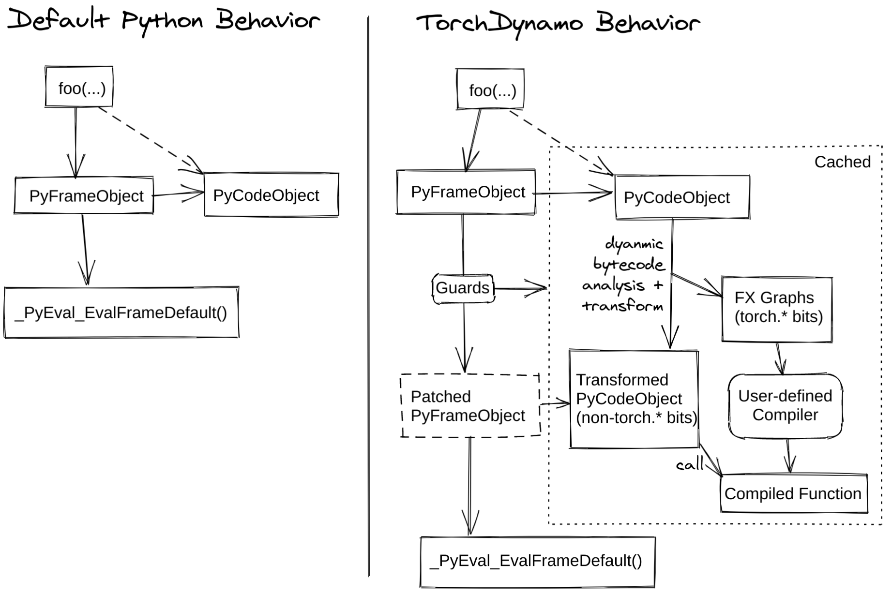

# Dynamo 图捕获与 FX 数据流

第一章看到 `torch.compile` 能为 `relu(x @ weight + bias)` 准备执行方案。但用户交给它的是一个 Python 函数，后端需要的却是能分析操作依赖的图。两者之间还有一步：把函数中实际发生的张量计算整理出来。

对这个模型，捕获结果应当保留下面的关系：

```text
函数输入 x、weight、bias
  → matmul(x, weight)
  → add(矩阵乘法结果, bias)
  → relu(加法结果)
  → 函数输出
```

Dynamo 从 Python 函数中识别张量计算，FX 保存这些操作及其连接，后端接收图并返回一个可以执行它的函数。记录 matmul 节点时，只是在描述之后要做矩阵乘法；真实输入上的乘加要等程序执行时才进行。

先看最简单的连续张量计算怎样成图，再解释为什么节点还需要形状等信息，最后加入 Python 分支，观察哪些逻辑可以留在图中、哪些会成为捕获边界。

## 1. Python 执行顺序与张量数据流

仍然使用同一个函数：

```python
def model(x, weight, bias):
    return torch.relu(x @ weight + bias)
```

若按 Python 求值顺序看，需要取得 `x`、`weight`，执行 `@`，再取得 `bias` 做加法，最后查找并调用 `torch.relu`。其中“查找函数名”和“矩阵相乘”属于不同层次：前者是 Python 程序行为，后者是希望优化的张量计算。

CPython 执行函数时，会维护当前局部变量和执行位置等信息，这组执行状态称为 frame。Dynamo 利用 CPython 提供的 frame evaluation 接口介入函数执行，再分析字节码，跟踪张量操作及相关 Python 行为。

下面的官方图把普通 Python 执行放在左边，把启用 Dynamo 后的处理放在右边。图中的 `PyFrameObject` 表示一次执行的状态，`PyCodeObject` 保存相应代码信息；不必先掌握它们的 C 结构。

<div class="source-figure">



</div>

图源：[PyTorch 2.7 Dynamo Overview](https://docs.pytorch.org/docs/2.7/torch.compiler_dynamo_overview.html#dynamo-overview)。

沿右侧从上往下看：Dynamo 分析字节码，把可捕获的张量计算交给 FX Graphs，再由后端编译器产生 Compiled Function。图中另一条路径生成 Transformed PyCodeObject，它保留并调整周围的 Python 执行逻辑，在适当位置调用这个编译函数。因此整个 Python 程序与交给后端的张量图可以同时存在。

图中的 Guards 与 Cached 表示复用还依赖输入和执行状态满足已有假设，第三章会专门展开。本节先关注 FX 图怎么形成，以及后端返回的函数怎样回到执行过程中。

捕获 `x @ weight + bias` 时，Dynamo 同时维护值对应的图节点，以及形状、类型等元数据。下表按处理任务展示这两类信息如何建立：

| 当前行为 | 图中的变化 | 可推导的信息 |
|---|---|---|
| 取得 x、weight | 建立输入引用 | `[2,3]` 与 `[3,2]` |
| 处理矩阵乘法 | 新建 matmul 节点，参数引用两个输入 | 结果 `[2,2]` |
| 处理加法 | 新建 add 节点，参数引用 matmul 和 bias | 结果仍为 `[2,2]` |
| 处理 ReLU | 新建 relu 节点，引用 add | 结果 shape 不变 |
| 处理返回 | 输出引用 relu | 后端需要交付哪个值 |

处理 add 时，Dynamo 已经有一个代表 matmul 结果的图节点，可以把它记为 add 的输入，无需先算出矩阵中的每个元素。用于跟踪这个结果的代理对象，帮助捕获器同时记录节点与元数据。

当它遇到可识别的张量操作时，会记录一个图节点。遇到常量、对象成员和可推导的 Python 行为时，则可能在捕获期间处理，并把依赖的假设记下来。例如某个模块的 `training` 属性决定一条分支，捕获结果必须受对应条件保护。

捕获得到的是一段计算方法及其适用条件。例如，图中记录“把两个输入做矩阵乘法”，以后传入另一组满足条件的数值，仍能执行这张图。

## 2. FX 节点与 GraphModule

FX 用节点保存操作，用节点间的引用保存输入输出关系。后端可以直接检查这些对象：

本例的图包含三个输入、三个计算节点和一个输出节点。按 FX 的节点类别整理如下：

| 节点 | 类别 | 保存的信息 |
|---|---|---|
| x、weight、bias | `placeholder` | 从外部调用取得的参数 |
| matmul | `call_function` | 调用矩阵乘法，参数引用 x 和 weight |
| add | `call_function` | 调用加法，参数引用 matmul 和 bias |
| relu | `call_function` | 调用激活，参数引用 add |
| output | `output` | 返回 relu 的结果 |

`matmul` 的参数直接引用图节点。后端沿这些引用，可以找到矩阵乘法的使用者，或发现一个中间结果流向多个分支。这与前面学习的 use-def 关系相通。

FX 的 `GraphModule` 把图及其所需模块属性组织在一起，并能生成 Python `forward` 方法。下面是本例捕获结果的整理版，只将临时变量重命名：

```python
def forward(self, x, weight, bias):
    matmul = x @ weight
    add = matmul + bias
    relu = torch.relu(add)
    return (relu,)
```

`forward` 是根据图生成的 Python 方法，可以直接执行这些操作。后端收到的仍是 GraphModule 和其中的图对象，不需要重新解析打印出来的 Python 文本。

本例的后端图把结果放在 tuple 中返回。外层包装代码会取出结果，恢复原函数的返回形式，因此用户调用 `compiled(...)` 仍得到 Tensor。内部函数和用户函数可以有不同的返回形式，但包装代码要负责对应转换。

## 3. 形状信息与没有真实数值的计算

节点连线说明了计算次序，后端还需要形状和类型等条件。不过整理这些条件时，不一定要真正计算输入张量的所有元素。

只知道存在矩阵乘法还不够。后端还需要知道输入秩、维度关系、dtype、设备和 stride 等信息。例如 x 为 `[2,3]`、weight 为 `[3,2]`，便能推出结果为 `[2,2]`；若内积维不匹配，计算本身就不成立。

在捕获和后续追踪中，PyTorch 可以使用携带张量元数据的 **FakeTensor**。它支持推导操作对 shape、stride、dtype 等的影响，而不以运行真实大矩阵为前提。捕获器使用的代理将这类元数据计算与图节点记录联系起来。

对于本例：

```text
Fake x：形状 [2,3]，float32，逻辑设备 CPU
Fake weight：形状 [3,2]，float32
         ↓ 推导 matmul 的元数据
Fake matmul：形状 [2,2]，float32
```

捕获阶段取得计算关系和元数据，元素值在执行时产生。因此，依赖 `x.sum()` 的 Python 分支还需要读取实际数据才能选择路径。

FakeTensor 推导形状、步长、类型和符号关系。依赖实际元素的决定，需要在运行时取得数值，或采用能够表达该行为的图机制。

## 4. Backend 的输入输出契约

图和输入信息准备好以后，Dynamo 把它们交给 backend。按照 [PyTorch 的 backend 接口约定](https://docs.pytorch.org/docs/2.7/torch.compiler_custom_backends.html)，backend 接收 GraphModule 与示例输入，返回与该图行为等价、调用方式兼容的可调用对象。这个约定规定了后端如何交接，没有要求所有后端采用同一种实现方式，也没有要求返回的一定是原图的 `forward`。

本节定义 `inspect_backend` 来观察捕获结果：它打印图，再返回图已有的执行方法。下面用“观察后端”指代这个示例；默认的 Inductor 后端会在取得图后继续优化和编译。

```python
graphs = []

def inspect_backend(gm, example_inputs):
    graphs.append(gm)
    print(gm.code)
    return gm.forward

compiled = torch.compile(model, backend=inspect_backend, fullgraph=True)
y1 = compiled(x, weight, bias)
y2 = compiled(x, weight, bias)
```

这里 `gm` 是捕获的 GraphModule，`example_inputs` 提供后端处理所需的输入信息。GraphModule 已经提供了 `gm.forward`；`inspect_backend` 只是将这个函数对象返回，并没有生成或优化它。返回函数对象与调用函数是两回事：Dynamo 随后通过这个对象执行相应图段，才会计算真实输入上的结果。

调用 `gm.forward` 时，Python 依次调用图中的 PyTorch 操作。默认 Inductor 后端则进一步优化、编译这张图，返回连接计算代码的入口：Python callable 负责组织调用，编译好的 kernel 或已有计算库负责数值计算。

从用户第一次调用开始，这个观察后端的交接可以完整展开：

```text
第一次 compiled(x,w,b)
  Dynamo 构造 gm，并准备适用条件
  调用 inspect_backend(gm, example_inputs)
    打印图，返回 gm.forward
  保存后端返回的 callable
  调用这个 callable，实际计算 y

第二次 compiled(x2,w2,b2)，相关条件仍满足
  复用已有 callable
  callable 读取新的元素并计算 y2
```

这里 backend 是“为图准备执行方式”的函数，它返回的 callable 才负责每次执行图。两个函数可能都是 Python 对象，但调用时机和职责不同。换成 Inductor 时，后端返回的执行入口连接的是编译产物；当前观察后端返回 FX forward，所以仍调用现有 PyTorch 操作。

固定实验中，连续两次输入相同条件的调用只触发一次 `inspect_backend`，两次结果均为：

```text
[[0.5, 7.5], [1.5, 0.0]]
```

这里需要数清两种调用：`inspect_backend` 接收图并准备执行方法，返回的 callable 则在模型每次运行时执行。后面统计 backend 调用次数时，统计的是前一种。

## 5. Python 分支与捕获边界

现在给原模型增加一个根据输入形状选择的分支，看看 Dynamo 怎样记录它：

```python
def shape_branch(x, weight, bias):
    y = x @ weight + bias
    if x.shape[0] > 4:
        return torch.relu(y)
    return y
```

如果本次捕获已知 batch 为 2，便能确定走最后一行。对这份特化实现而言，图里可以不包含通用的 Python `if`，但它不能不加条件地用于 batch 为 5 的调用。对应条件必须进入复用判断。

再把条件改为：

```python
if x.sum() > 0:
    return torch.relu(y)
```

这时，同样的 shape 可以对应不同分支。靠 shape 保护原先选定的分支就不够了。常规捕获可能在这个位置断图，由 Python 决定分支，再继续捕获后面的计算；如果要求 `fullgraph=True`，不支持的捕获会直接报错。需要图内控制流时，应考虑显式控制流操作及其约束，不能认为任意 Python 分支都会自动转成图内条件节点。

若第一次输入 x 的元素和为正，第二次元素和为负，而 shape 完全相同，两个调用应走不同分支。FakeTensor 的元数据相同，无法替代这项实际数值判断。普通 Python 分支和显式图内条件的区别，正在于分支由哪一层决定并执行。

发生断图时，Dynamo 除了生成 FX 图，还会改写调用这些图的 Python 字节码。例如，先调用图1取得 y，再执行保留的 Python 语句，随后把 y 传给图2。图以外的代码仍需要正确继续执行。

这要求 Dynamo 保存需要继续使用的局部值，并安排从哪个位置恢复 Python 执行。具体字节码随解释器版本变化；这里要抓住的是已经算出的 y 怎样传到后面的代码。

分段编译时，图之间的 Python 行为仍需保留。排查未被捕获的代码，可先定位 Dynamo 断图位置；下一章继续区分断图与 guard 失败造成的重编译。

## 6. 有限源码阅读与学习边界

需要进一步读源码时，可以先追踪捕获函数、生成图、调用 backend 的几个入口：

```text
编译入口
  → Dynamo 分析当前 Python frame
  → 构造 FX 图和相关假设
  → 调用 backend(gm, inputs)
  → 保存返回的 callable，并在满足条件时调用它
```

对应实现可从 [eval_frame.py](https://github.com/pytorch/pytorch/blob/v2.7.1/torch/_dynamo/eval_frame.py) 进入，在 [output_graph.py](https://github.com/pytorch/pytorch/blob/v2.7.1/torch/_dynamo/output_graph.py) 查后端编译的交接，再按需要读 [symbolic_convert.py](https://github.com/pytorch/pytorch/blob/v2.7.1/torch/_dynamo/symbolic_convert.py)。当要修改某种 Python 语法的捕获行为时，才继续深入它对应的变量追踪和字节码处理。

阅读这段捕获逻辑时，重点追踪两类去向：计算如何成为图节点，输入假设如何成为保护条件。

## 7. 推演与实践入口

1. inspect_backend 调用一次、模型调用两次时，第二次由哪个 callable 计算结果？这个示例中，数值计算由谁执行？
2. 处理 add 节点时，为什么不需要先算出 matmul 的元素？FakeTensor 能提供什么、不能提供什么？
3. 两次输入 shape 相同但元素和异号，根据 x.sum() 的 Python 分支为什么不能仅靠 shape 选择同一条路径？

[配套实验](https://github.com/jnfkdsn/aicompiler/tree/main/pytorch-compiler)的 `capture` 观察后端入口和复用；`shapes` 展开下一章的条件变化。元数据机制可核对 [FakeTensor 官方说明](https://docs.pytorch.org/docs/2.7/torch.compiler_fake_tensor.html)，FX 结构可核对 [FX 文档](https://docs.pytorch.org/docs/2.7/fx.html)。

## 图片来源与许可

- **Dynamo 总览图**：来自 [PyTorch 2.7 文档](https://docs.pytorch.org/docs/2.7/torch.compiler_dynamo_overview.html#dynamo-overview)，版权声明与使用条件见 [PyTorch 2.7.1 项目许可](/licenses/pytorch-2.7.1.txt)。原图未修改。
