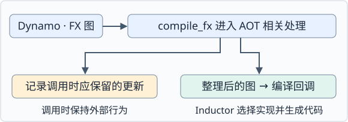

# AOT 编译交接、函数式化与算子分解

在本系列 PyTorch 2.7.1 的 Inductor 路径中，Dynamo 把 FX 图交给后端入口 `compile_fx`。在 Inductor 决定循环和存储之前，AOT 相关处理要先弄清这次调用对外有什么效果。调用者之后既能看到返回值，也能继续读取传入的张量，以及与它共享存储的视图。



设输入 `x = [-2, 0, 3]`。函数先执行 `x.add_(1)`，再返回 `x * 2`。调用结束时，返回值应为 `[-2, 2, 8]`，调用者手中的 x 也应变成 `[-1, 1, 4]`。如果把加法改为产生一个新值，并直接用新值算乘法，返回值可以完全正确，但调用者手里的 x 还缺一次更新。

这就是函数式化和调用边界需要一起解释的原因。图内可以把读写关系写成显式的值依赖，同时还要安排写回，才能让调用者观察到约定的修改。另一个动作是算子分解，把一个复杂操作表示成后端支持的基础运算。下面从只修改局部副本的情形讲起，再考察共享存储的视图、输入写回，以及这两类整理在编译流程中的位置。

## 1. 原地修改中的隐藏数据依赖

先从只修改局部副本的例子开始，分清“计算新值”和“修改共享存储”之间的差别，再回到开头的输入更新。

考虑给特征加 1，再做 ReLU：

```python
def local_update(x):
    y = x.clone()
    y.add_(1)
    return y.relu()
```

输入为 `[-2,0,3]` 时，输出应为 `[0,1,4]`，外部传进来的 x 保持不变。

`clone` 先复制 x 的数据得到 y，`add_` 随后直接修改 y 的数据，ReLU 必须读取修改后的 y。编译器如果只记录操作的返回值，而忽略谁修改了原有存储，就可能把读取安排到错误的时间。

这个关系在加入别名以后更明显：

```python
y = x.clone()
view = y.view(-1)
y.add_(1)
return view
```

`view` 虽然在 `add_` 之前创建，返回时也应观察到加 1 的结果。若编译器只追“变量 view 是在哪一行创建的”，却没有处理它与 y 的存储关系，就可能返回旧值。

把第二个例子的存储状态实际展开，能看见变量创建顺序不足以解释结果：

| 步骤 | y 的内容 | view 读到的内容 |
|---|---|---|
| clone 后 | `[-2,0,3]` | 尚未创建 |
| view 创建后 | `[-2,0,3]` | `[-2,0,3]` |
| y.add_(1) 后 | `[-1,1,4]` | `[-1,1,4]` |

`view` 与 y 指向同一底层存储。假设把 `add_` 改成产生新张量的 `add`，却仍让 `view` 指向旧数据，函数就会错误地返回 `[-2,0,3]`。所以改写时还要更新后续读取，让它们继续看到加 1 后的内容。

下一步要把“y 的数据已经被修改”明确写进图中的输入输出关系，让后端直接看到 ReLU 需要读取哪个值。

## 2. Functionalization 与显式值变化

对于第一个局部更新例子，可以把原地更新改写为返回新值的计算：

```text
原来：y = clone(x); mutate_add(y, 1); result = relu(y)
改写：y0 = clone(x); y1 = add(y0, 1); result = relu(y1)
```

改写后，`y0` 表示加法前的值，`y1` 表示加法后的值，ReLU 明确以 `y1` 为输入。这种用新值表达更新、同时调整后续读取的改写称为 **函数式化（functionalization）**。

配套实验用 `make_fx` 观察独立的 `torch.func.functionalize`。原图核心是：

```python
clone = torch.ops.aten.clone.default(x)
add_ = torch.ops.aten.add_.Tensor(clone, 1)
relu = torch.ops.aten.relu.default(add_)
```

处理后的核心变为：

```python
clone = torch.ops.aten.clone.default(x)
add = torch.ops.aten.add.Tensor(clone, 1)
relu = torch.ops.aten.relu.default(add)
```

原来 ReLU 依赖的是被 `add_` 修改过的数据；改写后，它直接读取 `add` 返回的新值。运行这个例子仍得到 `[0,1,4]`。

图用 `y0`、`y1` 区分更新前后的值，便于分析依赖。若旧值后续已无用途，存储优化仍可以让新值复用原 buffer。

刚才修改的是函数内部的副本。如果函数直接修改输入 x，调用结束后，外面的代码也应该读到更新后的 x。下面看这项要求怎样保留。

## 3. 输入修改与调用边界补偿

如果去掉 clone，情况就不同了：

```python
def input_update(x):
    x.add_(1)
    return x * 2
```

调用者既能看到返回值，也能在调用后读取被修改的 x。若只生成一个不修改输入的新张量，虽然返回结果相同，程序整体语义仍然改变了。

独立 functionalization 观察中的核心处理是：

```python
updated = torch.ops.aten.add.Tensor(x, 1)
result = torch.ops.aten.mul.Tensor(updated, 2)
torch.ops.aten.copy_.default(x, updated)
return result
```

代入输入 `x=[-2,0,3]`：updated 是 `[-1,1,4]`，返回值是 `[-2,2,8]`，调用结束后的原输入也必须变成 `[-1,1,4]`。

`updated` 保存加 1 后的新值，乘法读取它计算返回结果。最后的 `copy_` 再把 `updated` 写回原输入 x，让调用者随后读取 x 时也能看到更新。本例同时比较返回结果和调用后的 x。

实际 AOT 编译可能把这项写回放到图中，也可能交给包装编译结果的代码，即 wrapper。若由 wrapper 写回，编译图就需要把更新后的输入一并交给它。wrapper 要能区分用户要的结果、用于更新输入的值，以及哪些输出应当与输入共享存储。

因此，这里的 `copy_` 不能随意删除：删除后，返回结果虽然相同，调用者再次读取 x 却会得到旧数据。优化其他 copy 时，也要先检查它写入的内容是否还会被读取。

## 4. 算子分解与后端语义集合

函数式化解决了怎样表达原地更新的问题。另一个问题是算子种类太多：后端如果为每种复合函数和调用形式都实现一套代码生成逻辑，就会重复处理许多相同计算。

可以将某些复合算子展开成一组已有基础操作，这称为 **decomposition**。例如，Softmax 的一种数值稳定写法是：

```text
m = max_j(x[j])
e[j] = exp(x[j] - m)
y[j] = e[j] / sum_k(e[k])
```

展开后，后端看到的是求最大值、减法、指数、求和与除法，可以使用已有的归约和逐元素实现。各步之间的数据依赖也明确了：先得到最大值才能减它，得到完整行和才能做最后的除法。

以 `[1000,1001,999]` 为例，先减最大值后得到 `[-1,0,-2]`，指数约为 `[0.3679,1,0.1353]`，行和约为 1.5032，输出约为 `[0.2447,0.6652,0.0900]`。

这里的分解只生成更具体的计算图，尚未决定是否保存整行指数。后续可以融合或重算部分结果，但必须保留“分母是完整行和”等语义关系。

分解需要保持数值语义。例如直接 `exp(x)/sum(exp(x))` 在 `[1000,1001,999]` 上可能溢出，应采用稳定公式；低精度输入还要选择中间计算与累加类型。

后端也可以保留已有专用实现支持的高层算子。分解表据此选择哪些操作展开、哪些交给后续识别或库调用。

## 5. Dynamo 后端入口与 AOT 分派

前面使用独立的 `torch.func.functionalize` 展示了更新前后的变化。放到实际 `torch.compile` 调用中，是哪些代码安排这项工作、再把图交给 Inductor？

在本系列使用的 PyTorch 2.7.1 中，主要调用关系如下：

```text
Dynamo：FX GraphModule + 示例输入/元数据
    ↓ 调用Inductor后端入口 compile_fx
AOT相关处理：分析mutation/alias、整理图与调用协议
    ├─ 推理：将推理图交给配置的编译回调
    └─ 需要autograd：组织前向/反向图、保存值和编译回调
    ↓
Inductor核心：lowering → 调度 → 生成实现
    ↓
包装编译结果，恢复用户调用约定
```

`compile_fx` 接收 Dynamo 交来的图。它先配置推理、前向和反向图各自使用的编译回调，再调用 AOT 相关代码分析输入修改与别名。`aot_autograd.py` 根据是否需要梯度等条件，选择 `aot_dispatch_base` 或 `aot_dispatch_autograd` 等处理路径，随后调用相应的后端编译回调。

这里的 AOT 表示在执行相应图之前先完成图的准备和编译；这项工作可以发生在第一次 `torch.compile` 调用中。即使只做推理，也仍可能需要保留输入修改和别名行为。第七章的 Export/AOTInductor 则讨论提前编译并交付部署产物。

独立示例展示了需要保留的行为。实际 AOT 可以在图与 wrapper 之间采用不同分工，只要调用后的输入、结果和共享存储关系符合原程序。

## 6. 规范化、图优化与实现选择

函数式化和分解处理完以后，后端还要继续决定怎样优化和执行这些计算。

这几种变换经常相邻出现，但解决的问题不同。沿着主例可以区分：

```text
用户写法：x @ weight + bias，再 ReLU
    ↓ 整理调用和语义
ATen 图：mm → add → relu
    ↓ 合适的图变换与实现选择
可能采用：addmm 库调用 → 生成的 ReLU
```

将不同表面写法整理到一致的操作语义，帮助后端少处理重复情况；把 `mm + add` 合成 `addmm` 则利用了两项计算间的关系。最后选择库调用还是生成代码，又取决于具体目标和实现代价。

这些变换还会相互影响。例如，展开一个复合算子以后，新的逐元素操作可能与相邻计算融合；选择了某个库函数以后，又可能需要将输入转换成这个库要求的布局。检查一次变换时，要看它实际新增、删除或改写了哪些操作。

## 7. 规范化的收益与代价

函数式化让后端能够直接看到修改前后的值及其使用者；分解让后端用已有操作完成更多计算。代价是图中可能多出中间值和写回操作，原来的高层算子也可能不再容易识别。接下来的 Inductor 要决定这些值是否需要保存、哪些计算可以融合，以及哪些存储可以复用。

例如，本章最后写回 x 的效果必须保留，但 `updated` 是否需要独立存储，仍可根据它的使用者和别名判断。Softmax 的指数值也可以先保存再读取，或者在需要时重新计算；两种方案都必须使用正确的整行最大值与行和。

调查这类改写时，先比较 Dynamo 的图与 AOT 交给后端的图，再检查 wrapper 怎样处理返回值。看到 `copy_`，就沿着它的目标找后续读取。本章输入更新的例子说明：只测试函数返回值，会漏掉调用后 x 的内容是否正确。

## 8. 推演与实践入口

1. view 在 add_ 之前创建，为什么仍要看到更新值？仅将 add_ 改名为 add、保持旧引用是否足够？
2. 输入 [-2,0,3] 先原地加1再乘2，为什么同时比较返回值和调用后的输入才能验证转换？
3. 推理为何也可能经过AOT相关处理？分解和函数式化让后端更容易处理什么，又将哪些选择留给Inductor？

实验见 [labs 的 normalize](https://github.com/jnfkdsn/aicompiler/tree/main/pytorch-compiler)。语义契约见 [functionalize 契约与实现](https://github.com/pytorch/pytorch/blob/v2.7.1/torch/_functorch/eager_transforms.py)；编译交接见 [compile_fx](https://github.com/pytorch/pytorch/blob/v2.7.1/torch/_inductor/compile_fx.py) 和 [AOT runtime wrappers](https://github.com/pytorch/pytorch/blob/v2.7.1/torch/_functorch/_aot_autograd/runtime_wrappers.py)。独立实验用于解释机制，不声称覆盖所有 view、mutation 和别名组合。
