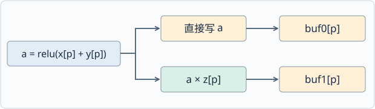

# Inductor 的表达式、存储与 Scheduler 融合

上一章给后端准备了一份语义清楚的图。接下来需要决定这份图怎样读写元素：例如先算 `a = relu(x + y)`，再算 `r = a * z`，是否一定要先把完整的 a 写入内存，再读回来？

若只返回 r，计算一个位置时就可以连续完成加法、ReLU 和乘法，最后只写 r。若同时返回 a 和 r，两个结果都必须保存，但同一轮计算得到的 a 仍可直接参与乘法。这两种情况把本章的问题分成了两步：

```text
张量操作 → 每个输出位置对应的读取和计算表达式
        → 决定哪些值需要成为 buffer
        → 根据读写依赖组织共同执行的计算
```

下面先看 Inductor 怎样描述“一个输出元素从哪里读取数据、做什么计算”，再用单输出和双输出两种函数观察中间值是否需要保存。最后检查 scheduler 怎样将已经分别表示的计算放到一起执行。

阅读内部 IR 时，可以始终跟踪同一个问题：a 在哪里计算，是否写入内存，乘法怎样取得它？

## 1. 从张量运算到元素计算

先假设矩阵乘法已产生 `M[B,N]`，需要继续计算：

```text
Y[i,j] = relu(M[i,j] + bias[j])
```

从图看，是 add 和 relu 两个节点。从输出元素看，只需完成一次加载 M、一次加载 bias、一次加法和一次激活。计算 `(i,j)` 时，其他位置的结果与它独立。

下面的伪代码描述一个输出位置的计算。这里先用连续数组说明索引，具体布局在第三节展开：

```python
def output_element(i, j):
    m = load(M, i * N + j)
    b = load(bias, j)
    return relu(m + b)
```

编译期间，索引函数描述每个元素将怎样计算。生成器据此构造循环体，目标程序运行时才会读取 M 和 bias。

代入主例 `M=[[0,8],[1,-3]]`、`bias=[0.5,-0.5]`：位置 `(1,1)` 读取 M 中偏移为 3 的元素与 bias 中偏移为 1 的元素，得到 -3 和 -0.5，最后计算 `ReLU(-3.5)=0`。

循环范围为 `0≤i<B, 0≤j<N`。计算函数描述一个位置做什么，范围描述要生成哪些位置。两者结合，就能形成 CPU 循环或 GPU 并行程序。

这样写以后，加法结果可以直接用于 ReLU。生成程序可以读入 M 和 bias，算完加法与 ReLU，再写输出，无需先把完整的加法结果保存成一个数组。

## 2. 广播如何进入索引

形状 `[N]` 的 bias 参与每一行，索引映射让各行读取同一组元素：

| 输出位置 | M 的元素 | bias 的元素 |
|---|---|---|
| `(0,0)` | `M[0,0]` | `bias[0]` |
| `(0,1)` | `M[0,1]` | `bias[1]` |
| `(1,0)` | `M[1,0]` | `bias[0]` |

如果把二维循环展平成 `p∈[0,BN)`，连续 M 的偏移是 p，bias 的偏移则是 `p % N`。在 N 固定时，索引可进一步简化；N 为符号时，仍可保留相应整数表达式。

后端生成读取 bias 的代码时，需要保留“各行读取同一列 bias”的关系。这个关系也会影响能否合并读取或生成向量操作。

## 3. 逻辑位置与物理布局

已经知道输出 `(i,j)` 需要 `M[i,j]`，还要知道这个元素实际存在哪里。相同形状的数组可以有不同的步长。

刚才 `i*N+j` 假定 M 连续存储。更一般的地址关系是：

```text
offset(i,j) = storage_offset + i * stride[0] + j * stride[1]
```

`stride[0]`、`stride[1]` 都以元素为单位：沿对应维度移动一个位置，要在存储中移动多少个元素。shape 给出各维的长度，stride 则决定怎样找到这些元素。

配套实验使用同样的 x 数值构造两种 `[5,7]` 张量：

```python
contiguous_x = x
strided_x = x.t().contiguous().t()
```

两者 shape 和元素值相同，stride 分别为 `[7,1]` 与 `[1,5]`。例如逻辑位置 `(1,2)`，前者的相对偏移为 9，后者为 11。

后端按 stride 生成正确索引，或先转换布局再调用有特定要求的实现。这里两种布局经 Inductor 编译后，都与 eager 的结果一致。

布局也影响代价：内层循环访问相邻地址时，更容易形成向量化和合并访问；跨较大步长读取时，可能需要不同循环顺序、复制或专用实现。布局选择因此与算子实现、融合和存储规划相互影响。

## 4. 延迟计算与 Realization

知道怎样读取输入之后，还要决定中间值 a 是否需要保存。先看 Inductor 怎样保留计算表达式，暂时不要求它对应一份独立结果 buffer。

如果看到加法就要求生成一份结果数组，后面的 ReLU 就需要重新读取它。Inductor 可以先保存“怎样计算加法结果”的表达式，让 ReLU 直接使用这个表达式。这里的 pointwise 指每个输出元素可以单独计算的逐元素操作。

例如：

```text
add 的结果：表达式 M(i,j) + bias(j)
relu 的结果：表达式 relu(M(i,j) + bias(j))
```

进一步把两个元素计算函数连起来，表达式融合的意图是：

```text
原来：add_element(i,j) = load(M,i,j) + load(bias,j)
      relu_element(i,j) = relu(add_element(i,j))

代入以后：relu_element(i,j) = relu(load(M,i,j) + load(bias,j))
```

relu 直接使用加法表达式，生成代码时便可先求和、再做激活，省去保存完整加法结果的中间数组。

上面是直接组合表达式、暂不建立中间结果 buffer 的情况。若后续处理需要把某项计算的结果作为一个有名字的 buffer 来使用，Inductor 就为它创建相应的 IR 对象。这一步称为 **realization**，通常译为“物化”。

例如，后续库函数要求接收一个已有张量，或者一个昂贵的中间结果会被多次读取，就可能需要先把结果保存下来。是否物化，要看谁使用这个值、怎样使用，以及重复计算和保存结果各自的成本。

在这个版本中，`Pointwise` 描述逐元素计算，`Reduction` 描述归约。`TensorBox` 表示逻辑张量，它通过 `StorageBox` 关联计算或存储对象。这里需要关注的变化是：`StorageBox.realize()` 可以将原来保存的计算描述变成一个 `ComputedBuffer`。

`ComputedBuffer` 记录结果名称、布局和计算方法，并登记到当前编译图中。后续调度器因此可以分析谁读取它、谁写入它，以及能否与其他计算一起执行。

这些 IR 对象在编译时创建，描述未来的计算与存储。后续优化继续决定融合和复用方案，生成程序运行时才执行实际的分配与写入。

假设两个后续操作都要用同一个行和。各自展开求和表达式，就可能把整行加两遍；先算出行和并保存，则只需算一遍，但增加了结果的写入和读取。物化时需要权衡的就是这些具体工作。

## 5. 一个逐元素链为何已经只有一个节点

下面先看只返回乘法结果的情况。为了单独观察逐元素计算，暂时去掉前例中的矩阵乘法：

```python
def elementwise(x, y, z):
    return torch.relu(x + y) * z
```

本机对长度33的连续float32向量编译，实际 `ir_pre_fusion.txt` 中就只有一个 `SchedulerNode(ComputedBuffer)`，循环体整理为：

```text
p = 当前输出索引
value = relu(load(x,p) + load(y,p)) * load(z,p)
store(buf0,p,value)
```

到 scheduler 接收这份程序时，加法、ReLU 和乘法已经组合成一个元素表达式，只有最终结果建立了 buffer。因此 `ir_pre_fusion.txt` 中已经是一个节点；这个例子没有发生“scheduler 把三个独立节点合成一个”的过程。

这样可以少建立中间结果 buffer，scheduler 也只需处理组合后的节点。下一节让函数同时返回 a，观察结果需要对外保留时有什么变化。

## 6. 从两份 ComputedBuffer 到一个融合组

现在让调用者同时取得 a 和乘法结果：

```python
def observable(x, y, z):
    a = torch.relu(x + y)
    return a, a * z
```

a 现在也要返回给调用者，需要保留它的结果。本例在 scheduler 融合前有两个节点，下面摘录主要的读取、写入和使用者：

```text
op0: SchedulerNode(ComputedBuffer)
  reads:  x[p], y[p]
  writes: buf0[p] = relu(x[p]+y[p])
  users:  op1, OUTPUT

op1: SchedulerNode(ComputedBuffer)
  reads:  buf0[p], z[p]
  writes: buf1[p] = buf0[p]*z[p]
  users:  OUTPUT
```

`op0` 在位置 p 计算 `buf0[p]`，`op1` 在同一位置读取它并乘以 `z[p]`。两个节点都遍历 33 个元素，因此可以逐位置先算 a，再用 a 做乘法。

调度器用 `MemoryDep` 记录每项访问的 buffer、索引和迭代范围。判断这两个节点能否融合时，还会检查设备、循环方式和依赖关系。`can_fuse` 及对应后端的检查用于筛掉不允许的组合，评分和配置则进一步影响选择。

实际 `ir_post_fusion.txt` 出现：

```text
op0_op1: FusedSchedulerNode(SchedulerNode, SchedulerNode)
  reads: x[p], y[p], z[p]
  writes: buf0[p], buf1[p]
```

注意两个输出buffer都保留了。生成代码却可以在同一次遍历中完成：

```text
a = relu(x[p] + y[p])
store(buf0,p,a)
store(buf1,p,a*z[p])
```

a 要写入 `buf0` 供调用者使用，但乘法可以直接使用刚算出的局部值，省去一次从 `buf0` 读取 a 的操作。两个输出 buffer 仍然保留，因为调用者同时需要 a 和乘法结果；后一个结果不能覆盖前一个结果。



从乘法回溯它的左输入，会直接回到刚算出的 a。这解释了为什么仍要写 `buf0[p]`，乘法却可以省下一次从它读回的操作。

如果第二个节点改为读取其他位置的 a，就要重新检查计算顺序是否满足依赖。即使融合后结果正确，也还要考虑是否增加了寄存器使用、重复计算或同步。本例观察的是固定 CPU 配置下的选择，没有对每个候选做计时搜索。

TVM 在图层按计算模式和使用路径分组；Inductor scheduler 此时已有具体 buffer 读写、索引和循环范围，可以利用这些信息判断融合。

## 7. 外部实现与内部计算共存

再回到矩阵乘法模型。若某项计算交给已有库函数，scheduler 就无法像刚才那样直接修改它内部的表达式。

回到第一章的实际 CPU 结果，Inductor 选择了 `addmm` 库调用，所以 bias 加法已经包含在库实现中。此时内部 pointwise 表示只需处理 ReLU。

实际调度前输出的关键部分为：

```text
op0: ExternKernelSchedulerNode
  kernel = extern_kernels.addmm
  output = buf0, size=[2,2], stride=[2,1]

op1: SchedulerNode(ComputedBuffer)
  read  = buf0[p], 0 <= p < 4
  value = relu(read)
  write = buf1[p]
```

上面整理自实际调度 IR：`op0` 调用库函数产生 `buf0`，`op1` 读取它计算 ReLU。调度器必须保证 `op0` 完成后，`op1` 才读取对应结果。

“Extern” 表示经已有调用接口执行计算。实际使用的库由 PyTorch 构建、dtype、设备和形状等条件共同决定。

`addmm` 已经计算矩阵乘法和偏置，但它是否能顺便计算 ReLU，取决于所选库接口。有些接口支持在矩阵乘法末尾附加激活，称为 epilogue；如果当前接口没有这项能力，就要单独执行 ReLU，或选择另一种矩阵乘法实现。

## 8. 归约维度与并行约束

另一个需要重新考虑融合的例子是 Softmax：一个位置的结果依赖整行的最大值与总和。

逐元素计算中，一个输出位置独立于其他位置。Softmax 则不同：

```text
m[i] = max_k(x[i,k])
y[i,j] = exp(x[i,j] - m[i]) / sum_k(exp(x[i,k] - m[i]))
```

输出维度里有行 i 和列 j，而 max/sum 还需要遍历整行的归约维 k。生成代码时不能让每个位置只读自己就完成结果。

因此后端要同时表达输出范围与归约范围，并决定归约怎样分块、由哪些执行单元协作、是否需要中间存储。归约与 pointwise 的融合可以减少搬运，但可能引入重复计算、寄存器压力或同步成本。

例如同一行有三列，如果每一列都重新计算整行的 max 和 sum，就会重复做三遍归约。也可以先算好行最大值与行和，让三列共同使用；这需要保存这些统计量，并在后续读取之前完成计算。后端要比较这些方案的计算量、存储与同步成本。

这也是为什么 Inductor 需要比 FX 更接近循环和索引的表示：仅仅知道“存在一个 softmax 节点”，不足以比较这些实现方式。

## 9. 推演与实践入口

1. 三个FX逐元素操作在ir_pre_fusion里只有一个节点，为什么不能直接说是scheduler把三者融合了？
2. observable变体融合后为什么还要两个输出buffer？减少了一次读取与删除一个输出存储有什么不同？
3. MemoryDep中的索引和范围怎样帮助判断候选？若消费者改读相邻位置，为什么需要重新检查？

实验见 [labs 的 inductor](https://github.com/jnfkdsn/aicompiler/tree/main/pytorch-compiler)。有限源码范围为 [lowering.py](https://github.com/pytorch/pytorch/blob/v2.7.1/torch/_inductor/lowering.py) 中具体操作的转换、[ir.py](https://github.com/pytorch/pytorch/blob/v2.7.1/torch/_inductor/ir.py) 的计算与存储表示，以及 [graph.py](https://github.com/pytorch/pytorch/blob/v2.7.1/torch/_inductor/graph.py) 向 scheduler 的交接。

逐元素两种变体的实际记录来自 [design_probe](https://github.com/jnfkdsn/aicompiler/blob/main/pytorch-compiler/design_probe.py)。调度入口可查 [scheduler.py](https://github.com/pytorch/pytorch/blob/v2.7.1/torch/_inductor/scheduler.py) 的 fuse_nodes_once、can_fuse 与后端交接。第六章继续追同一输出到目标代码、wrapper与执行，并实现一次有限FX改写。
