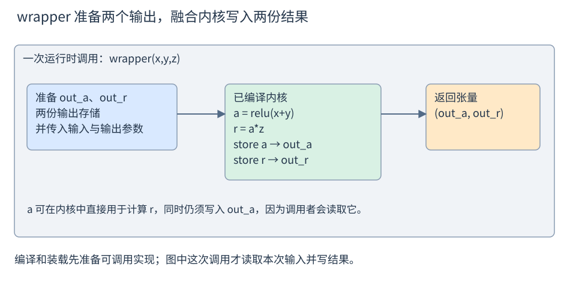

# 目标代码、执行包装与编译器修改

第五章将两个计算节点放入一个融合组。现在要把这个决定变成用户真正能调用的程序。沿用双输出例子：先算 `a = relu(x + y)`，再算 `r = a * z`，同时返回 a 和 r。

调用者需要拿到 a 和 r 两个张量，内核则需要知道从哪里读输入、向哪里写输出。wrapper 是围绕内核调用生成的包装代码：它准备输出、传递参数，再返回两个张量。下面用伪代码表示：

```text
wrapper(x, y, z)：
    准备 out_a 和 out_r
    调用已编译内核(x, y, z, out_a, out_r)
    返回 out_a、out_r

内核：
    遍历元素，计算 a 与 r
    分别写入两个输出
```

本章先说明代码怎样编译、装载并被 wrapper 调用，再打开 CPU 内核，检查融合以后省掉了哪次读取。接着对照各阶段的 IR 定位问题，并在后端入口加入一条自己的 FX 改写。

最后再看 GPU、库调用和归约怎样改变实现。它们采用不同的计算代码，但调用时都需要准备参数并取得结果。

## 1. 编译、装载与调用

本例的三个输入都是长度为 33、连续存储的 float32 向量。wrapper 为 a 和 r 各分配一个输出，把这两个输出连同三个输入一起传给内核。内核写好数据后，wrapper 再返回两个张量。

本例生成的 `output_code.py` 使用 `async_compile.cpp_pybinding` 提交 C++ 代码进行编译。编译结果准备好后，wrapper 才能调用它：

```text
生成C++源和接口描述
    ↓ 本机C++编译、链接；缓存命中时可复用产物
得到并装载可调用实现
    ↓
wrapper(x,y,z)：
    检查必要的shape/stride约定
    分配out_a和out_result
    调用内核(x,y,z,out_a,out_result)
    返回两个Tensor
```

编译把生成的 C++ 源码变成目标代码；装载让当前进程取得可以调用的函数；调用这个函数时，才读取本次输入的 33 个元素并写入结果。以后输入仍满足条件，就可以复用已经编译和装载的函数。

本例 wrapper 分配两个长度 33 的输出。只返回最终结果时，可省去另一输出分配；其他场景若旧值已不再使用，还可依据别名和使用关系复用存储。



外框表示一次运行时 wrapper 调用。内核内部可以把刚算出的 a 直接用于 r，省掉从输出再读一次的需求；但 a、r 都要返回，所以两份输出写入仍然存在。编译内核和执行这次调用属于不同时间段。

## 2. CPU 内核中的向量计算与输出写入

wrapper 已经说明输入输出怎样传递。接下来打开它调用的内核，核实第五章的融合决定在真实读写上产生了什么变化。

仍然计算：

```python
def observable(x, y, z):
    a = torch.relu(x + y)
    return a, a * z
```

第五章已经把两个 scheduler 节点合成一组。C++ 生成器据此生成一段循环，同时写出两个结果。下面摘录实际生成代码中的完整向量段，为便于阅读调整了参数名和临时变量名：

```cpp
auto vx = at::vec::Vectorized<float>::loadu(x + p, 16);
auto vy = at::vec::Vectorized<float>::loadu(y + p, 16);
auto vz = at::vec::Vectorized<float>::loadu(z + p, 16);
auto sum = vx + vy;
auto a = at::vec::clamp_min(sum, decltype(sum)(0));
auto result = a * vz;
a.store(out_a + p);
result.store(out_result + p);
```

本次生成代码按 16 个元素一组推进：p=0、16 处理完整段，p=32 用有效长度 1 完成加载和存储。分组宽度会随目标和实现选择变化。

`a` 同时用于两处：写入 `out_a`，以及与 `vz` 相乘。乘法直接使用当前向量值，没有重新从 `out_a` 加载。两个结果仍分别写入各自的输出数组，这就是本例融合后的实际读写变化。

## 3. 一条可操作的诊断链

假设原本希望两个计算共用一次遍历，生成代码却仍有两段独立循环。可以检查 scheduler 前后的 IR，确认它是否尝试并完成了融合，再检查代码生成结果。

不同文件保存了不同阶段的结果，检查时可以按下表寻找最早与预期不符的位置：

| 证据 | 重点检查 |
|---|---|
| Dynamo交给backend的FX图 | 捕获了什么，是否断图，参数与返回协议 |
| AOT交给后端的ATen图 | mutation、分解、保存值和别名契约 |
| ir_pre_fusion.txt | 哪些表达式已经组合，哪些结果被物化 |
| ir_post_fusion.txt | scheduler实际合了哪些节点，保留哪些输出 |
| output_code.py及目标代码 | 实际调用、索引、分配和中间读写 |
| 数值与计时 | 是否保持行为，时间消耗在哪个边界 |

debug 文件可能包含 `fx_graph_runnable.py`。阅读时先确认图来自 Dynamo 还是 AOT 后，再将文件内容对应到编译阶段，具体名称随版本和配置变化。

本例在 `ir_pre_fusion.txt` 中有两个节点，在 `ir_post_fusion.txt` 中有一个融合组，最终仍分配两个输出。这与函数要求一致。若两个输出错误地覆盖了彼此，就检查存储复用；若两个节点没有融合，则检查 scheduler 为什么拒绝了这个组合。

计时时也要区分首次调用和后续调用：首次调用可能包含捕获和编译，后续主要执行已有程序。例如，总耗时若有 90% 在 `addmm`，即使完全消除了剩余 ReLU 的开销，也最多减少约 10% 的总耗时。GPU 还需要考虑异步执行。内核数量、内存分配数量和运行时间应分别检查。

## 4. 在 Backend 中加入并验证 FX 改写

接下来让后端先改写收到的 FX 图：删除 `torch.relu(torch.relu(x))` 的外层 ReLU，再把图交给 Inductor 继续编译。这个推理示例只匹配显式的 `torch.relu` 调用，其他方法名和 ATen 重载暂不处理。

先考虑反例：

```python
def shared(x):
    a = torch.relu(x)
    return a, torch.relu(a)
```

两项结果的数值相同，但源程序返回两个分别产生的Tensor。若直接返回 `(a,a)`，调用者修改第一项就会改变第二项。数值比较可能发现不了这个错误。因此本规则保守地要求inner只有外层ReLU一个使用者，拒绝上述共享情况。

完整的有限改写函数如下：

```python
def remove_repeated_relu(gm):
    changed = 0
    for node in list(gm.graph.nodes):
        if node.op != "call_function" or node.target is not torch.relu or node.kwargs:
            continue
        if len(node.args) != 1:
            continue
        inner = node.args[0]
        if not isinstance(inner, torch.fx.Node):
            continue
        if (inner.op != "call_function" or inner.target is not torch.relu
                or inner.kwargs or len(inner.args) != 1 or len(inner.users) != 1):
            continue
        node.replace_all_uses_with(inner)
        gm.graph.erase_node(node)
        changed += 1
    gm.graph.lint()
    gm.recompile()
    return changed
```

循环中的 `node` 是外层 ReLU，`inner` 是内层 ReLU。`replace_all_uses_with(inner)` 让原来使用外层结果的位置改用内层结果，随后 `erase_node(node)` 删除外层节点。第一次 ReLU 仍然保留。

最后，`lint()` 检查图的结构，`recompile()` 根据修改后的图更新 GraphModule 的 Python 函数。它们还没有生成 CPU 机器码，也不能代替运行前后结果的比较。

把这项修改接入真实Inductor：

```python
from torch._inductor.compile_fx import compile_fx

def backend(gm, example_inputs):
    remove_repeated_relu(gm)
    return compile_fx(gm, example_inputs)

compiled = torch.compile(repeated, backend=backend, fullgraph=True)
```

这里 `repeated` 的函数体是 `return torch.relu(torch.relu(x))`，只返回最终结果。Dynamo 调用 `backend` 时，先执行我们的改写，再由 `compile_fx` 完成第四章的 AOT 处理和后端编译，将生成的可调用对象返回。示例使用 2.7.1 的内部接口 `compile_fx`，其他版本需要核对对应实现。

### 4.1 修改的验证与边界

实际CPU参考验证三个函数：重复ReLU改写一次；共享inner的双输出函数不改写；`relu(-x)`不改写。每个函数用混合正负、全负、全正三组输入与eager比较。双输出还在返回后修改第一项，确认第二项没有被连带修改。

验证时还保存了 backend 收到的图和改写后的图，用来确认重复 ReLU 确实被删除。如果规则完全没有执行，数值也可能正确，所以必须同时看图。现有验证限于这些推理用例，尚未覆盖训练、全部特殊浮点值、Tensor 子类和其他原地行为，也没有测量相对于 Inductor 原有优化的加速。

自己修改时，可以增加一种明确的匹配形式，再准备一个应该匹配的例子和一个应当拒绝的例子。需要读源码时，先追这次修改实际经过的函数，例如 `backend → compile_fx`；要调查融合失败，再转向 scheduler 的 `can_fuse` 检查。

## 5. 其他目标与计算结构的实现

前面的程序在 CPU 上执行逐元素计算。接下来换成 GPU，或者换成库调用与归约，观察参数仍怎样传递、计算代码又需要怎样调整。

### 5.1 GPU 路径与 Triton 的职责

同一逐元素计算在 GPU 上需要划分工作、屏蔽越界访问并安排设备调用。下面用手写 Triton 核心展示连续 float32、有限值输入下的计算结构；实际 Inductor 输出可用相应 GPU 环境中的生成代码对照。

```python
import triton
import triton.language as tl

@triton.jit
def pointwise(X, Y, Z, OUT_A, OUT_R, N: tl.constexpr,
              BLOCK: tl.constexpr):
    p = tl.program_id(0) * BLOCK + tl.arange(0, BLOCK)
    valid = p < N
    x = tl.load(X + p, valid, other=0.0)
    y = tl.load(Y + p, valid, other=0.0)
    z = tl.load(Z + p, valid, other=0.0)
    a = tl.maximum(x + y, 0.0)
    tl.store(OUT_A + p, a, valid)
    tl.store(OUT_R + p, a * z, valid)
```

`N=33`、`BLOCK=32` 时，两个 program 分别处理位置 0..31 与 32..63，第二个 program 只有位置 32 有效。这里的 program 是 Triton 分配的一组工作；其中各元素怎样交给 warp 和 lane，还要由 Triton 编译器处理。`valid` 必须用于加载和存储，才能防止越界访问。

实际 Inductor 生成的 Triton 程序还包含配置和编译元信息。Inductor 负责选择计算实现、组织融合并生成 Triton 代码，Triton 再将它编译成设备代码，运行时通过相应设备接口和 stream 启动执行。模型中的其他计算也可以继续调用已有库函数。

本系列使用 PyTorch 2.7.1+cpu，以上 Triton 代码用于说明计算分工，没有在 GPU 上执行。章末提供的 GPU 观察程序可在合适的 CUDA 环境中编译真实变体、保存代码并比较结果。

### 5.2 库调用与归约的实现边界

主模型 `relu(x @ weight + bias)` 的CPU结果采用addmm外部调用和独立ReLU内核。外部实现已经有自己的内部循环，scheduler不能像组合两个Pointwise表达式一样任意把ReLU塞进去。可以利用库的epilogue能力，或选择另一个整体实现，但需要相应实现与选择策略。

Softmax则在内部产生归约依赖。此前固定 `[2,3]` CPU观察中，虽然函数名为 `cpp_fused__softmax_0`，wrapper仍准备temporary与output两块矩阵。整理后的计算为：

```text
循环组一：求行最大值，将exp(x-row_max)写到temporary
循环组二：读取本行temporary求和，将归一化结果写到output
```

小归约被展开成元素表达式，函数融合没有消除全部临时存储。对于更大归约，还要比较分块、共享统计量、重算及资源压力。一个函数里有几个循环、读写哪些buffer，比名称更能说明优化效果。

逐元素例子可以在得到 a 后立即计算乘法；Softmax 必须先得到整行统计量；调用库函数则要使用它提供的接口。后端需要根据这些具体限制选择循环和存储方式。

## 6. 推演与后续阅读

1. 双输出变体为什么融合成一组后仍要两块输出存储？C++中的局部a省掉了哪次读取？
2. 为什么图里有三个逐元素操作，不一定意味着scheduler融合前三个节点？如何通过三份输出区分？
3. 删除重复ReLU为何检查inner的使用者？lint、数值比较和调用后修改输出分别保护什么？

到这里，一段推理计算已经从图变成可以调用的代码，我们也加入并检查了一条小改写。下一章讨论怎样提前编译并交付模型，第八章讨论训练中的前向和反向；可以根据接下来的任务选择阅读。

[CPU参考与改写](https://github.com/jnfkdsn/aicompiler/blob/main/pytorch-compiler/design_probe.py)保存实际图、调度表示和代码。[GPU观察入口](https://github.com/jnfkdsn/aicompiler/blob/main/pytorch-compiler/gpu_probe.py)用于适用设备环境；核心源码为 [C++ codegen](https://github.com/pytorch/pytorch/blob/v2.7.1/torch/_inductor/codegen/cpp.py)、[Triton codegen](https://github.com/pytorch/pytorch/blob/v2.7.1/torch/_inductor/codegen/triton.py)、[wrapper](https://github.com/pytorch/pytorch/blob/v2.7.1/torch/_inductor/codegen/wrapper.py) 和 [compile_fx](https://github.com/pytorch/pytorch/blob/v2.7.1/torch/_inductor/compile_fx.py)。
