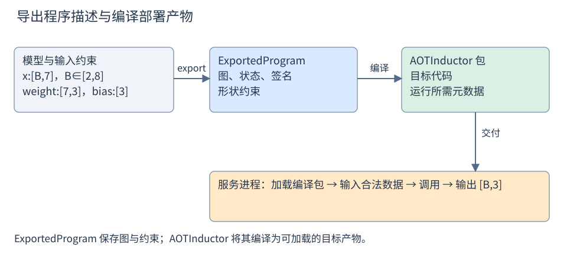

# Export 契约与 AOTInductor 部署

前六章已经能让模型在当前应用中编译并运行。现在换一个交付目标：服务进程启动时加载事先准备好的产物，收到请求后直接计算，不再从原 Python 模型重新开始捕获和构建。

继续使用 `relu(x @ weight + bias)`。假设服务承诺接受 batch 在 2 到 8 之间、其他维度和类型符合约定的输入，那么要交付的就不仅是一个示例输入的计算结果，而是一段在这个范围内有效的程序：

```text
模型 + 可接受输入范围
  → 导出程序与约束
  → 为目标环境编译、打包
  → 服务加载产物，传入满足约束的数据并取得结果
```

本章先说明导出究竟保存什么、输入约束为何会让某些模型导出失败，再把导出结果交给 AOTInductor，观察编译包怎样被加载使用。我们会区分“保存了一份程序描述”和“已经生成了目标实现”，即使它们碰巧使用相同文件后缀。

这条部署路径提前声明程序的适用输入范围，再生成产物。下面用动态范围和分支，比较它与 JIT 按请求特化的区别。

## 1. 从一次调用到可交付的程序

JIT 可以在收到新输入后决定是否再编译一个版本。现在希望服务直接使用事先编译的程序，就要预先说明输入可以怎样变化、权重怎样传入，以及程序将在什么环境里运行。

例如，本例约定：

```text
x:      [B,7]，float32
weight: [7,3]，float32
bias:   [3]，float32
B 的允许范围：2 到 8
输出：  [B,3]
```

本例只承诺处理上面约定的输入。B=5 是允许的变化；把内积维改成 8 或把输入改成整数，则超出了准备这份程序时的条件。服务收到这类请求时，不能直接假定已有实现仍然适用。

把范围写清以后，“支持动态 batch”就有了具体含义：batch 可以在声明范围内变化，内积维仍为 7，输出维仍为 3。后端可以利用这些固定维度生成代码，同时让 batch 保持为符号量。

## 2. ExportedProgram 保存什么

下面将模型和输入范围交给 `torch.export`，查看导出对象保存了什么：

```python
class AffineRelu(torch.nn.Module):
    def forward(self, x, weight, bias):
        return torch.relu(x @ weight + bias)

batch = torch.export.Dim("batch", min=2, max=8)
example = (torch.randn(2, 7), torch.randn(7, 3), torch.randn(3))
ep = torch.export.export(
    AffineRelu(), example,
    dynamic_shapes=({0: batch}, None, None),
)
```

`dynamic_shapes` 的第一项将 x 的第 0 维声明为 batch 符号，后两项保持静态。导出结果同时保存计算图、输入输出签名、状态和形状约束，供后续编译与调用使用。

本例实际导出的图核心为：

```python
matmul = torch.ops.aten.matmul.default(x, weight)
add = torch.ops.aten.add.Tensor(matmul, bias)
relu = torch.ops.aten.relu.default(add)
return (relu,)
```

本例打印出的范围约束是 `{s0: VR[2, 8]}`，表示输入 batch 对应的符号 `s0` 在 2 到 8 之间。符号名称可以不同，编译器需要保留的是它对应哪个输入维度，以及允许哪些值。

本例故意将 weight 和 bias 作为显式输入。如果模型把它们注册为参数，导出签名还要区分参数、buffer 和用户输入，并保存相应状态。看到图里多个 placeholder 时，应结合签名判断角色，不能都当成外部 API 的位置参数。

## 3. 导出约束与失败诊断

假如模型在不同 batch 下执行不同操作，就要检查导出的图是否适用于整个声明范围。

导出希望得到能够完整表达目标计算的程序，不能像一般 `torch.compile` 那样依靠任意 graph break 返回 Python 继续执行。

例如模型写成下面的逻辑：

```text
z = x @ weight + bias
若 batch > 4：返回 relu(z)
否则：返回 z
```

用 B=2 捕获时，当前路径直接返回 z；但声明的范围2到8还包含 B=5，此时必须返回 relu(z)。如果 z 中有负数，两条路径的结果不同。仅仅把输出行数写成符号 B，不能修复遗漏的激活分支。

导出需要证明程序适用于声明的整个范围。若 batch=2 和其他输入走不同分支，就需要表达这些路径或报告范围约束冲突。

如果只需要 B≤4，可以缩小允许范围；如果需要两侧的行为，就要使用导出支持的控制流写法，或者调整模型。这类错误可能是在指出“当前图只适用于部分输入”，而不只是某个参数写错了。

配套实验把 ExportedProgram 保存后重新加载，使用 batch 2、5、8 执行，并与 eager 比较。随后把 batch 改为 9，`loaded.module()` 的输入约束检查拒绝该调用。

这里是 `loaded.module()` 的调用包装拒绝了 B=9。直接调用更低层的函数时，是否也有相同检查，要另外确认；部署服务应通过有明确检查行为的入口接收输入。

## 4. AOTInductor 的编译产物

导出程序已经保存了计算图与输入约束，但还需要生成目标代码。下一步把它交给 AOTInductor 编译，再加载生成的包：

```python
package = torch._inductor.aoti_compile_and_package(
    ep, package_path="compiled.pt2"
)
loaded_model = torch._inductor.aoti_load_package(package)
y = loaded_model(*example)
```

这是本系列固定 PyTorch 2.7.1 实际验证的接口。下划线命名空间中的 API 需要按目标版本确认，理解主线时不必记忆所有参数。

AOTInductor 生成内核以及传参、分配输出等包装代码，再编译和打包。加载这个包以后，就可以调用已经准备好的实现，无需重新让 Dynamo 分析原来的 Python 函数。

在本机 CPU 验证中，编译包成功生成和加载，batch 2、5、8 均与 eager 一致。GPU 产物的设备架构、运行库和代码兼容性需要另行验证，不能由 CPU 结果代替。



从左到右依次建立输入约定、程序描述和目标实现，服务进程再加载并调用产物。部署后的输入继续遵守导出时保留的形状范围。

## 5. 两种保存结果的区别

现在手里既有导出程序，也有编译包。它们都能保存到文件，但保留的内容与加载后的职责不同。

本实验同时产生两个 `.pt2` 文件，但它们的角色不同：

| 产物 | 生成方式 | 下一步消费者 |
|---|---|---|
| `exported.pt2` | `torch.export.save` | 恢复 ExportedProgram，检查、变换或继续编译 |
| `compiled.pt2` | AOTInductor 编译与打包 | 加载目标实现并调用 |

保存 ExportedProgram，保存的是计算图、参数状态和输入约束；重新加载后，还可以检查和修改图。保存 AOT 编译包，则保留针对目标环境生成的实现及其包装代码，加载它需要相容的运行时和依赖库。

新进程可以直接加载 AOT 编译包，但每次请求仍要传入参数、准备存储、调用计算函数并返回结果。提前完成的是捕获和编译工作，运行时的这些动作仍然存在。

因此，虽然两个文件都以 `.pt2` 结尾，仍要根据保存时使用的 API 选择加载方法：一个恢复导出程序，另一个加载编译好的实现。

部署时，先将导出图编译为适合目标环境的产物，再确认设备、系统架构、运行时和依赖库相容，最后用预期输入范围检查数值与调用行为。

本例已经用 Python 加载并执行编译包。若要接入 C++ 服务，可以继续研究 AOTI loader/runtime；这部分服务代码尚未包含在本例中。

## 6. 训练 AOT 与部署 AOT

前文的 AOTAutograd 准备前向和反向图，并将它们交给编译回调，这可以发生在普通 `torch.compile` 调用过程中。这里的 AOTInductor 则接收导出程序，提前生成可保存、加载的部署产物。

二者可能共享底层组件，但回答不同问题：一个关注自动微分后的图怎样准备和编译，一个关注怎样在运行前准备可部署实现。

下一章会从反向计算需要哪些数据出发，进一步解释 AOTAutograd。

## 7. 推演与实践入口

1. ExportedProgram 已保存计算图，为什么还要目标编译？两种.pt2文件分别由谁加载？
2. B<=4直接返回z、B>4返回relu(z)，为什么不能把只保留前一条路径的图用于声明范围2到8？
3. 导出包装拒绝B=9，能否推出任意裸底层函数也会检查相同范围？部署入口需要承担什么责任？

实验见 [labs 的 export](https://github.com/jnfkdsn/aicompiler/tree/main/pytorch-compiler)。对应机制可核对 [torch.export](https://docs.pytorch.org/docs/2.7/export.html)、[AOTInductor 官方说明](https://docs.pytorch.org/docs/2.7/torch.compiler_aot_inductor.html) 和 [固定版本打包入口](https://github.com/pytorch/pytorch/blob/v2.7.1/torch/_inductor/__init__.py)。
