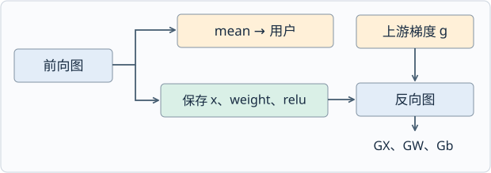

# AOTAutograd 与前向反向图的协作

推理时，调用模型得到 y 就完成了任务。训练还要计算损失并调用 backward，让 weight、bias 等参数得到梯度。即使前向计算完全相同，“返回 y 后可以丢掉哪些值”的答案也会改变。

本章继续沿矩阵乘法、偏置和 ReLU，加入平方均值损失。先把一次训练计算拆成两段：

```text
前向：输入和参数 → 中间结果 → 损失
                       ↓ 保留反向所需的值
反向：上游梯度 + 保存值 → 输入/参数梯度
```

例如，反向需要知道 ReLU 的哪些位置被截断，还要使用矩阵乘法的输入计算参数梯度。仅凭最后一个损失标量，无法恢复这些信息。AOTAutograd 因而需要决定前向保留哪些值，以及反向怎样接收它们。

下面先手算一小组梯度，找出反向需要的数据，再阅读实际前向和反向图的参数与返回值，最后讨论保存与重新计算的成本。

## 1. 从推理模型到训练目标

令：

```text
Z = X @ W + b
Y = relu(Z)
L = sum(i,j, Y[i,j]^2) / (B*N)
```

代码只增加一个损失：

```python
def loss(x, weight, bias):
    y = torch.relu(x @ weight + bias)
    return y.square().mean()
```

这里 x 为 `[B,K]`，weight 为 `[K,N]`，bias 为 `[N]`，L 是标量。训练需要得到与 x、weight、bias 对应形状的梯度。

假定反向从 `dL/dL=1` 开始，对 Y 有：

```text
G_Y = 2 * Y / (B*N)
```

再经过 ReLU，非正输入处采用 PyTorch ReLU 在该点的反向约定，得到：

```text
G_Z = G_Y * indicator(Z > 0)   # 逐元素相乘
```

继续传播到矩阵乘法与广播加法：

```text
G_X = G_Z @ transpose(W)
G_W = transpose(X) @ G_Z
G_b = sum_i(G_Z[i,:])
```

从公式可以看出，反向需要 X、W，以及足以计算损失导数和 ReLU 导数的信息。对于本例的有限普通输入，用 Y 就能判断哪些位置为正，并计算 `2Y/(BN)`。

把公式代回最初的小矩阵，可以具体看到反向在传递什么。此处是手工推演，使用第一章的2×3输入；后面的实验图使用另一组4×7输入。

```text
Y  = [[0.5, 7.5], [1.5, 0]]
L  = (0.5² + 7.5² + 1.5² + 0²) / 4 = 14.6875
GY = 2Y / 4 = [[0.25,3.75], [0.75,0]]
GZ = [[0.25,3.75], [0.75,0]]
Gb = [0.25+0.75, 3.75+0] = [1,3.75]
```

bias[j] 被每一行使用，因此各行对同一个 bias[j] 的贡献需要相加。这里又出现了归约关系，不过归约对象从前向的乘积变成了反向的梯度贡献。

## 2. 前向结果与保存值

手算已经找到了反向需要的 X、W 和 Y。下面看编译后的前向函数怎样把这些值保存下来。

用户调用 `loss` 只需要返回标量 L，但编译后的前向内部可能返回更多内容。固定实验捕获到的前向图末尾是：

```python
mm = torch.ops.aten.mm.default(x, weight)
add = torch.ops.aten.add.Tensor(mm, bias)
relu = torch.ops.aten.relu.default(add)
square = torch.ops.aten.pow.Tensor_Scalar(relu, 2)
mean = torch.ops.aten.mean.default(square)
return (mean, x, weight, relu)
```

这段代码摘自实际前向图，只调整了参数名。第一项 `mean` 是用户要的损失，后三项交给包装代码保存，供反向使用。包装代码会恢复原函数的返回形式，所以用户调用 `loss(...)` 仍然得到一个标量张量。

从公式能解释为何保存这些量：X 用于计算 weight 梯度，weight 用于计算输入梯度，relu 用于损失导数和激活反向。bias 的具体数值没有直接出现在这些梯度公式里，所以这份前向不必为了反向单独保存 bias。



图中下方三项由包装代码保存。调用 `loss.backward()` 时，本例的标量损失收到默认上游梯度 1；包装代码把梯度和保存值交给反向，autograd 再接收相应的梯度结果。

前向返回损失后，保存的 Y 还会被反向读取。如果这时覆盖 Y，反向就会用错误的值计算导数。因此前向保存了什么，必须与反向的参数一一对应。

保存时可以持有原输入的引用，也可以保留新产生的中间张量。只要反向还需要读取这些数据，就不能提前释放或覆盖它们，这也会增加前向结束后仍占用的内存。

## 3. 反向图的输入输出协议

反向函数接收前向保存的值，以及输出传回来的上游梯度。本例返回标量损失，调用 `.backward()` 时上游梯度默认为 1。更一般的输出可能接收一个梯度 Tensor。

将实际反向图中的 detach、形状包装等辅助节点省略，可整理为：

```text
输入：X、W、Y，以及上游标量梯度 g
GY = expand(g, [B,N]) / (B*N) * (2*Y)
GZ = ReLUBackward(GY, Y)
Gb = sum(GZ, dim=0)
GW = transpose(X) @ GZ
GX = GZ @ transpose(W)
返回：GX、GW、Gb
```

链式法则将梯度表达为新的矩阵乘法、归约和广播操作。后端继续为反向图选择实现、融合计算并生成代码；运行时将前向保存的数据和上游梯度传入反向函数。

## 4. 从分派协议到实际梯度执行

接下来观察前向、反向图分别怎样交给编译器，以及编译后是否算出了正确梯度。

AOTAutograd 把需要的计算分成前向和反向两份图。前向额外返回反向需要的值，反向把这些值和上游梯度作为输入。分区代码决定保留哪些值、哪些计算放入反向图；编译回调则分别接收图，并返回能够执行它的函数。

编译时准备的是导数计算方法。例如，生成一个用 X 计算 weight 梯度的矩阵乘法，并没有提前算出下一批输入的梯度。真正训练时，前向先产生本批次的保存值，反向再读取它们。AOTAutograd 的这些准备工作也可以发生在第一次 `torch.compile` 调用中。

为了看清两份图，参考实验分别设置前向和反向的编译回调，保存收到的 GraphModule，再返回执行 FX 图的包装函数。随后还使用真正的 Inductor 编译同一个 loss，并调用 `.backward()` 比较梯度。

前一个实验让我们看见图的参数、返回值及保存值；后一个实验检查实际编译后的计算结果。打印出的反向图有助于理解过程，运行后的梯度比较才检验这一组输入是否算对。

本例输入形状为 `[4,7] @ [7,3]`，损失约为 `0.247959`。输入、weight 和 bias 梯度均按浮点容差与 eager 比较，该样本的最大绝对差为零。换用其他算子、精度或调度时，应按相应数值要求检查梯度。

## 5. 保存与重计算的取舍

保存 Y 可以让反向直接使用它，但也意味着前向结束后仍要保留这块存储。如果内存紧张，就可以考虑少保存一些中间值，在反向需要时重新计算。

例如，若某个中间值只是廉价逐元素操作的结果，重算可能划算；若需要重新执行大型矩阵乘法，节省的内存是否值得计算成本就要重新评估。

分区时除了决定哪些操作放在前向、哪些放在反向，还要决定哪些值保存下来、哪些值在反向重新计算。选择会影响：

- 前向末尾保留哪些数据，以及峰值内存；
- 反向多执行多少计算与访存；
- 融合机会、内核边界和数值行为。

若要重算的是随机操作，必须保证需要的随机结果仍然一致；若计算会读取或修改状态，也要确认重复执行不会改变行为。仅仅复制相同的表达式还不够。

本例展示的是默认捕获结果和对应梯度；没有用该小模型测量不同分区策略的峰值内存，也不据此宣称某种重算策略最优。

## 6. 训练循环中的其他边界

实际训练还会清空梯度、更新参数，并涉及随机数、混合精度和分布式通信。这些工作需要分别确认捕获范围、实现与调用依赖。

应先明确编译范围：只编译模型前向并让框架组织反向，还是编译包含优化器更新的步骤？哪些参数在调用间发生修改，哪些状态影响捕获条件？

本章已经验证标量损失和反向梯度。继续研究训练编译时，可以逐项加入优化器状态、动态 loss scaling、checkpoint、梯度累积和通信，分别检查哪些状态要保存、何时发生更新。分布式训练还需要在实际通信与设备配置下测量。

## 7. 推演与实践入口

1. 用户只看到 loss，前向内部为什么还返回 X、W、Y？它们怎样到达反向程序？
2. Y=[[0.5,7.5],[1.5,0]]、损失为平方均值时，bias的梯度为何是[1,3.75]？
3. 保存Y和反向重算Y分别影响什么成本？只生成反向图为何不能代替实际梯度验证？

实验见 [labs 的 training](https://github.com/jnfkdsn/aicompiler/tree/main/pytorch-compiler)。有限源码可从 [aot_autograd.py](https://github.com/pytorch/pytorch/blob/v2.7.1/torch/_functorch/aot_autograd.py) 的编译边界进入，按需读 [分区实现](https://github.com/pytorch/pytorch/blob/v2.7.1/torch/_functorch/partitioners.py) 与 [runtime wrappers](https://github.com/pytorch/pytorch/blob/v2.7.1/torch/_functorch/_aot_autograd/runtime_wrappers.py)。
