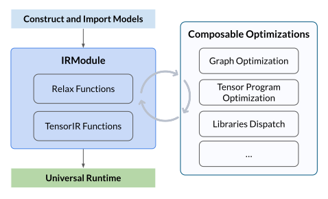

# 从张量模型到 TVM 执行程序

一个模型写成 `relu(x @ weight + bias)` 时，数学含义已经确定，但这行公式没有决定矩阵乘法采用什么循环、三个操作是否共用中间存储，以及运行时由谁准备结果。

我们要完成的任务很具体：把这个模型编译成一个可以反复调用的程序。第一次传入一组 x、weight、bias 得到结果；换一组满足相同输入约定的数据，还能调用已经编译好的程序。先用下面这幅简图把整件事连起来，其中“计算函数”代表后面负责实际数值运算的实现：

```text
编译时：模型的计算关系 → 数值计算的实现 → 可执行产物
运行时：传入 x、weight、bias → 准备结果空间 → 调用计算函数 → 返回 y
```

TVM 用 Relax 记录模型要做哪些运算，用 TensorIR 描述其中的循环与数组访问，再编译这些函数并安排运行时调用。本章先用一个小模型看清输入怎样得到输出；后续章节再解释 TVM 为什么这样划分工作，以及怎样改进生成的程序。

下面是 TVM 0.20 官方教程引用的整体结构图。先读左侧的 IRModule，再读右侧可以作用于它的优化，最后看下方运行时。

<div class="source-figure">



</div>

图源：[TVM v0.20 官方教程](https://github.com/apache/tvm/blob/v0.20.0/docs/get_started/tutorials/quick_start.py)。

IRModule 同时容纳 Relax Functions 和 TensorIR Functions，分别组织模型调用与张量计算。右侧循环箭头表示可以组合图优化、循环变换及库实现选择；下方 Runtime 执行构建产物，build 与装载细节在第七章展开。

回到本章模型，可以分别寻找负责组织调用的 `main`，以及实际计算输出的函数。官方图给出它们在系统中的位置，下面的小模型再说明它们怎样配合。

## 1. 计算目标与实现空间

输入数据为：

```text
x = [[ 1, -2,  3],     weight = [[1,  0],     bias = [0.5, -0.5]
     [ 0,  1, -1]]               [2, -1],
                                 [1,  2]]
```

每行输入经过线性映射，再加偏置与激活：

```text
y[i,j] = max(sum_k(x[i,k] * weight[k,j]) + bias[j], 0)
```

手工计算得到：

```text
x @ weight       + bias           ReLU
[[0,  8],        [[0.5,  7.5],     [[0.5, 7.5],
 [1, -3]]         [1.5, -3.5]]      [1.5, 0.0]]
```

计算每个输出时，k 方向需要累加；不同输出位置之间则可以在条件允许时并行。这些关系来自运算语义。把 k 分成多少块、j 是否向量化、bias 与激活何时执行，则属于实现选择。

我们需要一种表示保留整体张量计算关系，也需要一种表示描述更具体的循环、存储和访问。TVM 的 Relax 与 TensorIR 分别承担这些层次的工作，并且可以同时存在于一个模块中。

在这一刻，答案已经可以手算，但还没有编译程序。可以把同一次任务分成两个时间段：编译时处理形状、运算和使用关系，运行时处理实际元素。后面的每次“生成”都要问清楚，产生的是程序表示、可执行代码，还是本次输入的数值结果。

```text
编译时：形状与计算关系 → 具体实现 → 可调用产物
运行时：实际 x、weight、bias → 调用产物 → 实际 y
```

例如，编译器知道输出有四个 float32 元素，就能安排输出空间；不知道 x 的元素，也照样能生成“读取 x、做乘法”的指令。空间大小已知与计算结果已知是两件事。

这条流程中有三个值得继续追问的设计：模型中的调用怎样与底层循环对应，开发者怎样修改循环，以及运行时怎样调用编译好的函数。第一章先看完整调用；第三章再逐步打开变换后的 IR。

## 2. 用 Relax 保存模型关系

知道预期数值以后，下一步要把这些依赖交给 TVM。先保留模型层的运算关系，暂时不选择矩阵乘法内部的循环。

下面用 TVMScript 写出完整的高层表示。它借用 Python 语法构造 IR，供后续编译器分析和转换。

```python
from tvm.script import ir as I, relax as R

@I.ir_module
class Model:
    @R.function
    def main(x: R.Tensor((2, 3), "float32"),
             weight: R.Tensor((3, 2), "float32"),
             bias: R.Tensor((2,), "float32")) -> R.Tensor((2, 2), "float32"):
        with R.dataflow():
            mm = R.matmul(x, weight)
            added = R.add(mm, bias)
            result = R.nn.relu(added)
            R.output(result)
        return result
```

`main` 的参数描述三项运行输入的结构；函数体保存 matmul、add、relu 的使用关系；`R.output` 指定哪些值离开这个 dataflow 区域。

此时已有足够信息推导中间张量形状：matmul 输出 2×2，bias 长度 2 可以沿行广播，ReLU 保持形状。还没有决定哪层循环放内侧，也没有要求先分配每个中间张量。

本例此时的状态可以逐项核对：

| 已经确定 | 还没有确定 |
|---|---|
| mm 消费 x 和 weight，added 消费 mm 和 bias | 用哪种循环或库计算 mm |
| mm、added、result 都是 `[2,2]` | 是否给每个逻辑结果单独分配存储 |
| 输出按 ReLU 语义截断负数 | 用几次调用、怎样安排向量化 |

模型中的 mm 是带结构信息的 IR 值。后续 Pass 可以改写产生它的计算和使用它的操作，同时保持模型的可观察结果。

模块 `Model` 是 `IRModule`，可以容纳多个函数。对于大模型，它不只是某个单算子的循环容器，还可以组织模型入口、辅助计算及不同层次的实现。

## 3. 从模型操作到张量程序

现在 Relax 已经能描述模型，却还缺少执行每项计算的实现。下面检查编译器怎样补上这一层。

为了生成代码，需要给 `R.matmul` 等操作接上实现。对于本例选定的 CPU 路径，可以生成描述循环和 buffer 访问的 TensorIR 函数。

矩阵乘法的核心意图可以先用普通伪代码表达：

```text
for i in 0..1:
    for j in 0..1:
        M[i,j] = 0
        for k in 0..2:
            M[i,j] += x[i,k] * weight[k,j]
```

TensorIR 进一步显式记录归约轴、读写区域和初始化关系，便于后续合法变换。高层调用可以改写成“调用这份低层实现，结果为 2×2 float32 张量”。

转换后，两层表示共同工作：Relax 组织张量值和调用，底层函数计算各项结果。

如果目标环境有合适的外部库，也可以选择库实现。图层操作与实现选择之间存在明确边界，后续章节会分别观察生成代码和外部调用。

## 4. 组合变换与函数融合

本系列固定 TVM 0.20.0，使用一条便于观察的已有 pipeline：

```python
import tvm
from tvm import relax

optimized = relax.get_pipeline("zero")(Model)
```

它对这个例子完成操作实现转换和函数融合。实际结果中，模型入口调用一个 TensorIR 函数：

```python
result = R.call_tir(
    Module.fused_matmul_add_relu,
    (x, weight, bias),
    out_sinfo=R.Tensor((2, 2), "float32"),
)
```

这里省略了外围函数，只保留实际输出中的调用。`out_sinfo` 说明结果是 2×2 的 float32 张量。后续编译还会为模型入口生成准备输出、把输出传给计算函数的代码。

融合函数内部仍有三组计算和两个中间 buffer。按每个元素的数据去向，实际结构是：

```text
matmul 将结果写入 M
add 读取 M 与 bias，将结果写入 A
relu 读取 A，将结果写入最终 out
```

因此，合为一次调用以后，M、A 仍然各被写入和读取。若把加偏置和 ReLU 移到每个输出元素的归约完成之后，就有机会直接使用刚算出的局部值，省去完整的 M、A。第三章会分别检查调用、循环和存储，避免仅凭函数数量判断访存是否减少。

后续调度可以根据循环依赖把计算移动到合适的位置，向量化内层循环，或改变缓存方式。那些选择都需要在具体输入与硬件条件下验证。

## 5. 编译与运行是两段工作

组合后的函数仍然是编译器里的程序表示。要让真实数组得到结果，还需要把它构建为可执行产物，再在运行时传入数据。

完成当前变换以后，为 CPU 构建可执行对象：

```python
executable = tvm.compile(optimized, target="llvm")
vm = relax.VirtualMachine(executable, tvm.cpu())
```

`target="llvm"` 指定这里采用 LLVM CPU 代码生成路径。编译阶段根据 IR 和目标产生程序；此时仍不需要刚才 x、weight、bias 的实际元素值。

运行时再把数据交进去：

```python
import numpy as np

x = np.array([[1., -2., 3.], [0., 1., -1.]], dtype="float32")
w = np.array([[1., 0.], [2., -1.], [1., 2.]], dtype="float32")
b = np.array([.5, -.5], dtype="float32")
y = vm["main"](tvm.nd.array(x), tvm.nd.array(w), tvm.nd.array(b))
print(y.numpy())
```

本机实际输出为：

```text
[[0.5 7.5]
 [1.5 0. ]]
```

把这一调用按时间展开：VM 先取得三个输入张量，检查它们满足形状和类型约定；再准备 `[2,2]` 输出；随后把三个输入和输出存储交给已编译的数值函数；函数写完后，VM 返回对应 Tensor。

从 Python 看，`y = vm["main"](...)` 返回一个张量；从计算函数看，它接收一个输出数组，把数值写进去。VM 执行模型入口中的分配、调用和返回指令，把这两种用法连接起来。

其中 `NDArray` 承载运行时张量，`vm["main"]` 找到编译产物中的模型入口。VM 负责组织调用、形状检查和必要的存储操作，数值内核则由编译的 TensorIR 实现执行。

本例的 VM 指令负责分配输出、调用 `fused_matmul_add_relu` 并组织返回值；矩阵循环由编译后的数值函数执行。

## 6. 一次执行中的完整数据链

现在可以把各层连起来：

```text
Relax：张量之间怎样计算和传递
  ↓ 选择实现、改写调用、组合函数
TensorIR：循环怎样读写buffer并计算张量
  ↓ 调度与目标lowering
编译产物：数值函数 + 模型执行组织
  ↓ 传入实际NDArray
运行时：检查、分配、调用、返回结果
```

这张图表示本例经过的职责关系，不要求所有 TVM 程序只有一种固定 pass 次序。模型优化、实现选择和张量程序优化可以交错进行，外部库也可以参与执行。

可以与之前的 MLIR 学习对照：高层保留运算关系，低层逐渐写出循环和访存，转换时必须保持输入输出的含义。这里采用的是 TVM 自己的 IR、调度与运行时，示例没有经过 MLIR。

## 7. 推演与实践入口

1. 本例 bias 是运行参数。只替换其数值，shape 和 dtype 不变，为什么可以复用编译产物？
2. 融合函数内部仍先写 M、A 再读取它们，是否已经消除中间访存？你需要再看到哪种变化才能作出判断？
3. 执行 `vm["main"]` 时，输出存储由哪一层准备，矩阵乘加由哪一层执行？

下一章从[模型导入与 Relax](/notes/compile/tvm/02_relax)继续。完整实验见 [TVM labs](https://github.com/jnfkdsn/aicompiler/tree/main/tvm-e2e)；固定源码可核对 [pipeline](https://github.com/apache/tvm/blob/v0.20.0/python/tvm/relax/pipeline.py)、[编译入口](https://github.com/apache/tvm/blob/v0.20.0/python/tvm/driver/build_module.py) 与 [VM 构建](https://github.com/apache/tvm/blob/v0.20.0/python/tvm/relax/vm_build.py)。

## 图片来源与许可

- **TVM 整体编译结构图**：来自官方教程引用的 [tlc-pack/web-data](https://github.com/tlc-pack/web-data/blob/main/images/design/tvm_overall_flow.svg)，采用 [Apache-2.0](/licenses/tvm-web-data.txt)。原图未修改。
