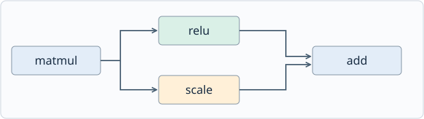

# 操作实现转换与图融合

上一章的 Relax 已经说明要依次做矩阵乘法、加偏置和 ReLU，却还没有给出矩阵乘法内部的循环。现在要让这份模型逐步接近可执行程序，同时减少不必要的计算与存储开销。

先看本章跟踪的三次变化：

```text
Relax：matmul → add → relu
    ↓ 为每个操作补上实现
Relax 调用三个 TensorIR 函数
    ↓ 根据依赖选择可融合的一组计算
组合成一个 TensorIR 函数
    ↓ 继续调整内部循环与存储，才可能减少中间访存
```

这些步骤逐步建立实现：`call_tir` 连接 Relax 调用与低层计算，分组决定哪些操作共同处理，后续函数合并和调度再决定中间 buffer 的去留。

下面始终追踪这三个操作：先看矩阵乘法实现怎样生成，再看为什么把它和 add、relu 分成一组，最后打开合成的函数检查循环和 buffer。每一步都对照变换前后的程序。

## 1. 操作语义与具体实现

输入仍为 `x[2,3]`、`weight[3,2]`、`bias[2]`，都是 float32：

```python
mm = R.matmul(x, weight)
added = R.add(mm, bias)
result = R.nn.relu(added)
```

`mm` 的形状为 `[2,2]`。矩阵乘法语义已经确定，但这里没有循环，也没有选择库函数。本章先采用生成 TensorIR 的路径；外部实现选择在第六章展开。

`LegalizeOps` 遍历 Relax 调用，查询操作已注册的转换规则。矩阵乘法规则的结构摘录如下，计算定义和检查暂时省略：

```python
@register_legalize("relax.matmul")
def _matmul(bb, call):
    # 此处定义 te_matmul，描述输出元素怎样由输入计算。
    # 此处还检查生成实现需要的 dtype 等信息。
    ...
    return bb.call_te(
        te_matmul, call.args[0], call.args[1], primfunc_name_hint="matmul"
    )
```

`call` 是正在处理的调用对象，两个参数是 IR 中的 x 和 weight。规则执行时不计算输入矩阵的数值，而是生成以后执行矩阵乘法的程序。

`te_matmul` 使用张量表达式描述计算。对本例，其核心意思为：

```text
输出范围：0 <= i < 2，0 <= j < 2
归约范围：0 <= k < 3
输出元素：sum_k(x[i,k] * weight[k,j])
```

`bb.call_te` 根据张量表达式生成 TensorIR PrimFunc，把它加入当前模块，再返回调用该函数的 Relax 表达式。于是模块里同时有了“怎样计算矩阵乘法”的函数和“在哪里调用它”的语句。

## 2. 转换后的模块与调用关系

矩阵乘法调用变为：

```python
mm = R.call_tir(
    Module.matmul, (x, weight),
    out_sinfo=R.Tensor((2, 2), "float32"),
)
```

`Module.matmul` 指向新增的 TensorIR 函数，`(x, weight)` 是输入，`out_sinfo` 说明结果的形状和类型。后续编译会生成准备输出存储的代码，再把输出一同传给这个函数。

加法和 ReLU 也取得实现后，模块关系是：

```text
main（Relax）：
    mm     = call_tir matmul(x, weight)
    added  = call_tir add(mm, bias)
    result = call_tir relu(added)

matmul（TensorIR）：遍历输出位置，沿内积维累加
add   （TensorIR）：读取 mm[i,j]、bias[j]，写出 added[i,j]
relu  （TensorIR）：读取 added[i,j]，写出 max(added[i,j], 0)
```

main 仍组织张量数据流，各个 PrimFunc 描述具体计算。得到正确的实现还没有回答怎样分块、缓存或向量化；这些决定需要继续在具体实现上进行。

## 3. 融合候选的计算模式

到这里，每项高层操作已经有可调用的实现。下一步是决定哪些调用值得组合：先识别每项计算的访问模式，再检查它们在整张图中的使用路径。

将计算放进同一低层函数后，调度可以继续调整计算位置。分组前需检查其他消费者、实现支持和数据依赖。

`AnnotateTIROpPattern` 分析 TensorIR，为实现附上模式分类。本例实际输出为：

| 实现 | `op_pattern` | 供分组使用的性质 |
|---|---:|---|
| matmul | 4 | 可与输出侧逐元素处理组合的一类计算，`kOutEWiseFusable` |
| add | 0 | `kElemWise`；输出与矩阵输入位置对应，bias 被广播读取 |
| relu | 0 | `kElemWise`；每个输出消费对应位置的输入 |

这些数字是当前版本的分类编码。本例虽然包含 bias 广播，实际实现仍归类为 0；可以结合生成的访问模式理解分类结果。

Relax 已有操作语义、形状和类型；现在还取得了实现层的访问与计算模式。融合策略根据这些模式筛选可以组合的操作。

## 4. 使用路径与分组边界

主例只有一条链：

```text
matmul → add → relu → 区域输出
```

算法沿使用关系寻找下游候选，并检查连接路径上的模式与已有分组。本例符合规则，最终将三个计算合为一组。

若 matmul 的结果有两个使用者，沿图中上下两路分别走到 add。scale 在这里表示逐元素缩放。



只沿 relu 路径考虑融合，会漏掉 scale 仍需要 matmul 结果这件事。算法先寻找从当前节点出发的所有使用路径必经的下游节点；这里两条路径在 add 汇合。这个关系称为后支配关系，它帮助确定要检查的候选范围。

找到汇合点以后，还要检查两条路径上的计算模式和边界。若其中有不支持通用融合的 opaque 调用，就不能因为路径最终汇合而直接合并。该图说明候选选择过程，不承诺任意同形图都得到相同分组。

固定实现的主要过程是：

```text
建立生产—使用图，标记区域外使用
    ↓
计算后支配关系，寻找候选下游节点
    ↓
CheckPath：检查路径与已有组是否符合模式规则
    ↓
检查分组规模等限制
    ↓
CommitFuse：将通过检查的节点归入同一组
```

实现用并查集记录哪些节点已经属于同一组，并分阶段应用不同计算模式的融合规则。对这张分支图，先抓住一件事：matmul 的结果同时流向 relu 和 scale，判断分组时必须检查两条路径。

若模型还要返回 mm，它就需要对组外可见，分组策略会重新处理这个使用关系。支持多输出融合的实现可以保留该结果，具体选择还取决于算法支持及收益判断。

Relax 融合分析读取 TensorIR 的 `op_pattern`。底层实现变化后，应重新分析访问模式，使分组使用与实际计算一致的信息。

如果开发者已经知道要替换哪个子图，可以用 DPL（Dataflow Pattern）描述它，并编写匹配后的替换函数。第八章会用它删除重复 ReLU。本章的 `FuseOps` 则按计算模式和使用路径进行通用分组，不需要我们先手写一个 matmul-add-relu 模式。

## 5. Relax 分组与 TensorIR 函数组合

模式和使用路径给出了分组依据。现在看这项决定怎样真正改变 Relax 调用和 TensorIR 函数。

`FuseOps` 将选定调用提取到带 Primitive 属性的 Relax 函数。主例此时的实际结构为：

```text
main：调用 group(x, weight, bias)

group（Relax，实际名称为 fused_matmul_add_relu）：
    call_tir matmul
    call_tir add
    call_tir relu

模块中仍有三个独立的 TensorIR PrimFunc
```

此时三个调用位于同一个 Relax 函数中，底层实现仍是分开的。随后 `FuseTIR` 才把它们组合起来：将 matmul 的输出作为 add 的输入，将 add 的输出作为 relu 的输入，并整理合成函数的参数与局部存储。

组合后的数值意图如下，是省略轴声明的伪代码：

```text
fused_matmul_add_relu(x, weight, bias, out)：
    准备 M[2,2] 和 A[2,2]
    第一组循环：M[i,j] = sum_k(x[i,k] * weight[k,j])
    第二组循环：A[i,j] = M[i,j] + bias[j]
    第三组循环：out[i,j] = max(A[i,j], 0)
```

main 现在通过一次 call_tir 调用这个 PrimFunc。实际生成 IR 仍有两个 `T.alloc_buffer` 和三组循环。它们进入了共同的优化范围，但中间矩阵仍然被写入和读取。

## 6. 循环调整与中间存储

函数已经组合起来，但上一节仍能看到中间 buffer。要判断访存是否减少，还必须打开函数检查计算顺序与存储。

进一步考虑每算完一个输出元素，就完成它的后处理：

```text
对每个 i,j：
    acc = 0
    对每个 k：acc += x[i,k] * weight[k,j]
    out[i,j] = max(acc + bias[j], 0)
```

这种候选实现省去完整的 M、A 中间矩阵及相应读写，改为使用局部值。局部值最终如何存放，则由后端结合寄存器资源等条件决定。

后处理必须等待对应归约完成。若两项乘积为 -2、3，bias 为零，正确计算得到 `max(-2+3,0)=1`。若每次累加后都做 ReLU，第一次将 -2 改成 0，第二次得到 3，结果就改变了。

因此观察优化时要分别回答：调用是否合并、循环如何组织、中间数据是否仍然读写。复用一个 buffer 只说明空间可重用，不自动消除该 buffer 上的 store/load。

## 7. 实现入口与推演

本例经历“生成实现 → 决定分组 → 连接实现”。下一章展开 PrimFunc 内部的循环、计算块与归约约束，为进一步调整执行组织做准备。

1. LegalizeOps 是否需要 x 的真实元素？它生成了哪两项互相引用的内容？
2. 菱形图中，为什么只检查 relu 分支不足以决定 matmul 的分组？若 scale 是 opaque 调用，会影响哪一步？
3. 合成一个 PrimFunc 后仍有 M、A 两块存储，能否说中间访存已经消除？改变什么计算组织才有机会省掉它们？

规则与调用链可查 [matmul legalization](https://github.com/apache/tvm/blob/v0.20.0/python/tvm/relax/transform/legalize_ops/linear_algebra.py)、[BlockBuilder.call_te](https://github.com/apache/tvm/blob/v0.20.0/python/tvm/relax/block_builder.py)、[LegalizeOps](https://github.com/apache/tvm/blob/v0.20.0/src/relax/transform/legalize_ops.cc)。分组对应 [FuseOps](https://github.com/apache/tvm/blob/v0.20.0/src/relax/transform/fuse_ops.cc) 与 [GraphPartitioner](https://github.com/apache/tvm/blob/v0.20.0/src/relax/analysis/graph_partitioner.cc)，组合对应 [FuseTIR](https://github.com/apache/tvm/blob/v0.20.0/src/relax/transform/fuse_tir.cc)。[配套实验](https://github.com/jnfkdsn/aicompiler/tree/main/tvm-e2e)保存主例的实际阶段输出；分支图用于推演分组检查，没有包含在这组实验中。
