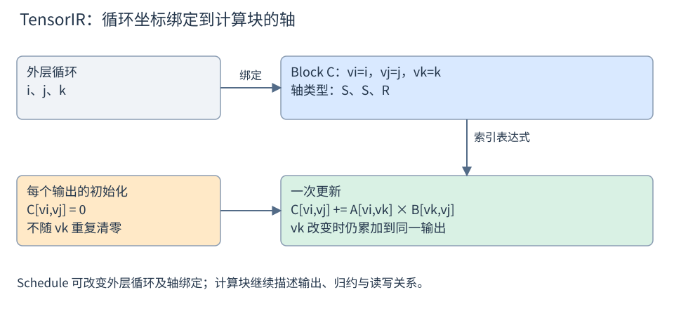

# TensorIR 的循环、计算块与存储契约

上一章的 Relax 会调用一个矩阵乘法实现。现在打开这个函数，我们要弄清它如何计算 `C = A @ B`，以及 TVM 怎样从这份程序里识别可以调整的循环。

先固定一个输出位置 `C[i,j]`。它从 0 开始，依次加上 `A[i,k] * B[k,j]`；换一个 i 或 j，就在计算另一个输出；只改变 k，则仍在更新同一个输出。这就是接下来所有结构围绕的计算过程。

```text
选定输出位置 (i,j) → 初始化 C[i,j]
                  → 沿 k 读取 A、B 并累加
                  → 得到这个位置的最终结果
```

TensorIR 除了写出这些读写，还用计算块、轴绑定和初始化区域明确表示它们之间的关系。编译器因此能够检查：换循环顺序会不会破坏归约，某个循环能否并行，某次读取和写入是否可能重叠。

本章先算出一个输出，再放回完整 PrimFunc，解释循环、计算轴和初始化怎样配合。读懂这份计算以后，下一章再用 Schedule 改写它。

## 1. 一个输出元素的计算过程

矩阵乘法的定义是 `C[i,j] = sum_k(A[i,k] * B[k,j])`。固定 i、j 后，k 的每个值为同一个 C 元素贡献一项。先用前章的小矩阵看清一次归约：

```text
A = [[1,-2,3], [0,1,-1]]
B = [[1,0], [2,-1], [1,2]]

计算 C[0,1]：
初值 0
k=0：加  1 *  0 = 0，累计 0
k=1：加 -2 * -1 = 2，累计 2
k=2：加  3 *  2 = 6，累计 8
```

同一个 C[0,1] 要保留前一项的累计值。换成 C[1,1] 时则开始另一份累加。由此产生两类坐标：i、j 选择输出位置，k 选择贡献给这个输出的项。

后续为了展示列分块和非整除尾部，将尺寸扩大到 32×32；公式和轴的作用不变。普通循环的意图是：

```text
对 i=0..31：
    对 j=0..31：
        C[i,j] = 0
        对 k=0..31：
            C[i,j] += A[i,k] * B[k,j]
```

下面的完整程序表达这个过程，并额外保存计算轴与归约初始化的信息。

## 2. PrimFunc 的完整结构

单个位置的清零和累加过程已经确定。下面把所有输出位置写成一份完整程序，再从中辨认刚才的计算。

```python
from tvm.script import ir as I, tir as T

@I.ir_module
class Matmul:
    @T.prim_func
    def main(A: T.Buffer((32, 32), "float32"),
             B: T.Buffer((32, 32), "float32"),
             C: T.Buffer((32, 32), "float32")):
        T.func_attr({"tir.noalias": True})
        for i, j, k in T.grid(32, 32, 32):
            with T.block("C"):
                vi, vj, vk = T.axis.remap("SSR", [i, j, k])
                with T.init():
                    C[vi, vj] = T.float32(0)
                C[vi, vj] = C[vi, vj] + A[vi, vk] * B[vk, vj]
```

先按三层读：函数参数给出 A、B、C 三块存储；外部循环决定遍历顺序；计算块描述当前坐标下的初始化与一次更新。定义这个 Python 类时是在构造 IR，并没有执行全部矩阵运算。

A、B 是输入，C 是调用方提供的输出存储。`T.Buffer` 给出逻辑形状和元素类型，不会因为写在函数签名里就自动分配矩阵。数值函数通过写 C 交付结果。

`T.grid(32,32,32)` 在这里表示按 i、j、k 嵌套的三层循环。每组 `(i,j,k)` 对应一次乘积更新；整个函数计算 1024 个输出，每个输出累加 32 项。

前章的 `call_te` 也会生成这种 PrimFunc。开发者先用 TE 张量表达式声明每个输出元素怎样计算，TVM 再将它转换成 TensorIR。直接写 TVMScript 和使用 TE，都能得到后续可调度的程序；运行矩阵乘法时，无须再执行一次这段 TE 构造过程。

普通循环已经足够执行矩阵乘法，Block 则让编译器更容易改写它：初始化、更新、读写区域和计算轴都能单独取出分析。不过，调度原语也有适用条件。循环中若包含复杂控制流或副作用，某些变换就可能无法证明安全而拒绝执行。

## 3. 计算块与轴绑定

完整程序里同时出现了外层循环变量和块内轴。它们的绑定把“当前执行到了哪次迭代”连接到“正在计算哪个输出、哪个归约项”。

`T.block("C")` 将计算及其结构信息组织为一个张量计算块。调度器通过块名 C 定位它，再根据块内表达式和访问关系实施变换。

关键绑定是：

```python
vi, vj, vk = T.axis.remap("SSR", [i, j, k])
```

| 块坐标 | 本例绑定 | 类别 | 作用 |
|---|---|---|---|
| vi | i | S：spatial | 选择输出行 |
| vj | j | S：spatial | 选择输出列 |
| vk | k | R：reduction | 选择同一输出的累加项 |

当循环处于 `(i,j,k)=(1,0,2)`，计算块读 A[1,2]、B[2,0]，更新 C[1,0]。下一轮 k=3 仍更新 C[1,0]，只是读入另一项。

SSR 没有自动生成加法，也没有让循环自动并行。加法来自更新表达式；轴类别让分析和调度知道这项更新处于什么结构中，不能靠随意把 R 改为 S 来消除依赖。

两组变量暂时相等，为什么仍要区分？外层循环回答“怎样遍历”，块坐标回答“当前计算公式中的哪个位置”。将 j 拆成 jo、ji，宽度为 8 后，可以保留同一个计算公式，只将绑定变为：

```text
vj = jo * 8 + ji
例如 jo=2、ji=3，仍然计算原矩阵的第19列
```

这让编译器可以改变遍历组织，同时检查是否覆盖原来的计算域。代码中没有显式写出的读写区域也可以由解析器推导；这些区域与轴绑定共同供后续依赖分析使用。



图把循环、轴绑定与计算放在不同层。调度可以改动上层循环，但必须维持块内表达式与新绑定之间的对应；初始化仍要服务整个输出归约，不能随每次乘积重新清零。

## 4. 归约初始化与更新

`T.init()` 是归约块的初始化字段。在这个简单循环中，每个 `(i,j)` 开始归约时执行一次清零，之后各个 k 更新共享累加结果。

用第一节的三项贡献 0、2、6 对照：

| 阶段 | 正确的归约初始化 | 如果每次更新前都清零 |
|---|---:|---:|
| 开始 | 0 | 0 |
| 加第一项 | 0 | 0 |
| 加第二项 | 2 | 2 |
| 加第三项 | 8 | 6 |

后者只留下最后一项。初始化和更新的相对位置因此直接决定数学结果。

在这一版本中，Block 用 `init` 单独保存清零操作，用 `body` 保存累计更新，另外记录轴和读写区域；BlockRealize 保存每次执行时的轴绑定值。后续 lowering 因此可以取出初始化，并生成让它在每个输出开始归约时执行的代码，无须从普通赋值里猜测哪一句是初值。

下一章的 `decompose_reduction` 会将初始化拆成独立 block。拆分后仍需保证每个输出先初始化，再完成全部贡献；只是这个关系改由更显式的循环位置表达。

## 5. 共享读取与归约写入冲突

明确清零和累加的位置后，就能根据各迭代是否更新同一结果位置，判断哪些计算可以独立执行。

C[0,0] 和 C[0,1] 可以共同读取 A[0,0]。在输入保持不变的条件下，这种共享读取是安全的；带宽与缓存效率则影响它的性能。

对于同一个 C 元素，直接并行执行不同 k 的 `C += contribution` 会发生竞争：读取旧值、相加和写回分为三个动作。假设旧 C 为 0，两个任务分别贡献 2 和 6：

| 时刻 | 任务甲 | 任务乙 |
|---|---|---|
| 1 | 读取 C，得到 0 | |
| 2 | | 读取 C，也得到 0 |
| 3 | 写回 0+2=2 | |
| 4 | | 写回 0+6=6 |

最终只留下 6，贡献 2 丢失。这里的冲突来自两个任务同时读写同一位置，需要调整归约方式或引入同步。

要并行计算 k 方向，可以让不同任务先把各自负责的项加成部分和，再把这些部分和加起来；也可以在目标与数值要求允许时使用原子更新等机制。前一种方式改变了加法分组，浮点舍入也可能变化。仅给原来的 k 循环加上并行标记，并没有解决这些问题。

## 6. Buffer 别名与输出协议

还有一种写入冲突来自存储重叠：虽然名字分别是 A、B、C，调用者会不会让它们指向同一块内存？

`tir.noalias=True` 是供优化使用的前提。本实验为 A、B、C 分配独立存储。如果 C 与 A 重叠，先写出的结果可能覆盖后面仍需读取的输入；只检查 shape 和 dtype 发现不了这种错误。属性不会自动复制输入以修复别名。

在 Relax 中，这项计算写成 `C = call_tir matmul(A,B)`；底层 PrimFunc 却接收 A、B、C 三个 buffer。后续编译会为模型入口生成准备 C 的代码，把 C 与 A、B 一同传给数值函数，再把对应张量交给使用结果的操作。

因此“一个逻辑张量值”和“存放它的内存”需要分别理解。多个阶段可能复用存储；读写是否消失，还要看循环内具体有没有 load/store。函数内部的 `T.alloc_buffer` 也描述存储需求，最终布局和存储层次会继续受调度与 lowering 影响。

## 7. 从计算描述到调度

这份 PrimFunc 已经明确了计算什么、读写哪里、何时初始化。下一章保留这些关系，改变 j 的分块、遍历顺序和向量化，让相邻输出列一起推进。

1. 在 32×32 程序中，`i=1,j=0,k=2` 读取哪些元素、更新哪个元素？换成 k=3，输出位置是否改变？
2. 用第一节给出的 A、B 计算 C[0,1]；如果每次 k 更新前清零，最后为什么只剩 6？
3. 两个任务同时读 A[0,0]，与两个任务同时读改写 C[0,1]，正确性条件有什么不同？并行归约需要补充什么步骤？

完整程序与数值验证见 [TVM labs](https://github.com/jnfkdsn/aicompiler/tree/main/tvm-e2e)。对象结构与契约可查固定版本的 [Block/BlockRealize](https://github.com/apache/tvm/blob/v0.20.0/include/tvm/tir/stmt.h)、[Buffer](https://github.com/apache/tvm/blob/v0.20.0/include/tvm/tir/buffer.h)；调度如何消费这些信息见 [Schedule API](https://github.com/apache/tvm/blob/v0.20.0/python/tvm/tir/schedule/schedule.py)。
