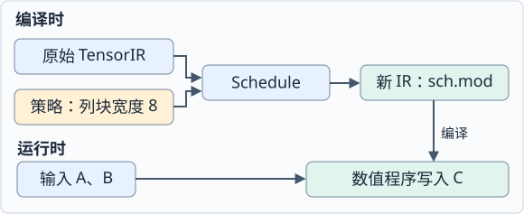
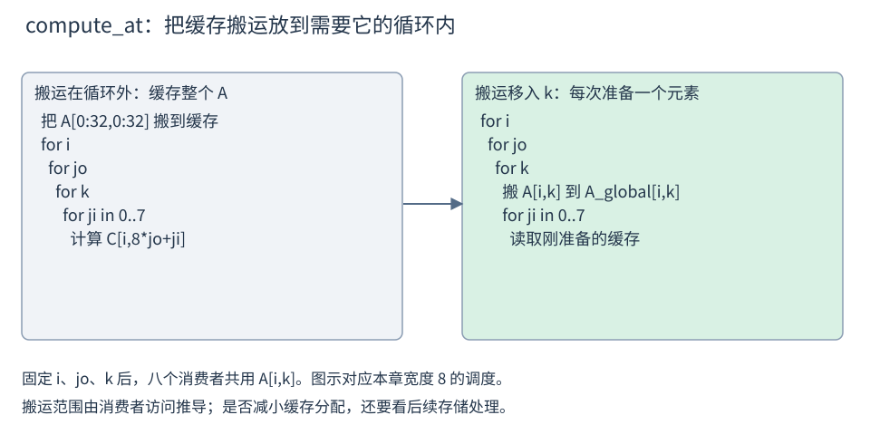

# TensorIR 调度：程序变换、计算位置与存储

第四章的 TensorIR 已经规定了怎样读取 A、B 并把乘积累加到 C，可以直接编译。在 TVM 中，还可以另写一段调度程序，在编译时调用 `tir.Schedule` 改写这些循环，让同一份计算按另一种顺序执行。



本章由我们选择“固定行 i 和归约位置 k，一次更新八个相邻列”。这样一个 `A[i,k]` 可以参与八次乘法，同一行 B 的八个元素也能连续读取。**宽度 8 是传给调度器的选择**。TVM 据此拆分循环、重写坐标，并检查相应变换对这份程序是否适用。安排缓存时，调度器还会根据消费者读取的范围推导要搬哪些元素。

观察结果要看两处。先比较原程序与 `sch.mod` 中的循环和访问，再把新程序编译运行，检查数值与性能。下一章再讨论候选调度可以从哪里来，以及怎样用测量选择方案。

## 1. 计算程序与变换程序

第四章的 `Matmul` 描述将来怎样读取 A、B 并写 C。下面这段 Python 则以该 IR 为输入，产生另一份 IR：

```python
sch = tir.Schedule(Matmul)
block = sch.get_block("C")
i, j, k = sch.get_loops(block)
jo, ji = sch.split(j, factors=[None, 8])
sch.reorder(i, jo, k, ji)
sch.vectorize(ji)
sch.decompose_reduction(block, k)
optimized = sch.mod
```

`block`、`i`、`j`、`k` 是调度器定位计算块和循环的句柄。编译器执行 `split` 时创建新循环、替换坐标表达式并维护块绑定；完成后，`sch.mod` 保存变换后的 IRModule。

编译和数值执行发生在后面：

```python
lib = tvm.tir.build(sch.mod, target="llvm")
lib(a_nd, b_nd, c_nd)
```

这里三个 NDArray 分别提供输入 A、B 和输出 C 的存储。如果仍把原来的 `Matmul` 传给 build，这次手工调度就没有应用到那份编译输入上。

因此，可以为同一个 Matmul 写两套调度，比较它们生成的循环，无须重写矩阵乘法公式。不过，调度要能找到并操作当前 IR 的结构。如果 C 块已被拆分，或者循环不满足变换条件，原来的调度也需要调整。

## 2. 从访存需求到分块和重排

要同时更新八列，需要先把 j 拆成“哪组列”和“组内哪列”，再将组内列循环放到 k 循环里面。

原程序按 i、j、k 遍历，每次算完一个 C[i,j]。行主序矩阵的访问为：

```text
固定 i、j，推进 k：
A[i,0]、A[i,1]、A[i,2]……      偏移每次增加1
B[0,j]、B[1,j]、B[2,j]……      偏移每次增加32
```

相邻列又需要同一行 A。我们选择先处理八列，让固定 A[i,k] 对应 B[k,j] 的八个相邻元素。为此拆分列坐标：

```text
j = 8*jo + ji
jo = 0..3，ji = 0..7
```

`split(j, factors=[None, 8])` 推导外层范围为4，将原来的 j 引用改为 `8*jo+ji`。此时顺序还是 i、jo、ji、k；每个输出仍沿 k 算完。再执行 `reorder(i, jo, k, ji)`，才能同时推进八列。

固定 i=0、jo=1、k=2，新内层的工作是：

```text
共同读取 A[0,2]
分别读取 B[2,8] … B[2,15]
分别更新 C[0,8] … C[0,15]
```

每个 C 元素仍按 k=0…31 累加，只在相邻贡献之间穿插其他列的更新，因而改变访问顺序和复用机会。TVM 还会检查重排条件，其他程序按各自依赖重新判断。

## 3. 向量化、初始化与尾部

八个 ji 更新八个输出，适合做空间向量化：广播一个 A 元素，与连续的八个 B 元素相乘，再更新八个累加值。`vectorize(ji)` 表达这种组织，后续 lowering 根据目标指令宽度落实它。

`decompose_reduction(block, k)` 将归约初始化拆出，放到指定 k 循环之前。上述实际调度输出的核心如下，省略块轴和读写声明：

```python
for i, jo in T.grid(32, 4):
    for ji_init in T.vectorized(8):
        C[i, jo * 8 + ji_init] = T.float32(0)
    for k in range(32):
        for ji in T.vectorized(8):
            C[i, jo * 8 + ji] += A[i, k] * B[k, jo * 8 + ji]
```

每组输出先清零，再累加 32 项。本例在固定版本中先执行 `vectorize`，再拆分初始化，以满足调度原语要求的结构。调用次序会改变下一条原语看到的 IR，因此不能假设交换接口调用顺序也一定成功。

如果把块宽改为7，最后一组 jo=4 名义上覆盖 j=28..34。默认 split 会为未整除部分生成相应谓词，限制初始化和更新中的有效访问：

```python
T.where(jo * 7 + ji < 32)
```

合法 ji 只有0..3。相比之下，直接把归约 k 标成普通 parallel，会让多个任务读改写相同的 C 元素；本例的调度检查拒绝该操作。归约并行需要另外构造部分和与合并，不能通过修改标签消除依赖。

## 4. CacheRead：创建搬运阶段

前面的变换改变了计算顺序。如果还想把 A 的数据先复制到一块缓存，再从缓存读取，就需要增加复制操作和存储。

下面单独试验这项变换，让 C 的计算通过 A_cache 读取 A：

从原 Matmul 新建 schedule，完成 split 和 reorder 后执行：

```python
a_cache = sch.cache_read(block, 0, "global")
```

这里 `block` 是 C 计算块，索引0选择其读集合中的 A，返回值指向新建的复制块。这个例子中的读集合为 A、B；不能把数字0当成所有程序中固定的 A。

生成结构可以整理为：

```text
先将 A 的所需区域复制到 A_global
C 的计算改读 A_global，仍从 B 读取另一项
```

TVM 在这里创建了 buffer 和复制块，并把原计算对 A 的读取改为读取新 buffer。选择 `global` 是为了在 CPU 上观察这一变化，它并没有创建 GPU shared memory。若额外复制一遍以后仍没有增加复用，程序反而可能更慢。

## 5. ComputeAt：根据消费者推导生产范围

有了复制块以后，还要决定何时复制、每次复制多少。这个问题可以从 C 块在各层循环里需要哪些 A 元素来判断。

接着把这个复制块移入 k 循环：

```python
sch.compute_at(a_cache, k)
```

C 块位于 i、jo、k、ji 四层循环内。固定 i、jo、k 时，内层八次 ji 迭代都读取 A[i,k]，因此只需在它们开始前复制这一个元素。TVM 根据这个读取范围，重新生成复制块的循环范围。实际 IR 的核心为：

```text
for i, jo, k:
    A_global[i,k] = A[i,k]
    for ji in 0..7:
        C[i,8*jo+ji] += A_global[i,k] * B[k,8*jo+ji]
```

初始化仍由归约结构表达，上面的伪代码突出搬运和更新的位置。此时 cache buffer 的声明还可能是 32×32；后续 lowering 再根据生产范围和分配位置压缩实际存储。

这就是 `compute_at` 所做的工作：把产生数据的块（producer）移到指定循环下，再根据使用它的块（consumer）推导需要计算的范围。这里 producer 是复制块，也可以是普通中间计算。移动之前仍要检查数据依赖、变量作用域和使用位置。

位置还有代价。上述方案对每个 jo 重复读取同一 A[i,k]，一行共有4组；如果在更外侧准备整行 A，可能减少重复生产，却扩大同时存活的区域。在更内侧准备单个值，工作集小，但生产次数可能增加。选择必须同时看“每次产生多少”与“总共产生几次”。



图中沿用上面的 A 缓存：进入某次 k 循环后，`i`、`jo`、`k` 已固定，八个 `ji` 都读取同一个 `A[i,k]`。于是这次搬运只需准备一个元素。这里展示的是作用域与访问范围，具体分配大小还要检查后续存储压缩后的 IR。

## 6. CacheWrite：局部累加与写回

输入可以先复制到缓存，输出也可以先在局部 buffer 中累加，等归约完成后再写回 C。

下面从另一份已完成 split/reorder 的 schedule 开始：

```python
writeback = sch.cache_write(block, 0, "local")
sch.reverse_compute_at(writeback, jo)
```

`cache_write` 将 C 块的输出改写到 C_local，并创建把结果写回 C 的块；返回句柄指向写回块。`reverse_compute_at` 将这个消费者放到指定循环下，并推导应消费的区域。实际结构整理为：

```text
for i, jo:
    初始化当前八列的 C_local
    for k:
        for ji:
            C_local[i,8*jo+ji] += A[i,k] * B[k,8*jo+ji]
    for ji:
        C[i,8*jo+ji] = C_local[i,8*jo+ji]
```

现在先在局部存储累加，完成后写回 C。`local` 表达存储作用域，目标 lowering 再决定实际分配与寄存器使用。

现在可以分别检查两端：输入缓存在哪层循环准备、多少次计算共用它；输出缓存累加多少项、何时写回。改变其中一个位置，就可能同时改变复制次数和需要保留的数据量。

## 7. 多级分块与硬件映射

如果将行、列和归约维都分块，就可以让一组输出共用两块输入。下面用一个候选方案解释这一点。

更大的 Matmul 可以把 i、j、k 都分成外层块和内层坐标。一个候选的意图是：

```text
一个输出块 C_tile[Bi,Bj]
    沿归约块 ko 推进：
        准备 A_tile[Bi,Bk] 与 B_tile[Bk,Bj]
        用这两块输入更新 C_tile
    将 C_tile 写回
```

例如 Bi=Bj=8、Bk=4 时，一轮需要32个 A 元素和32个 B 元素；A 的每个元素服务8列，B 的每个元素服务8行。相比只分 j，它多利用了行方向的复用，但也增加同时需要保留的输入和64个累计结果。这是设计推演，本章的 CPU 实测仍是前面的有限变体。

GPU 上还要决定输出块属于哪个 thread block，哪些循环绑定到线程，输入 tile 是否进 shared memory，以及合作搬运后的同步。`bind` 表达执行映射，cache scope 表达存储意图，二者需要共同满足硬件和依赖条件。`tensorize` 则可以把满足描述要求的计算块替换成已注册的张量指令实现；匹配形状、布局与约束比改一个名字复杂。

这些能力解释 TensorIR 为何保留计算块及读写信息。当前先理解它们解决的选择问题；GPU/NPU映射和张量指令的性能要在后续真实目标上验证。

## 8. 调度记录、验证与选择

`sch.trace` 记录构成该调度的变换和决定，便于重放和构造其他候选。它使“找到一份快的程序”还能回答“这份程序怎样从原程序得到”。更换输入 IR 后，原 trace 是否仍适用需要重新检查。

本章 CPU 参考已执行 tile=4/8/7、读取缓存移入 k、局部输出缓存等版本，并与矩阵乘法参考比较；另有直接并行归约的拒绝例。缓存变体用于验证结构和正确性，没有据此声称比原版本快。

选择块宽、计算位置与存储 scope 的是策略；实施选择的是调度原语。下一章让规则和搜索系统参与选择。第七章继续观察 sch.mod 怎样经过实际 TIR passes，变成 LLVM IR 和可调用代码。

1. `compute_at(a_cache,k)` 后，为什么每个 i、jo、k 只需复制一个 A 元素？如果 producer 移到不同层，生产范围和总次数会怎样变化？
2. cache_write 返回的块负责哪一步？把写回放在归约未完成的位置会破坏什么？
3. 已取得 sch.mod，构建时却仍传入原 Matmul，哪一套循环会进入编译？你会怎样比较缓存方案的正确性和性能？

固定实现可从 [Schedule API](https://github.com/apache/tvm/blob/v0.20.0/python/tvm/tir/schedule/schedule.py) 的 compute_at/cache_read 等入口，进入 [调度原语实现](https://github.com/apache/tvm/tree/v0.20.0/src/tir/schedule/primitive)。[配套观察](https://github.com/jnfkdsn/aicompiler/blob/main/tvm-e2e/design_probe.py)保存缓存前后 IR 和实际 lowering；现有调度练习继续保留，正文不依赖运行脚本才能理解。
