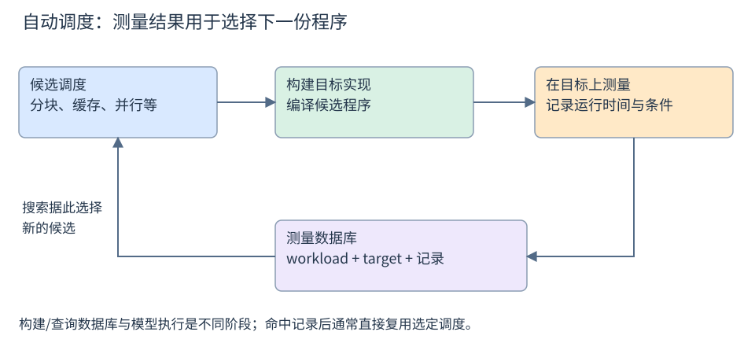

# 自动调度、测量数据库与外部实现

上一章由我们手工决定分块、循环顺序和缓存位置。但对于同一个 Matmul，块宽、缓存层级和计算位置可以组合出许多合法程序，无法只凭“看起来更规整”判断哪个更快。

本章把手工选择变成一个反馈过程：

```text
同一份 TensorIR
  → 生成若干合法调度候选
  → 分别构建、运行并测量
  → 保存表现较好的记录
  → 对匹配的计算与目标复用这项选择
```

本章先介绍候选实现的来源，再沿一次小规模搜索观察测量怎样影响选择、数据库保存哪些记录。选中的方案随后进入构建和调用流程。

后半章介绍外部实现：将计算交给已有函数或后端。编译器可以按目标支持和收益，在自行生成代码与调用外部实现之间选择，两条路径都要满足模型的输入输出约定。

## 1. 从人工 Schedule 到候选空间

手工方案中，开发者明确写出 `split/reorder/vectorize`。对于32列，可能考虑块宽4、8、16；归约维也可能分块；不同块还可以安排到不同并行层次。

候选空间不应该是任意改写的全集。首先需要保留语义与结构约束，再结合目标限制产生合理候选。例如越界必须有正确处理，归约不能随意并行，某种指令要求的维度和布局必须满足。

**规则调度**将常见的结构判断与变换策略编码下来，在遇到某类计算时生成合适方案。TVM的DLight提供这一类能力，具体规则和支持目标依版本而定。

**搜索调度**则在规则和可变决策形成的空间里探索多个方案，并使用评估结果更新选择。MetaSchedule将调度规则、候选生成、构建、测量和记录组织起来。

规则构造并限制候选空间，搜索在其中比较决策；不同操作可以选择不同策略。

这些组件分别决定不同的事：Schedule 原语负责改写 IR；调度规则根据 Block 的计算方式选择可以尝试的变换；搜索策略决定下一批测量哪些候选。DLight 的相应规则可以直接给出方案，MetaSchedule 则生成候选并结合测量进行选择。能处理哪些计算，仍取决于各项规则的支持范围。

例如第五章创建复制块后，可以把它放到 k 循环里面，每次准备一个元素；也可以考虑在外层准备更多数据。调度原语负责完成这些改写，人工策略或搜索系统负责选择位置。搜索省去了手工逐一比较，却需要花时间构建和测量候选。



沿闭环追踪的是候选实现及其测量记录。每个候选需要构建并在目标条件下测量，搜索器再利用这些结果选择下一批候选。模型正常执行时可以复用已选实现，不必每次请求都重新跑这个闭环。

## 2. 构建、运行与反馈

候选仍然只是一种调度方案。只有把它构建并执行，搜索过程才有依据判断这项选择的成本。

一个候选从“看起来可能更快”到“具有测量记录”，至少经历：

```text
生成合法schedule
  → 应用到原始TensorIR
  → 构建目标代码
  → 在目标环境运行并测量
  → 记录成功结果或失败原因
```

下面用三个候选和假设耗时，推演测量反馈如何影响选择：

| 候选 | 构建与执行 | 运行时间 | 后续处理 |
|---|---|---:|---|
| 宽度4 | 成功 | 3微秒 | 保存有效测量 |
| 宽度8 | 成功 | 2微秒 | 当前较好候选 |
| 某个激进方案 | 构建失败 | 无有效时间 | 记录失败，不能当成零耗时 |

如果预测模型原来把激进方案排第一，构建失败仍会使它无法成为可用实现。预测只影响先尝试谁，实际反馈才说明候选能否在目标环境运行以及测得多快。

builder负责把候选变成可运行产物，runner负责测量。构建失败、资源超限和测量失败都是搜索需要处理的结果，不能把没有成功运行的候选当作最快实现。

成本模型利用候选特征预测性能，帮助筛掉一部分方案、减少实际测量。目标设备上的测量再为选择提供反馈。

下面的实验采用随机成本模型，只尝试 8 次，用来观察候选怎样被构建、测量和保存。这样的规模不足以说明已经找到了高性能方案。

## 3. 一次实际 MetaSchedule 搜索

对前章的32×32 Matmul，核心调用为：

```python
database = ms.tune_tir(
    mod=Matmul,
    target="llvm -num-cores=1",
    work_dir="tuning",
    max_trials_global=8,
    num_trials_per_iter=4,
    num_tuning_cores=1,
    cost_model="random",
    strategy="replay-trace",
    seed=0,
    # 完整实验还显式限制builder/runner并发与测量次数
)
sch = ms.tir_integration.compile_tir(database, Matmul, "llvm -num-cores=1")
```

`tune_tir` 运行搜索并保存测量记录。后面的 `compile_tir` 在这里返回的是一个 `Schedule`：它查询匹配记录，把选中的变换应用到原 TensorIR。这个函数名容易使人误以为已经拿到机器码，但还需要编译 `sch.mod` 才能运行。

这次实验得到 8 条测量记录，随后编译选中的程序并与 NumPy 比较，最大绝对误差约为 `1.9e-6`。

计时结果只能告诉我们运行用了多久。实验还需另外比较数值，确认选中的程序正确计算了矩阵乘法。

搜索结束后，模型运行时不必重新尝试这八个候选。编译阶段从数据库取得适用的 trace，将其中的变换应用到原 TensorIR，再构建选中的实现。最终每次执行模型，只运行选定程序。

```text
调优阶段：原程序 → 多个 schedule → 多次编译与测量 → 数据库
构建阶段：原程序 + 目标 → 查询匹配记录 → 重放 schedule → 编译产物
运行阶段：实际输入 → 调用选中程序 → 结果
```

trace记录的是从原程序到候选程序的变换和决定，数据库还要关联工作负载、目标等信息。复用时需要找到匹配问题，不能把一个矩阵大小的最快记录不加判断地套到另一个问题上。

## 4. 测量范围与复用条件

小规模搜索已经产生记录，接下来要确定记录能回答多大的问题：测了哪些开销，又能在什么条件下用于另一轮编译？

一个记录的意义依赖具体条件：shape、dtype、目标特征、线程配置、编译选项和测量环境。改变其中某项可能改变最优方案，甚至使原实现不适用。

模型级性能还包括图调用、分配、布局转换和外部边界。如果某个单算子变快，却新增了两次大张量布局复制，整个模型可能更慢。因此最终仍要回到端到端测量。

假设原函数耗时 10 微秒，新函数只需 6 微秒，但使用它之前和之后各需 4 微秒转换布局，那么这一段总耗时变成 14 微秒，反而更慢。单独测内核会漏掉这项代价。

搜索本身也有成本。对只运行一次的小任务，大量调优不一定划算；对于长期重复部署的固定模型，提前测量并复用数据库则更有价值。

上面比较的都是 TVM 自己生成的程序。选中后得到的仍是 TensorIR，第七章会继续把它编译为可调用代码。另一种选择是直接调用现成函数，接下来就看模型如何传入数据、取得它计算的结果。

## 5. 外部函数的调用契约

上面是在自行生成的程序之间选择。若已有一个外部实现可以完成相同计算，就要改为解决接入问题：模型如何准备参数、取得结果？

现在不让TVM生成本例全部数值循环，而是交给一个已注册函数。Relax可以表达：

```python
result = R.call_dps_packed(
    "course.affine_relu",
    (x, weight, bias),
    out_sinfo=R.Tensor((2, 2), "float32"),
)
```

模型层仍然知道结果结构，因此后续能够分配输出。被调用函数按约定接收输入以及目标输出存储，负责填入结果。

观察实验注册一个Python/NumPy参考函数：

```python
@tvm.register_func("course.affine_relu")
def affine_relu(x, weight, bias, output):
    value = np.maximum(x.numpy() @ weight.numpy() + bias.numpy(), 0)
    output.copyfrom(value)
```

这个注册动作把名字与一个 callable 关联起来，并未在注册时执行模型。后续模型运行时先准备输出 Tensor，再通过名字解析到该 callable，按 `x, weight, bias, output` 的顺序传入参数。函数填充 output，模型层得到的 result 就对应这份输出。

若没有注册这个名字，运行时就找不到函数；若注册成功却传错参数顺序，调用也不能正确计算。因此要分别检查函数是否存在、参数是否正确，以及函数本身的计算是否正确。

这个函数运行后同样得到 `[[0.5,7.5],[1.5,0]]`。示例使用 Python 和 NumPy，会有调用开销与数据拷贝；它用于展示外部函数怎样接收参数和填充输出。

接入实际库时，也要说明函数名怎样找到实现、参数按什么顺序传递、输出由谁分配和释放。若函数在设备上执行，还要检查 dtype、布局和设备是否符合要求，以及调用使用哪个 stream、何时需要同步。

## 6. 从单函数接入到 BYOC

完整的 **Bring Your Own Codegen（BYOC）** 接入，还需要告诉 TVM 哪段模型可以交给外部后端。编译器先识别这些计算，把它们提取成函数，再调用外部后端编译，最后让模型入口能够调用生成的结果。

可以沿本例推演：

```text
识别 matmul + bias + relu 模式
  → 检查dtype、shape、layout和目标支持条件
  → 将支持区域交给外部codegen
  → 模型图改为调用外部实现
  → 运行时加载产物并传递输入/输出
```

如果只支持某种精度或激活，不能不加检查地匹配所有形状和dtype。区域之外的计算仍由其他实现完成，边界上的布局转换、workspace和同步也会影响收益。

前节的实验只演示了 PackedFunc 调用。这里的 BYOC 流程用于说明进一步接入后端时还需完成哪些工作，相关固定版本源码列在章末。

无论计算函数由 TVM 生成，还是由外部后端提供，模型入口都要准备符合要求的输入与输出，再按约定调用它。下一章继续看 TVM 自己生成的函数怎样完成编译和运行。

## 7. 推演与实践入口

1. 预测最快的候选如果构建失败，为什么不能被选为可用实现？调优结束后每次模型调用是否还要重新试全部候选？
2. 内核由10微秒降到6微秒，新增两次各4微秒的布局复制，整段是否加速？这对测量边界有什么要求？
3. 外部函数已注册且结果正确，是否已经完成BYOC？还缺哪些图分区、编译和调用边界工作？

实验见 [TVM labs 的 tune 与 external](https://github.com/jnfkdsn/aicompiler/tree/main/tvm-e2e)。固定源码参考 [MetaSchedule集成](https://github.com/apache/tvm/blob/v0.20.0/python/tvm/meta_schedule/tir_integration.py)、[DLight](https://github.com/apache/tvm/tree/v0.20.0/python/tvm/dlight)、[RunCodegen](https://github.com/apache/tvm/blob/v0.20.0/src/relax/transform/run_codegen.cc) 与 [FuseOpsByPattern](https://github.com/apache/tvm/blob/v0.20.0/src/relax/transform/fuse_ops.cc)。
