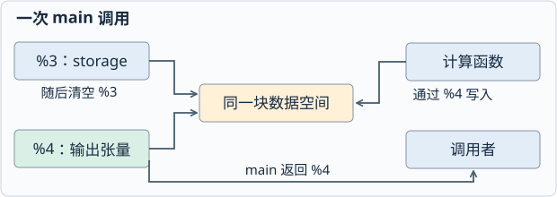

# TIR Lowering、目标代码与 Relax VM

前面已经能为矩阵乘法写出 TensorIR，并通过调度调整循环。接下来要让模型真正运行起来：传入 x、weight、bias，得到 `relu(x @ weight + bias)` 的结果。

这里还需要完成两件事。计算函数要编译成 CPU 能执行的代码；调用这个函数的程序还要准备输出张量，把输入和输出一起传进去，最后返回结果。先用伪代码看清它们怎样配合：

```text
main(x, weight, bias)：
    output = 分配一个形状为 [2,2] 的输出张量
    compute(x, weight, bias, output)
    返回 output

compute(x, weight, bias, output)：
    计算矩阵乘法、偏置和 ReLU
    将结果写入 output
```

后面用 `compute` 指这里负责数值计算的函数。在本例中，TVM 将它编译成 CPU 代码，将 `main` 编译成由 Relax VM 执行的字节码。调用者请求 VM 执行 `main`，VM 再调用 `compute`。

本章就沿着这次调用展开：先分清编译时和运行时分别做什么，再看计算函数怎样编译、输出怎样传入，最后解释 VM 的执行和输出存储的释放。

## 1. 编译时生成程序，运行时处理数据

先假设 `compute` 已经编译好了。它接收四个参数，最后一个参数告诉它把结果写到哪里。因此，调用它之前必须准备好输出张量。

这正是 `main` 要做的工作：准备输出，调用 `compute`，再把填好数据的输出返回。在本章的实现中，这些步骤由 VM 执行。

编译和运行发生在不同时间。编译器看到“分配输出”这条操作时，会生成以后执行分配的代码；它不会因此就完成某次请求的输出分配。同样，编译矩阵乘法循环时，也还没有计算本次输入的结果。

| 时机 | compute | main |
|---|---|---|
| 编译时 | 把 TensorIR 中的循环、读写和算术操作编译成目标代码 | 生成检查输入、准备输出、调用 compute 和返回结果的字节码 |
| 运行时 | 读取本次输入的数据，将计算结果写入输出 | 执行这些字节码，为本次调用准备输出并传递参数 |

调用者拿到的是模型的输出张量。为了产生这个张量，VM 和已经编译好的计算函数各自完成一部分工作。

## 2. 把 TensorIR 编译成 CPU 代码

`compute` 的循环在 TensorIR 中已经写好了，但 CPU 无法直接执行 TensorIR。TVM 还要继续改写这份程序，生成 LLVM IR，再由 LLVM 生成目标代码。

为了看清循环怎样变化，这一节使用第五章独立的 32×32 Matmul。它比包含偏置和 ReLU 的整个模型更容易观察。下一节再回到原来的模型调用。

编译这个 Matmul 使用：

```python
lib = tvm.tir.build(sch.mod, target="llvm")
```

`sch.mod` 是调度后的 TensorIR 模块。`build` 会运行后续 Pass，并调用 LLVM 后端。下面观察其中两项具体变化。

### 2.1 二维索引与向量循环的改写

第五章把输出列分成了宽度为 8 的块。`jo` 表示第几个列块，`ji` 表示块内的列位置，因此列号为 `jo*8+ji`。一个累加步骤可以写成：

```text
C[i, jo*8+ji] += A[i,k] * B[k, jo*8+ji]
```

这些矩阵每行有 32 个元素。要访问 `C[i,j]`，从开头跳过 i 行，再向后走 j 个元素，元素偏移就是 `i*32+j`。`FlattenBuffer` 会把这样的二维访问改成一维偏移。实际中间 IR 中的更新可以简写为：

```text
C[i*32 + jo*8 + ji] += A[i*32 + k] * B[k*32 + jo*8 + ji]
```

元素的位置没有改变，只是索引的表达方式变了。例如 `C[1,2]` 仍是从开头数、偏移为 34 的那个元素。

此前我们还把 `ji` 循环标记为向量化。`VectorizeLoop` 会继续处理这项标记，将块内八个位置的加载、计算和存储写成向量操作。下面用切片形式示意实际向量 IR 的含义：

```text
base = i*32 + jo*8
C[base : base+8] = C[base : base+8]
                  + broadcast(A[i*32+k], 8) * B[k*32+jo*8 : k*32+jo*8+8]
```

八个输出共用同一个 `A[i,k]`，分别乘上 B 中相邻的八个元素，再加到 C 的八个位置。`broadcast` 在这里表示把一个标量作为向量的八个分量使用。

这个例子的 LLVM 输出包含 `<8 x float>` 的加载、存储，以及 `llvm.fmuladd.v8f32` 调用。它们表明八元素向量计算已经出现在生成的 LLVM IR 中。LLVM 还会根据目标 CPU 选择机器指令、分配寄存器；最终是否用一条同宽指令完成，要继续查看汇编。

### 2.2 其他结构怎样继续降低

二维索引和向量循环之外，TensorIR 还包含计算块、归约初始化和存储声明。后端也要处理这些内容，才能把程序交给代码生成器。

例如，归约的初始化如果仍保存在 `T.init` 中，就需要改写成普通的执行语句；高层计算块可以去掉，但块里的循环、算术和读写要保留下来；存储相关的 Pass 则继续处理 buffer 的分配与使用。

本例实际构建经过的相关 Pass 可以摘录为：

```text
LowerInitBlock
  → ConvertBlocksToOpaque / LowerOpaqueBlock
  → FlattenBuffer
  → VectorizeLoop
  → StorageRewrite 等后续处理
  → host/device 与调用接口处理
  → 目标 intrinsic 处理、LLVM codegen
```

这份摘录省略了其他 Pass，主要用于对应刚才观察的变化。第五章已经拆出的初始化，不需要 `LowerInitBlock` 再生成一次。

也可以由此区分调度与 lowering：我们通过调度决定把哪八列放在一起计算，后续 Pass 再把这个决定写成向量加载和算术操作。`target="llvm"` 指定编译目标，但并没有替我们选择第五章的分块大小或缓存位置。

最终的存储也还可能变化。调度后看到的缓存声明，后续可能被缩小、移动或进一步优化；局部值也可能因寄存器不够而存到内存。判断实际访问了多少内存，需要说明正在看哪个阶段的 IR，必要时检查目标代码。

## 3. 为计算函数准备输出参数

回到完整模型。Relax 中的调用写成：

```python
result = R.call_tir(Module.fused_matmul_add_relu,
                    (x, weight, bias),
                    out_sinfo=R.Tensor((2, 2), "float32"))
```

这里的 `fused_matmul_add_relu` 就是开头所说的 `compute`。Relax 表达式提供三个输入，并把结果记为 `result`；对应的 TensorIR 函数却需要四个 buffer 参数，最后一个是要写入的输出。

缺少的输出参数由编译器补上。`out_sinfo` 已经说明结果形状为 `[2,2]`、类型为 float32，编译器可以据此生成准备输出的代码，再把输出传给计算函数。改写前后的意思如下：

```text
改写前：
    result = call_tir(fused, x, weight, bias)

改写后：
    result = 分配形状为 [2,2]、类型为 float32 的输出张量
    fused(x的数据, weight的数据, bias的数据, result的数据)
    后续计算使用 result
```

在这个版本中，`CallTIRRewrite` 等变换完成这类处理。运行时，先准备 `result` 的空间，再调用计算函数；计算函数将结果写进去以后，后面的程序就能读取它。

因此，模型中的“返回一个张量”可以通过“调用方准备张量，计算函数负责写入”来实现。用户仍然得到一个结果张量，只是内部多了准备空间和传递输出参数这几步。

若输出形状包含动态维度，例如 `[B,2]`，程序就需要在运行时取得 B，再确定本次输出要多大。这也是输出形状信息必须保留到这个阶段的原因。

## 4. VM 怎样执行一次模型调用

调用者通过下面这行代码运行模型。三个参数是已经准备好的 TVM 输入数组：

```python
y = vm["main"](x_nd, weight_nd, bias_nd)
```

VM 找到编译后的 `main`，执行它的字节码。这里的字节码可以理解为 VM 支持的一组指令，用来检查输入、准备张量、调用函数和返回结果。本例的关键指令如下，省略号表示未列出的检查参数和常量索引：

```text
@main:
  call vm.builtin.check_tensor_info ...
  call vm.builtin.match_shape ...
  call vm.builtin.alloc_storage ... dst: %3
  call vm.builtin.alloc_tensor  ... dst: %4
  call vm.builtin.null_value        dst: %3
  call fused_matmul_add_relu in: %0, %1, %2, %4 dst: %void
  ret %4
```

可以先抓住最后两行。`%0`、`%1`、`%2` 保存三个输入，`%4` 保存输出张量。VM 把这四个参数传给 `fused_matmul_add_relu`，等函数写好输出后，再把 `%4` 返回给调用者。

前面的分配指令就是在准备 `%4`。其中 `%3` 暂存一个存储对象，`alloc_tensor` 基于它创建输出张量。之后 `%3` 被清空，但 `%4` 仍然有效；下一节会解释这两个对象怎样共同使用底层存储。

矩阵乘法中的加载、乘法和加法没有逐条出现在这份字节码中。它们已经由第二节的后端编译成 CPU 代码。VM 只需调用计算函数，CPU 就会执行其中的循环。

整次调用因此是：调用者传入数据，VM 执行 `main` 并准备输出，计算函数填入结果，VM 返回输出。这也说明为什么只编译好计算函数还不够——还需要程序为它准备参数并发起调用。

本章使用 TVM 的 bytecode 模式。固定版本也支持其他执行模式，这里先用实际观察到的这条路径说明 VM 与计算函数的分工。

## 5. 输出张量与底层存储

### 5.1 清空 storage 后，output 为什么仍然有效

本例的输出有四个 float32 元素，需要 16 字节的数据空间。编译后的 Relax 中，可以看到如下分配和调用代码：

```python
storage = R.vm.alloc_storage(R.shape([16]), R.prim_value(0),
                             R.dtype("uint8"), R.str("global"))
output = R.vm.alloc_tensor(storage, R.prim_value(0),
                           R.shape([2, 2]), R.dtype("float32"))
R.vm.kill_object(storage)
Module.fused_matmul_add_relu(x, weight, bias, output)
return output
```

`alloc_storage` 先取得一块按字节计量的存储，`alloc_tensor` 再在其上创建形状为 `[2,2]`、元素类型为 float32 的张量对象。两个操作分别负责数据空间和张量描述。

`output` 不仅记录形状和类型，还持有底层存储。因此，即使程序不再保留 `storage` 这个局部引用，仍然能通过 `output` 使用那块数据。顺着绿色输出张量的两条线读，一条线找到它使用的数据，另一条线找到最终拿到它的调用者。



`kill_object(storage)` 清除的是当前局部引用，没有强制释放 `output` 仍在使用的数据。计算函数可以继续向 `output` 写入结果；函数返回后，调用者也可以继续读取结果。等相关对象都不再持有这块存储时，运行时才可以回收或复用它。

16 字节是这份输出数据的大小。计算中的临时 buffer 和张量管理信息还会占用额外空间。

### 5.2 最后一次使用与存储复用

同一块空间能否交给另一个张量使用，要看原来的数据是否还会被读取。

假设 A 和 B 都需要 16 字节，运行顺序是：

```text
步骤1：产生 A
步骤2：最后一次读取 A
步骤3：产生 B
步骤4：读取 B
```

从步骤3开始，A 的数据已经没有用途。如果设备、大小、对齐和别名等条件允许，B 就可以使用原来存放 A 的空间。

若步骤 4 继续读取 A，步骤 3 写 B 就会破坏所需旧值，复用因此失效。A 被返回时，也要为调用方保留其数据。

编译器可以提前分析这些使用关系，并为能够证明安全的情况安排存储复用。这就是内存规划的一部分。动态形状也能保留有用的信息：若输出为 `[B,2]`、float32，数据大小就是 `8B` 字节。B 的具体数值可以等到运行时取得，再执行相应的大小计算和分配。

## 6. 设备执行与模型加载

### 6.1 从 CPU 调用到 GPU 执行

上面的计算函数在 CPU 上运行。若改成 GPU 执行，主机通常还需要准备设备参数，通过设备运行库启动 kernel，GPU 再执行各线程负责的计算。

TVM 的 `SplitHostDevice`、`MakePackedAPI`、`LowerDeviceKernelLaunch` 等 Pass 会处理主机与设备代码的拆分、参数传递和启动操作。调用者仍然要提供输入和取得输出，只是执行计算的设备和调用方式发生了变化。

进入 GPU 后，需要为循环重新安排线程映射、共享存储与同步，再使用 TVM 的设备后端构建并在目标上检查性能。本章使用 LLVM CPU 路径。

### 6.2 保存并重新加载编译结果

模型编译完成以后，可以保存产物，供之后的程序加载使用。本例的代码是：

```python
executable.export_library("affine.so")
module = tvm.runtime.load_module("affine.so")
vm = relax.VirtualMachine(module, tvm.cpu())
y = vm["main"](x_nd, weight_nd, bias_nd)
```

第一行将编译结果导出到共享库文件。随后加载这个文件、创建 VM，就可以再次调用 `main`，不必重新构造原来的 Relax 模型并编译。本例重新加载后仍得到 `[[0.5,7.5],[1.5,0]]`。

加载环境需要有相容的 TVM runtime、系统和目标架构。若模型还会调用外部函数，也要让运行时能找到相应实现。例如，第六章通过 Python 注册的 PackedFunc，在新进程中仍需要提供；保存模型不会把那段 Python 函数自动编译进共享库。

最后还要区分计算时间和整个调用的时间。把 NumPy 数据转成 TVM 数组、把结果转回 NumPy，都可能复制数据。DLPack 可以在适用条件下共享存储，但仍要正确处理设备同步和存储的持有关系。只测计算函数时通常不包含这些步骤；测应用的总耗时时，则需要明确是否把它们算在内。

## 7. 回顾与自查

模型最终能够运行，是因为两部分程序已经准备好：计算函数包含编译后的循环与算术操作，`main` 负责检查输入、准备输出并调用它。在本例中，VM 执行 `main` 的字节码，计算函数将结果写入输出张量，最后由 VM 把这个张量返回给调用者。

可以用下面三个问题检查这次调用：

1. `compute` 已经编译成 CPU 代码，却没有自行返回一个结果张量。调用前还要准备什么？`main` 的这些步骤由谁执行？
2. `call_tir` 只写了三个输入，为什么调用计算函数时会出现第四个输出参数？准备输出的代码何时生成，内存分配何时执行？
3. VM 字节码里没有矩阵乘加循环，矩阵乘法在哪里执行？清空 `storage` 局部引用后，为什么仍能通过 `output` 读取结果？

本章采用 TVM v0.20.0。可复现例子见 [TVM labs 的 runtime](https://github.com/jnfkdsn/aicompiler/tree/main/tvm-e2e)，实际 TIR Pass 输出和 LLVM IR 由 [design_probe](https://github.com/jnfkdsn/aicompiler/blob/main/tvm-e2e/design_probe.py)保存。

需要继续读源码时，可按正在调查的问题选择入口：输出参数与分配见 [CallTIRRewrite](https://github.com/apache/tvm/blob/v0.20.0/src/relax/transform/call_tir_rewrite.cc) 和 [StaticPlanBlockMemory](https://github.com/apache/tvm/blob/v0.20.0/src/relax/transform/static_plan_block_memory.cc)；VM 的生成与执行见 [VM 构建](https://github.com/apache/tvm/blob/v0.20.0/python/tvm/relax/vm_build.py) 和 [VM runtime](https://github.com/apache/tvm/blob/v0.20.0/src/runtime/relax_vm/vm.cc)；计算函数的后端见 [TIR build](https://github.com/apache/tvm/blob/v0.20.0/python/tvm/tir/build.py)、[TIR pipeline](https://github.com/apache/tvm/blob/v0.20.0/python/tvm/tir/pipeline.py) 和 [LLVM codegen](https://github.com/apache/tvm/blob/v0.20.0/src/target/llvm/codegen_llvm.cc)。
