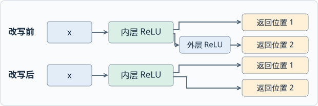

# Relax 改写、调度修改与问题定位

前面几章介绍了 TVM 怎样编译和运行模型。这一章，我们给编译器增加一条自己的优化规则：如果图中连续做了两次 ReLU，就删掉第二次。

ReLU 会把负数变成 0，保留非负数。例如，`[-2,0,3,8]` 经过一次 ReLU 后得到 `[0,0,3,8]`，再做一次，结果仍然相同。因此可以把 `relu(relu(x))` 改成 `relu(x)`。

我们要把这个想法写成一个 Pass，让它在编译时检查 Relax 函数，找到重复的 ReLU，修改相应的表达式。之后继续编译和运行模型，检查结果有没有变化。下面先看图应该怎样修改，再写匹配与替换代码，最后讨论规则没有生效或结果出错时该查哪里。

## 1. 重复 ReLU 的等价改写

先看一个 Relax 函数的主体。它做两次 ReLU，并把两次计算的结果都返回：

```python
with R.dataflow():
    inner = R.nn.relu(x)
    result = R.nn.relu(inner)
    R.output(inner, result)
return inner, result
```

这里有两个需要保留的输出，但不需要做两次相同计算。第一次 ReLU 已经把负数变成 0，第二次 ReLU 得到的张量值与 `inner` 相同。因此，原来使用 `result` 的地方可以直接使用 `inner`：

```python
with R.dataflow():
    inner = R.nn.relu(x)
    R.output(inner)
return inner, inner
```

函数仍然返回两项结果。输入为 `[-2,0,3,8]` 时，两项都是 `[0,0,3,8]`。改写删除了第二次 ReLU，保留了第一次计算和两个返回位置。

这个例子还说明了为什么不能把匹配到的两层操作都删除：第一次 ReLU 仍然负责处理输入中的负数。如果直接返回 `x`，第一个元素就会错误地保留为 -2。

另一种图也不能使用这条规则：

```text
inner = negative(x)
result = relu(inner)
```

当 `x=-2` 时，取负再做 ReLU 得到 2。删掉取负会改变结果，因此规则需要匹配两层 ReLU 及其连接关系。

本例讨论的是 Relax 中的张量值。若要将相同改写用于允许原地修改的接口，还需要检查调用者是否要求两个输出拥有独立存储：返回两个数值相同的张量，与返回同一个可修改对象两次，可能有不同的后续行为。

## 2. 用 DPL 匹配两层 ReLU

匹配器沿调用关系寻找目标：外层是 ReLU，它的输入来自另一个 ReLU。这样，即使变量改名，规则仍能识别相同的计算结构。

TVM 的 Dataflow Pattern Language，简称 DPL，用来描述这样的匹配条件。这个例子需要三行描述：

```python
from tvm.relax.dpl import wildcard, is_op, rewrite_call

x = wildcard()
inner = is_op("relax.nn.relu")(x)
outer = is_op("relax.nn.relu")(inner)
```

这里的 Python 变量 `x`、`inner`、`outer` 保存的是**匹配条件**，写下这些代码不会创建实际的 ReLU 计算。

`wildcard()` 表示这里可以匹配任意输入表达式。我们不要求输入必须来自函数参数，也允许它来自前面的其他计算。`inner` 在这个条件之外加了一层要求：输入必须经过一次 ReLU。`outer` 再加一层，要求内层 ReLU 的结果又被一次 ReLU 使用。

假设实际函数里写的是：

```text
a = relu(input)
b = relu(a)
```

匹配外层 `relu(a)` 时，TVM 会沿着 `a` 的定义找到 `relu(input)`，从而识别出两层 ReLU。它不要求源码恰好写成一行 `relu(relu(input))`，也不要求实际变量叫 `inner`。

对于上一节的 `negative → relu`，外层虽然是 ReLU，内层却不符合 `inner` 的条件，所以匹配失败，函数保持原样。

DPL 到这里完成了“找到哪段计算”的工作。找到以后用什么替换，还需要我们编写下一节的回调。

## 3. 替换回调与函数 Pass

匹配成功后，我们希望外层 ReLU 直接使用内层的结果。替换函数只需要返回匹配到的内层表达式：

```python
def replace(call, matched):
    return matched[inner]
```

`call` 是当前匹配到的调用；本例是外层 ReLU。`matched` 保存匹配条件与实际表达式之间的对应关系，因此 `matched[inner]` 能取到刚才找到的内层 ReLU 表达式。这个简单规则不需要另外读取 `call`。

返回这个表达式，就是告诉 TVM：“用内层的计算结果替换当前外层调用。”如果返回 `matched[x]`，就会绕过两次 ReLU，变成直接使用原输入，第一节的负数例子便会出错。



从右向左追第二个返回位置，替换前会经过两次 ReLU，替换后只经过一次。第一个返回位置的输入一直来自内层。

接下来，把匹配条件和替换函数放进一个函数 Pass。下面是完整的 Pass 定义：

```python
from tvm import relax
from tvm.relax.dpl import wildcard, is_op, rewrite_call

@relax.transform.function_pass(opt_level=0)
class RemoveRepeatedRelu:
    def transform_function(self, func, mod, ctx):
        x = wildcard()
        inner = is_op("relax.nn.relu")(x)
        outer = is_op("relax.nn.relu")(inner)

        def replace(call, matched):
            return matched[inner]

        return rewrite_call(outer, replace, func)
```

先看最后一行：`rewrite_call(outer, replace, func)` 要求 TVM 在 `func` 中寻找符合 `outer` 条件的调用，找到后执行 `replace`，并返回改写后的函数。

外面的 `function_pass` 将这个类包装成 TVM 可以执行的函数 Pass。运行 Pass 时，TVM 把要处理的 Relax 函数交给 `transform_function`；我们的实现再把该函数交给 `rewrite_call`。`mod` 和 `ctx` 分别提供所在模块和 Pass 上下文，这条规则没有用到它们。

整个过程可以按下面的顺序读：

```text
执行 RemoveRepeatedRelu
    → TVM 调用 transform_function，传入待处理函数
    → rewrite_call 在函数中寻找两层 ReLU
    → 匹配成功时调用 replace
    → replace 返回内层表达式
    → rewrite_call 整理替换后的函数并返回
```

我们写的代码负责选择匹配条件和替换内容；遍历表达式、应用替换以及整理绑定由 TVM 的改写工具完成。因此，回调里没有手工删除所有相关节点的代码。第一次 ReLU 还被返回值或其他操作使用时，这项计算应当保留。

这与 MLIR Pattern 一样，先匹配适用条件，再构造替换结果。这里的回调返回替换表达式，框架随后用它改写匹配位置。

## 4. 执行 Pass 并验证结果

定义好 `RemoveRepeatedRelu` 后，模块还没有发生变化。下面第一行才真正执行这个 Pass。假设 `mod` 是包含第一节函数的 `IRModule`，后面几行继续编译模型并创建 VM：

```python
import tvm

rewritten = RemoveRepeatedRelu()(mod)
optimized = relax.get_pipeline("zero")(rewritten)
executable = tvm.compile(optimized, target="llvm")
vm = relax.VirtualMachine(executable, tvm.cpu())
```

`RemoveRepeatedRelu()` 创建 Pass 对象，紧接着的 `(mod)` 把它应用到模块。得到的 `rewritten` 是改写后的模块；后续 pipeline 和编译器处理的是这份结果。

这个 Pass 要在 ReLU 仍表示为 `relax.nn.relu` 时运行。例如，经过 `LegalizeOps` 后，原来的 ReLU 已经可能变成调用 TensorIR 函数的 `call_tir`。计算仍然是 ReLU，但图中已经没有我们要匹配的操作形式，这条规则就找不到它了。

可以把它理解为对同一计算的两种表示：

```text
改写规则认识的形式：relax.nn.relu(inner)
实现转换后的形式：  call_tir(relu_impl, ...)
```

因此，检查自定义优化时，要同时检查它做了什么，以及它被安排在什么时候执行。

运行后先看 `rewritten` 的 IR。第一节的函数应只剩一次 ReLU，返回两次 `inner`；`negative → relu` 的函数应保持不变。然后再把改写前后的模块分别编译运行，比较所有返回结果。

这两项检查不能相互替代。即使 Pass 一次也没匹配成功，模型通常仍能算出正确结果；只比较数值，就发现不了“自己的优化根本没有执行”。反过来，IR 中少了一次 ReLU，也需要检查是否删错了计算。

本章参考实现已在 CPU 上比较过四组输入：混合正负数、全负数、全正数，以及包含 NaN、正负无穷和负零的一组数据。两个返回结果均参与比较；不匹配的函数也检查了结构保持不变。特殊值的比较把对应位置的 NaN 视为一致，未检查 NaN 的位模式或正负零的符号位。这里验证的是这些用例的结果，没有测量这条规则能带来多少加速。

## 5. 用中间 IR 定位错误

写优化时，常见的两种情况是：规则没有改变图，或者图变了但结果错了。它们应该从不同位置开始检查。

如果重复 ReLU 仍然存在，先确认传给 Pass 的函数里是否还有 `relax.nn.relu`，然后检查两层操作是否真的相连。这样可以区分“运行太晚，操作已经展开”和“匹配条件写错”这两种原因。

如果图已经改变，但负数输入的结果出错，就先检查回调返回了什么。例如，把 `matched[inner]` 写成 `matched[x]`，会让负数未经 ReLU 就进入返回值。此时已经有明确的错误来源，无需先阅读 LLVM 后端。

更复杂的错误也可以用相同方法缩小范围。回到前几章的模型，假设某个输入位置的矩阵乘法结果与 bias 为：

```text
matmul[0,1] = 8
bias = [0.5, -0.5]
```

第一行第二列应该使用 `bias[1]`，所以最终结果是 `relu(8 - 0.5) = 7.5`。如果生成代码错误地使用 `bias[0]`，就会得到 8.5。

可以按编译顺序检查：Relax 中的加法是否仍然按列广播，生成的 TensorIR 是否使用 `bias[j]`，调度之后的访问又有没有改变。若转换前正确、转换后首次出现 `bias[i]`，就优先检查产生这份 IR 的变换。

性能问题也需要看具体代码。假设函数名包含 `fused`，但函数内部仍有两块 `alloc_buffer`，这说明函数合并后还保留着中间张量。继续检查循环在哪里写入、在哪里读取这些张量，才能判断哪些访存被消除了。最终的分配和访问还可能在后端继续变化，判断实际成本要结合目标代码与测量。

每次保留一个足以触发问题的小输入，并对比某次变换前后的 IR。这样通常比同时翻查导入、调度、VM 和所有后端更容易找到原因。

## 6. 图改写与调度练习

理解上述过程后，可以在已有工程中修改一条小规则。练习的重点是独立决定哪些情况能改、应该改成什么，并为容易改错的情况准备输入。

图改写可以尝试消除两次互为逆的维度置换。先限制张量秩和两次置换的轴顺序都已知。例如，三维张量形状为 `[2,3,4]`：

```text
第一次按 [1,2,0] 置换：形状变为 [3,4,2]
第二次按 [2,0,1] 置换：形状回到 [2,3,4]，各元素回到原位置
```

若第二次仍使用 `[1,2,0]`，结果形状变为 `[4,2,3]`，两次操作应当保留。消除规则需确认组合置换使每个轴回到原位，即使某些维度大小相等也一样。若接口返回可修改 view，还要检查共享存储行为。

调度练习则可以继续使用第五章的 32×32 Matmul：将列分块大小改成参数，分别尝试 4、8、7，观察生成的循环，检查不能整除时怎样处理剩余列。若增加缓存，再检查缓存每次准备多少元素，以及相关搬运会执行多少次。

这两种练习改变的内容不同。图改写删除了一项由操作语义证明多余的计算；调度仍然计算同一个矩阵乘法，但改变循环顺序、分块和数据搬运的位置。任选一个小改动完成“预测变化—实现—检查 IR—比较结果”，就能继续练习本章的方法。

## 7. 回顾与自查

这条优化最初只有一个等式：`relu(relu(x)) = relu(x)`。为了让 TVM 执行它，我们用 DPL 找到两次相连的 ReLU，用回调返回内层表达式，再把这个 Pass 放到 ReLU 尚未展开的位置。检查改写后的 IR，能确认规则是否执行；运行前后的程序，能检查输出是否保持一致。

可以用下面三个问题检查是否理解了这个过程：

1. 输入为 `[-2,0,3,8]`。如果回调返回 `matched[x]`，两个返回值会发生什么变化？为什么原来的内层 ReLU 仍需要保留？
2. 执行 Pass 后结果正确，但 IR 里仍有两次 ReLU。接下来应检查什么？如果 Pass 收到的图里只剩 `call_tir`，原来的匹配条件还能找到目标吗？
3. 第一节的函数还增加了一项 `extra = add(inner, 1)`。删除外层 ReLU 时，`extra` 应继续读取哪个值？如果同时删除内层 ReLU，会破坏哪项计算？

后续学习 PyTorch Compiler 时，可以用同样的重复 ReLU 例子比较 FX 图的修改方式，并进一步检查输出对象能否独立修改。TVM 调度中已经遇到的索引、存储和循环问题，也会帮助理解 Triton 如何把内核变成设备代码。

参考实现和前后 IR 见 [design_probe](https://github.com/jnfkdsn/aicompiler/blob/main/tvm-e2e/design_probe.py)，独立调度练习见 [TVM labs](https://github.com/jnfkdsn/aicompiler/tree/main/tvm-e2e/exercises)。本章接口使用 TVM v0.20.0；需要确认参数和实现时，可查 [DPL rewrite_call](https://github.com/apache/tvm/blob/v0.20.0/python/tvm/relax/dpl/rewrite.py) 与 [function_pass](https://github.com/apache/tvm/blob/v0.20.0/python/tvm/relax/transform/transform.py)。
