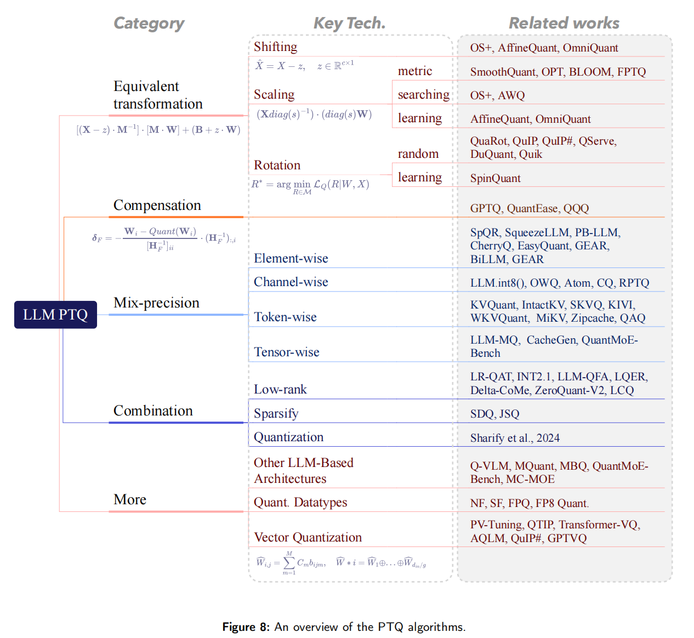

# QAT、PTQ 与量化误差处理

本章整理自 [A Survey of Low-bit Large Language Models](https://doi.org/10.48550/arXiv.2409.16694) 的对应主题。全篇阅读顺序见[量化笔记](./)。

**QAT, Quantization-Aware Training**
训练或微调时模拟量化，让模型适应低精度。

**PTQ, Post-Training Quantization**
给定预训练 FP 模型和少量 calibration data，不做端到端训练，直接得到量化模型。

---

## 5.1 QAT：极低比特更需要

LLM-QAT
BitDistiller
EfficientQAT
BitNet / BitNet b1.58

> QAT 适合 ultra-low-bit，尤其是 1/2/3-bit；但训练复杂、资源要求高。实际更推荐从预训练模型做 QAT fine-tuning，而不是从头训练。

---

## 5.2 PTQ：论文最重要的分类

论文 Figure 8 给出了 PTQ 方法

---

## 5.2.1 Equivalent Transformation：处理 outlier 异常值

如果一个 channel 中有极大值，量化范围就会被 outlier 拉大，普通值只能挤在很少的格点里，误差巨大。

Equivalent Transformation 的核心是：

> 在不改变 FP 模型输出的前提下，重分布 weight/activation，让 outlier 更平滑、更对称、更容易量化。

论文把它分成三类：shifting、scaling、rotation。

---

### Shifting Transformation

目标是处理 activation 的不对称 outlier。

OS+ 使用 channel-wise shift：

> X̂ = X − Δ

其中 Δ 是每个 channel 的 shift。简单做法是取该 channel 最大值和最小值的中点。这样可以减少整体范围。OmniQuant、AffineQuant 则把 Δ 变成可学习参数，用 block-wise quantization error minimization 来优化。

直觉：
如果某个 channel 的分布偏移很大，先把它“居中”，再量化会更好。

---

### Scaling Transformation

Scaling 处理的是 outlier 幅值过大的问题。

SmoothQuant 是代表方法：把 activation 中难量化的大幅值转移到 weight 中，使 activation 更平滑。因为 weight 是静态的，更容易离线处理。AWQ 则发现重要 weight channel 和 activation scale 相关，因此用 activation-aware 的方式保护 salient weight channels。论文给出 AWQ 的搜索目标，用一个超参数 α 平衡显著通道和非显著通道。

直觉：
**activation 难量化，就把难度“搬”到 weight；weight 难量化，就保护重要 channel。**

---

### Rotation Transformation

Rotation 是近年来 LLM 4-bit 量化非常重要的路线。

QuIP 的洞察是：如果 weight 和 Hessian 不够 incoherent，量化误差会集中在某些坐标轴方向。通过正交矩阵旋转 weight，可以让数值分布更均匀，outlier 更少。后续 QuaRot、QuIP#、SpinQuant、QServe、DuQuant 等都属于这个方向。论文指出，QuIP 使用 Kronecker-structured orthogonal matrices 来降低额外计算。

直觉：
不是直接裁剪 outlier，而是“旋转坐标系”，让 outlier 不再集中在某个维度。

---

## 5.2.2 Compensation：补偿量化误差

Equivalent Transformation 主要是让模型更“好量化”；Compensation 则是在量化后补偿误差。

代表方法是 **GPTQ**。GPTQ 的思想来自 Optimal Brain Quantization/Compression：逐列量化权重时，用 Hessian 信息估计某个权重量化对输出误差的影响，然后把误差传播/补偿到还没量化的权重上。

论文把 GPTQ、QuantEase、QQQ 等归到 compensation 类。

我的理解是：

* SmoothQuant/AWQ/QuaRot 是“量化前把分布改好”；
* GPTQ 是“量化过程中边量化边修正”。

两类方法经常可以组合。

---

## 5.2.3 Mixed Precision：不同位置给不同 bit

统一 INT4 很简单，但不是最优。LLM 不同层、不同 channel、不同 token 的敏感度不同，因此 mixed precision 很自然。

论文按粒度分成：

### Element-wise mixed precision

例如 SpQR、SqueezeLLM、PB-LLM、CherryQ、EasyQuant、GEAR、BiLLM 等。一般思想是：大部分值低比特，少量 outlier 或重要值高精度保存。

### Channel-wise mixed precision

代表方法包括 LLM.int8()、OWQ、Atom、CQ、RPTQ。比如 LLM.int8() 会把 outlier channels 单独高精度处理；RPTQ 会 reorder channels，把范围相近的通道聚到一起再量化。

### Token-wise mixed precision

主要用于 KV cache。论文提到 KVQuant、IntactKV、SKVQ 发现特殊 token 或低语义 token 可能造成 token-wise outlier，因此要高精度保留；KIVI、WKVQuant 会保留最近 KV cache 为 full precision，而量化过去 KV cache；MiKV、Zipcache、SnapKV、QAQ 则根据重要性指标保留重要 KV。

### Tensor-wise mixed precision

例如 LLM-MQ、CacheGen、QuantMoE-Bench。CacheGen 发现早期层的 KV cache value 损失更敏感，因此给早期层更高 bit。QuantMoE-Bench 则研究不同 MoE block、expert、linear layer 的 bit 分配。

---

## 5.2.4 Combination：量化与其他压缩方法结合

论文认为，在极高压缩率下，仅靠低比特量化表示能力不足，所以需要和其他压缩方法结合。

### Low-rank + Quantization

例如 LR-QAT、INT2.1、LLM-QFA、LQER、Delta-CoMe、ZeroQuant-V2、LCQ。

这类方法的核心是：量化误差通常可以用低秩结构近似，因此用 LoRA/SVD/低秩补偿来修复量化输出。例如 LR-QAT 通过 LoRA 形式做参数高效 QAT；INT2.1 用 LoRA 把优化目标从单层误差转向整体模型输出误差；LQER 用 SVD 分解量化误差并重建。

### Sparsity + Quantization

比如 SDQ、JSQ。稀疏化减少非零参数，量化减少每个参数 bit，两者可以叠加压缩。

### Quantization + Quantization

论文提到，也可以把不同量化技术组合，比如 SmoothQuant + GPTQ。它强调 equivalent transformation 和 compensation 往往是正交的，可以组合探索。

---

## 5.2.5 新架构：MLLM 和 MoE 量化

这部分和你之前关心的 MLLM 量化很相关。

论文指出，除了传统 dense LLM，MLLM 和 MoE 的量化开始受到关注。

### MLLM

* **Q-VLM**：第一个面向 MLLM 的 PTQ 框架，通过挖掘 cross-layer dependency，在离散误差和搜索成本之间做折中；
* **MQuant**：静态量化方案，为视觉模态和语言模态使用独立量化参数，并缓解 online Hadamard rotation 带来的 weight outlier；
* **MBQ**：考虑语言和视觉模态敏感性差异，通过调整 reconstruction loss 来求 channel-wise equalization factors。

核心问题是：
**MLLM 不是单一文本分布，视觉 token 和语言 token 的分布、敏感性、误差传播方式都不同。**

### MoE

* **QuantMoE-Bench**：探索 MoE 结构感知 mixed precision；
* **MC-MOE**：把 expert 的 bit allocation 转化为线性规划问题，平衡专家重要性。

MoE 的难点是 expert 不均衡，不同 expert、router、block 的敏感度不同。

---

## 5.2.6 更多量化形式：NF/SF/FP/VQ

论文指出，除了 integer quantization，还有很多形式可以把平均 bitwidth 压到 4-bit 或更低；它们不一定加速显著，但常常精度更好。

### More Quantization Datatypes

* **NF**：假设正态分布，信息论上让每个 bin 分到相近数量的值；
* **SF**：假设 Student-t 分布，更适合 LLM 的厚尾分布；
* **FP quantization**：比如 FPQ、FP8 quantization，可以灵活分配 exponent/mantissa，更适合长尾或钟形分布。

### Vector Quantization, VQ

VQ 不是单个元素量化，而是把一组维度作为 vector，选择 codebook 中的向量来表示。论文提到 AQLM、QuIP#、GPTVQ、PV-Tuning、QTIP 等。VQ 的潜力是超低比特高精度压缩，但通常需要复杂 codebook 和特殊 kernel。

对 PTQ 的总结：

> 标准 PTQ 中，shifting/scaling/rotation 可以缓解 outlier；GPTQ 等 compensation 可以进一步降低误差；高精度优先可以用 mixed precision；高压缩率优先可以结合 low-rank 和 sparsity；未来还可以探索新数据格式、新量化函数、MLLM/MoE 等新架构。

---
