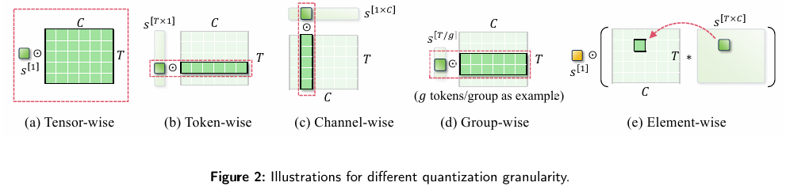
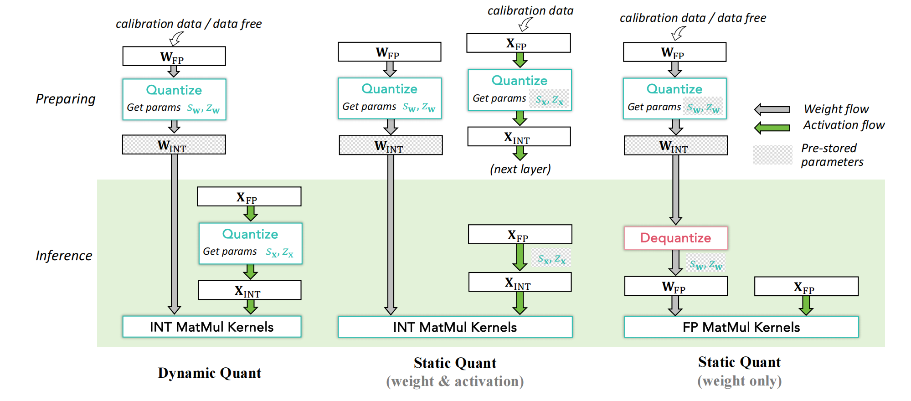

# 低比特格式、量化粒度与流程

本章整理自 [A Survey of Low-bit Large Language Models](https://doi.org/10.48550/arXiv.2409.16694) 的对应主题。全篇阅读顺序见[量化笔记](./)。

论文第 2 节讲三个基础问题：

1. **用什么低比特数值格式表示？**
2. **按什么粒度量化？**
3. **动态量化还是静态量化？**

---

## 2.1 低比特数值格式

### 2.1.1 标准格式：FP、INT、Binary

**FP 浮点格式**

浮点数由符号位指数位，尾数位组成。
- 浮点数类型：

| 格式 | 总位宽 | 符号 / 指数 / 尾数位 | 最大正规数 | 最小正正规数 | 十进制有效位数 | 核心定位 |
|------|--------|-------------------|-----------|-----------|------------|------|
| FP32 | 32 位 | 1/8/23 | ~3.4×10³⁸ | ~1.175×10⁻³⁸ | 6~9 位 | 通用高精度基准 |
| FP16 | 16 位 | 1/5/10 | 65504 | ~6.1×10⁻⁵ | 3~4 位 | 边缘推理、图形渲染 |
| BF16 | 16 位 | 1/8/7 | ~3.4×10³⁸ | ~1.175×10⁻³⁸ | 2~3 位 | 大模型训练 / 推理主力 |
| FP8 E4M3 | 8 位 | 1/4/3 | 448 | 0.015625 | 1~2 位 | 权重 / 激活值计算 |
| FP8 E5M2 | 8 位 | 1/5/2 | 57344 | ~6.1×10⁻⁵ | ~1 位 | 梯度计算 |

**INT 整数量化**

整数是最主流的量化格式。核心是把连续浮点值映射到有限个离散整数。整数的好处是硬件友好、固定点计算快；坏处是对 outlier 敏感，因为离散点是等间距的。

**Binary / Ternary**

二值化是最激进的量化：只保留符号，例如 {-1, 1} 或 {0, 1}。它能带来极强压缩和潜在加速，但信息损失非常大。论文认为，LLM 二值化/三值化很有价值，但也非常困难，通常需要重新设计训练或架构。

---

### 2.1.2 专门为 LLM 设计的格式

LLM 的权重和激活经常有 outlier，所以一些论文设计了特殊数值格式。

**NormalFloat, NF**

NF 是 QLoRA 使用的格式。它不是均匀地把 [-1,1] 切成等距区间，而是假设权重近似服从正态分布，用正态分布分位点来放置量化点。这样每个 bin 期望包含差不多数量的值，信息利用率更高。论文指出 NF 主要用于 **weight-only quantization**。

**Micro Scaling FP**

Micro Scaling FP 用一个共享的 E8M0 scale 作用在一个小 block 上，block 内元素可以是 FP8、FP6、FP4、INT8 等。它的意义是：既保留较好的数值表示能力，又因为 scale 共享而更硬件友好。论文提到这是由 AMD、Arm、Intel、Meta、Microsoft、NVIDIA、Qualcomm 等产业成员共同推动的格式。

**Flint**

Flint 结合浮点和整数的优点。它用有限 bit 表示更大的动态范围，比纯 INT 更适合 LLM 参数的长尾分布。

**Abfloat**

Abfloat 专门处理 outlier。它和 Flint 类似，但会用更大的 exponent bias 扩大表示范围。论文强调它只用于 outlier，而普通值仍然用 INT4/INT8 或 Flint 存储。

**Student Float, SF**

SF 是 NF 的改进。NF 假设权重服从正态分布，而 SF 假设 LLM 的权重/激活更接近 Student-t 分布。Student-t 有更厚的尾部，更适合长尾/outlier 场景。论文后面也再次强调，SF4 是针对 LLM 分布统计重新设计的理论上更优格式。

---

## 2.2 量化粒度

核心原理：
```
x_int = round(x / scale) + zero_point
x_hat = (x_int - zero_point) * scale
```
量化时通常需要 scale 和 zero-point。**粒度**决定多少元素共享一组 scale/zero-point。



| 粒度 | scale 共享范围 | 常见用途 | 优点 | 局限 |
| --- | --- | --- | --- | --- |
| Tensor-wise | 整个 tensor 共用一个 scale | 最基础的整体量化 | 最快、元数据最少 | 最粗糙；tensor 内动态范围差异大时精度损失明显 |
| Token-wise | 每个 token 一个 scale | LLM 激活量化 | 能适配不同 token 的激活分布差异，更适合输入相关变化 | 比 tensor-wise 开销更高 |
| Channel-wise | 每个 channel 一个 scale | 权重量化 | 能适配不同通道的数值范围，精度通常更好 | 元数据和计算开销高于更粗粒度 |
| Group-wise | 每组 token 或 channel 共用一个 scale | 精度与开销的折中方案 | 兼顾量化精度和系统开销；例如每 128 个通道共享一个 scale | 仍然不如更细粒度灵活 |
| Element-wise | 每个元素一个 scale | 训练阶段或需极细粒度控制的场景 | 最精细，表达能力最强 | 推理开销太大，通常不会直接用于推理，常在推理前合并进权重 |

论文里还特别提到，**activation token-wise + weight channel-wise** 是常见组合，因为计算输出时可以把 token 方向和 channel 方向的 scale 合并，额外开销相对较小。


---

## 2.3 量化流程

论文解释了三种常见流程：动态量化、静态 W/A 量化、静态 weight-only 量化。


### 动态量化

权重提前量化好，但激活的 scale/zero-point 在推理时根据当前 batch 动态计算。优点是无需 calibration，部署简单，激活误差小；缺点是推理时多了计算 scale 的开销。

### 静态量化

用少量 calibration data 预先确定权重和激活的 scale。推理时直接用固定参数量化激活，然后走 INT GEMM。优点是推理更快；缺点是依赖 calibration 数据，且如果输入分布变化大，可能失准。

### Weight-only 静态量化

只量化权重，激活保持 FP16。推理时把低比特权重 dequantize 回 FP16，再和 FP16 激活做 FP GEMM。这类方法非常常见，比如 GPTQ、AWQ，因为它更容易保持精度，也更容易部署。

---
