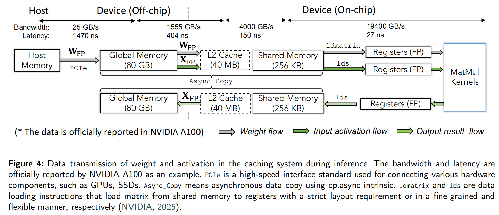
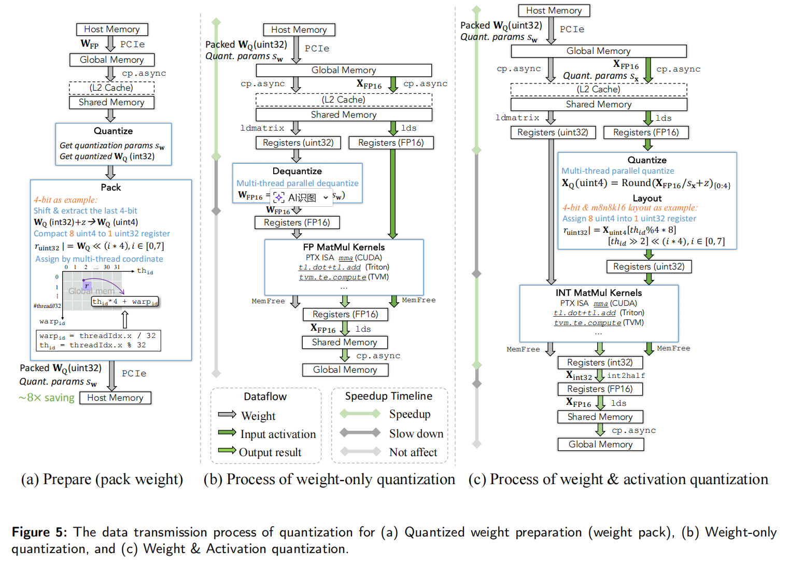
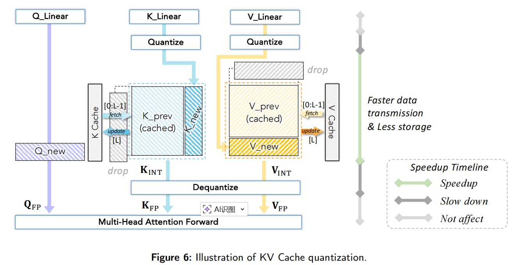

# 量化推理的数据流与系统实现

本章整理自 [A Survey of Low-bit Large Language Models](https://doi.org/10.48550/arXiv.2409.16694) 的对应主题。全篇阅读顺序见[量化笔记](./)。

论文指出，一个算法把权重从 FP16 变成 INT4，并不自动意味着推理加速。真正的加速取决于：

1. 数据是否真的以紧凑格式存储；
2. 搬运路径上是否减少了字节数；
3. 是否有低比特 kernel；
4. dequantize/quantize 的额外开销是否小于节省的时间；
5. 硬件是否支持对应 bitwidth 的 MatMul。

---

## 3.1 Inference Framework for Quantization
LLM 推理不是单一过程，而是两阶段：

**Prefill**：一次性处理 prompt，生成上下文表示和 KV cache。这个阶段计算密集。

**Decode**：自回归逐 token 生成，每次只生成一个 token，但会读取已有 KV cache。这个阶段对内存带宽和 KV cache 更敏感。

所以量化优化也要分场景：

* Prefill 更看重矩阵乘法吞吐；
* Decode 更看重权重读取、KV cache 读取和 batch 规模；
* 长上下文时，KV cache 压缩会越来越重要。

---

## 3.2 系统层数据流




不同层级带宽差异极大：PCIe 到 device 的带宽远低于片上 shared memory/register 访问。因此 LLM 推理中很多时候瓶颈不是算力，而是 **数据搬运**。量化要真正加速，必须从底层系统支持数据压缩、搬运、解包、反量化和 kernel 计算。

这也是为什么 **weight-only quantization** 在 LLM 里特别有效：大模型权重太大，推理时搬权重成本高，压缩权重可以减少内存带宽压力。

---

## 3.3 量化系统数据流



解释了 weight-only 和 W/A 量化的数据流。weight-only 的流程是：
### weight-only

1. 离线计算 weight scale；
2. 把 FP 权重量化成低比特；
3. pack 成紧凑格式，例如 8 个 INT4 打包进一个 uint32；
4. 推理时读取 packed weight；
5. 在寄存器中 dequantize 回 FP16；
6. 与 FP16 activation 做 FP MatMul。

它的加速来自：**权重搬运减少**。
它的额外开销来自：**dequantize**。
只要省下的数据搬运时间大于 dequantize 时间，就能加速。


### Weight & Activation 
W/A 量化比 weight-only 更激进：

1. 权重低比特；
2. 激活也在推理时量化成 INT8/INT4/FP8；
3. 使用低比特 MatMul kernel；
4. 输出通常累加为 INT32 或其他高精度，再 cast 回 FP16。

它理论上更快，因为 MatMul 本身也低比特化。但它有两个难点：

* 激活 runtime quantization 有额外开销；
* 低比特 kernel 必须硬件支持。

论文提到一些系统工作专门优化数据类型转换，比如 QQQ 的 FastFP16toINT8、INT4→INT8、INT32→FP16 等；还有一些方法用 GEMV 或 LUT-based MatMul 来适配非标准 bitwidth。目前工业界最常用FP8 W8A8 + FP8 KV Cache。

---

## 3.4 KV Cache 量化

KV cache 每生成一个 token，都会把新的 K/V 存起来，后续 token 不用重新算前文。问题是：长上下文下 KV cache 占用随序列长度增长。

论文总结了 KV cache 量化的四类策略：

1. **直接低比特化**：例如 QoQ 压到 4-bit，KIVI 做 tuning-free 2-bit KV cache；
2. **窗口量化**：保留最近一段 full precision，超过窗口再批量量化，比如 SKVQ；
3. **跳过新 token 的 dequantization**：例如 WKVQuant，把新的 K/V 先以 FP 参与当前计算，再量化存入 cache；
4. **处理 token-wise outlier**：特殊 token 或低语义 token 可能形成 outlier，需要高精度保留或单独处理。

对长上下文部署来说，这一节非常重要。论文未来方向也强调，KV cache 压缩会成为重点。

## 3.5 量化与反量化（Quantization and Dequantization）

### 3.5.1 浮点量化与反量化

浮点量化看起来只是“把 FP16 变成 FP8”，但底层并不是简单截断。它本质上是在更小的 exponent 和 mantissa 预算下，重新编码原来的浮点数。

以 `FP32 -> FP8` 为例，算法流程：

1. **先 scale**：低比特浮点的表示范围更小，如果直接 cast，很多值会溢出或下溢，所以通常先把 tensor 缩放到更适合目标格式的范围里。这个 scale 一般通过 calibration 或训练学习得到。
2. **检查 overflow / underflow**：
   - 如果值超过目标 FP 格式的上界，就直接截到最大/最小可表示值；
   - 如果值太小，连最小正规数都放不下，就进入 subnormal 的处理逻辑。
3. **复制符号位和指数位，再对 mantissa 做舍入**：目标格式 mantissa 更短，所以精度损失主要发生在尾数截断和 rounding 上。

反量化：从低比特 FP 转回高比特 FP 时，目标格式的 exponent 和 mantissa 位数都更多，所以可以把原来的符号位、指数位、尾数位复制到高位，再把剩余位补零即可。  
这种“反量化”不会恢复被截掉的 mantissa 信息，它只是把低比特浮点值**无损地嵌入**到更高比特格式中，便于后续计算。

可以把浮点 Q/DQ 理解成：

* 量化时最麻烦的是“如何在更小动态范围里保住尽量多的信息”；
* 反量化时最麻烦的不是数学，而是**高效实现格式转换**。

### 3.5.2 整数量化与反量化

整数量化是最主流的路径。它的核心思想是：把连续浮点值映射到一组等间隔的离散整数上，再用 scale 和 zero-point 把它们解释回近似的实数。

常见写法可以概括成：

```text
q = clip(round(x / s) + z)
```

其中：

* `s` 是 scale，决定量化步长；
* `z` 是 zero-point，用来把实数 0 对齐到整数域中的某个值；
* `clip` 保证结果落在目标 bitwidth 的表示范围内。

反量化则是：

```text
x_hat = (q - z) * s
```

* 量化时先把浮点值“除以步长”，映射到整数格点；
* 反量化时再把整数“乘回步长”，恢复到原始数值尺度。


以 `FP32 -> INT4` 为例，整数量化算法流程：

1. **缩放并取整**：把 FP 值变成 INT；
2. **pack**：把多个低比特值打包进更大的机器字；
3. **unpack / dequantize**：计算前再把它们解出来；
4. **乘对应粒度的 scale**：恢复数值幅度。

以 `INT4` 为例，单个数只有 4 bit，GPU 不会按“半字节”直接高效搬运，所以常见做法是：

* 先把量化值转成 unsigned 形式；
* 每 8 个 `INT4` 打包成 1 个 `uint32`；
* 推理时按相同布局 unpack，再进入 dequantize 或 MatMul kernel。

这样做的收益

* 内存占用大幅下降；
* host memory 到 global memory，再到片上 cache 的搬运字节数都减少。

但系统代价也随之出现：

* pack / unpack 需要位运算；
* dequantize 需要乘 scale；
* 如果是非标准 bitwidth，比如 INT3 / INT5 / FP6，布局和转换逻辑会更复杂。

#### scale 是怎么来的

`s` 可以有几种来源：

* 直接由 `max/min` 初始化；
* 从候选集合里搜索一个更优的 `s`；
* 把 `s` 作为可学习参数。

这件事的重要性在于：**dequantize 只是线性恢复，但恢复质量几乎完全取决于 scale 选得对不对。**  
所以很多 PTQ 方法真正优化的不是“整数乘法”，而是“如何找到更好的 scale 和 rounding”。

#### 为什么 dequantize 常常是瓶颈

从系统角度看，很多量化方法最终卡的不是 MatMul，而是 datatype conversion。

例如：

* `weight-only` 量化里，权重虽然低比特存储，但计算前通常要先 dequantize 回 FP16；
* `W/A` 量化里，激活需要在 runtime 从 FP16 量化到 INT8/INT4，输出又常常要从 `INT32` cast 回 `FP16`。

所以推理路径里常会出现三类热点转换：

1. `FP16 -> INT8/INT4`：激活量化；
2. `INT4 -> INT8/FP16`：权重解包和反量化；
3. `INT32 -> FP16`：低比特 MatMul 后的输出回写。

论文提到的 QQQ 就是在优化这些 conversion kernel，比如更快的 `FP16 -> INT8`、`INT4 -> INT8`、`INT32 -> FP16`。  

### 3.5.3 二值化与反量化

二值化是最激进的量化形式。它通常不再把值映射到多级整数，而是只保留一个 bit，例如：

* 用 `sign` 表示 `{-1, +1}`；
* 用 `bool` 表示 `{0, 1}`。

它的系统优势非常大：

* 存储压缩最强；
* 可以利用 bitwise 指令和 `popcount` 这类操作加速矩阵乘。

但它的代价也最大，因为大量幅值信息被直接抹掉了，只剩下符号或真假。  

二值化后的“反量化”通常只是乘一个 scale：

```text
x_hat = alpha * b
```

其中 `b` 是二值结果，`alpha` 用来恢复原 tensor 的整体幅度。  
这种恢复非常粗糙，因此二值化的关键不是反量化本身，而是：

* 用什么二值编码；
* 如何在 kernel 里把 bitwise accumulation 映射回我们想要的数值语义。
