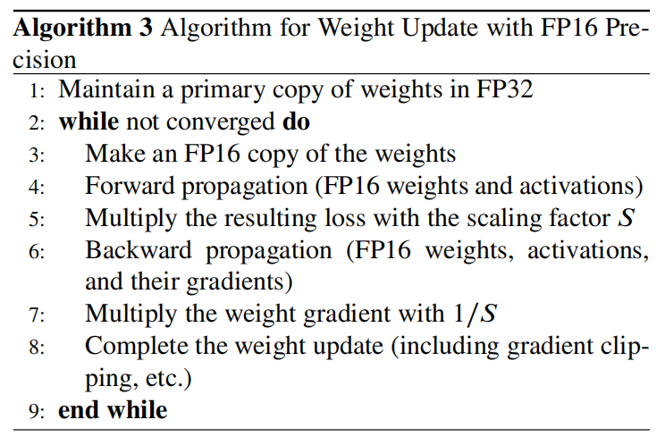

# 低精度训练与参数高效微调

本章整理自 [A Survey of Low-bit Large Language Models](https://doi.org/10.48550/arXiv.2409.16694) 的对应主题。全篇阅读顺序见[量化笔记](./)。

## 4.1 BF16 / FP16 / FP8 / INT8 训练

### BF16 / FP16


BF16 是当前 LLM 训练常用格式，因为指数位多，训练稳定。但需要硬件支持。FP16 指数位少，容易 overflow/underflow，所以需要 loss scaling。 Algorithm 3 展示了 FP16 训练流程：保留 FP32 主权重，前向/反向用 FP16，loss 乘 scaling factor，反向梯度再除S，unscale和后续梯度检查、optimizer update、master weight update一般在FP32中进行。

### FP8 training

FP8 训练依赖 NVIDIA/AMD 等硬件和 Transformer Engine。FP8 的动态范围不足以用一个全局 loss scale 覆盖所有 tensor，因此需要 **每个 FP8 tensor 独立 scaling factor**，拿一个线性层举例,不只是梯度tensor，前向激活和权重输入也会有动态范围问题：
```
Y = XW
X：输入激活张量
W：权重张量
Y：输出激活张量
反向时又会有：
dY：输出梯度
dX：输入梯度
dW：权重梯度
在 FP8 训练里，这些张量往往都可能各自有自己的 scale。
```
常用 delayed scaling：根据之前若干 iteration 的 amax 历史来选 scale，而不是每步在线计算。


### INT8 training

INT8 训练更难，因为反向传播中的量化不稳定，可能导致训练崩溃。论文列举了 QST、Q-GaLore、Jetfire、4-bit Optimizer 等方法。Q-GaLore 的一个亮点是将 projection matrix 存成 INT4、weights 存成 INT8，使 Llama-7B 可以在单张 16GB GPU 上从头训练。

> BF16/FP16 风险较低，已经广泛使用；FP8 在特定模块和硬件上有效，但精度风险更高；INT8 训练风险最高，目前研究多、实践还没有普遍。

---

## 4.2 量化 + PEFT

LLM 微调时，内存不仅来自权重，还来自梯度、优化器状态、中间激活。PEFT 的目标是只训练少量参数。

### 4.2.1 Partial Parameter Fine-Tuning with Quantization

传统 QAT 接近全量训练，开销大。于是一些方法只更新部分参数。例如：

* PEQA：量化权重后，只训练 scale；
* OWQ：只更新 mixed precision 中保留高精度的 weak columns。

这类方法的核心思想是：**不要训练所有权重，只训练最影响量化误差的少量参数。**

---

### 4.2.2 Low-bit Low-Rank Adaptation

LoRA 冻结原始权重，只训练低秩矩阵 A、B。但原始模型权重仍然要存，所以显存仍然大。QLoRA 进一步把 frozen base model 量化到低比特，forward 变成：

> Y = X · dequant(Wq) + X · A B

这样优化器只需要保存 LoRA 参数的梯度，基础模型权重也低比特存储。QLoRA 使用 NormalFloat 和 double quantization，单张 48GB GPU 可微调 65B 模型。

后续方法包括：

* **IR-QLoRA**：引入信息论校准；
* **LoRA+**：A/B 矩阵使用不同学习率；
* **QDyLoRA / Bayesian-LoRA**：动态或贝叶斯式 rank 分配；
* **QA-LoRA**：希望 fine-tune 后能把 LoRA 无损 merge 进 INT 权重，部署无额外开销；
* **L4Q**：同时更新 quantizer 参数，得到可直接部署的量化模型；
* **LoftQ / LQ-LoRA**：关注 LoRA 初始化，使 W ≈ Wq + AB，减少量化误差。


---
